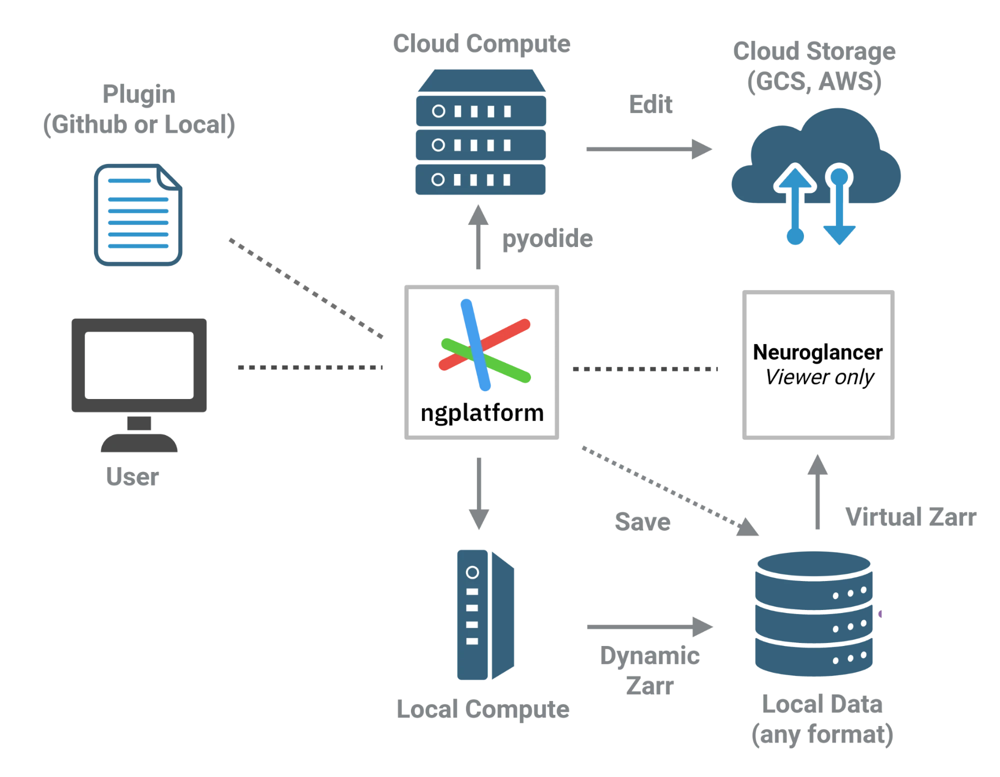

<p align="center">
  
</p>

A workspace around [Neuroglancer](https://github.com/google/neuroglancer),
extended by plugins. Live at https://alleninstitute.github.io/ngplatform/.

ngplatform hosts domain-specific tools for Zarr, OME-Zarr and Zarr Vectors
datasets (track filtering, registration, annotation and segmentation,
filters, data formats) as plugins around an unchanged Neuroglancer. Tools
that are too specialised or too large to add to Neuroglancer itself live
here instead.

The platform provides:

- **A workspace:** datasets, scenes, and a link that holds them all.
- **Local data:** files on your computer read in place as virtual Zarr stores.
- **An SDK** (`@ngplatform/sdk`): plugins add tabs, commands, views,
  overlays, jobs and data formats through it.

<p align="center">
  
</p>

**Docs:** https://ngplatform.readthedocs.io/ has the user guide, a page for
each plugin and how to contribute (sources in [`docs/`](docs/)).

## Add a plugin

Each plugin is a folder in [`plugins/`](plugins/):

```
plugins/
  index.ts             the list of plugins the app ships: add yours here
  workers.ts           worker modules of data-type plugins
  my-plugin/
    manifest.ts        what the platform shows before loading any code
    plugin.ts          export const plugin: PluginModule = { activate(ctx) { … } }
    tests/             *.test.ts, run by npm test
    README.md
```

1. Copy a plugin folder close to what you need:
   [`track-filtering`](plugins/track-filtering/) or
   [`filters`](plugins/filters/) for a tool, or
   [`zarr-vectors`](plugins/zarr-vectors/) for a data format.
2. Give it a manifest with a unique `id`, and import the platform only as
   `@ngplatform/sdk`.
3. Add one line for it to [`plugins/index.ts`](plugins/index.ts) (and, for a
   data format, its worker modules to [`plugins/workers.ts`](plugins/workers.ts)).
4. `npm test` checks the manifest and the entries; the **Plugins** tab
   switches it on and off.

To try one without building, the Plugins tab's **Add** loads a
JavaScript module or a Python file from your computer, and reloads it after
each edit.

The full guide, with the manifest, the `ctx` API and examples:
[`plugins/README.md`](plugins/README.md).
