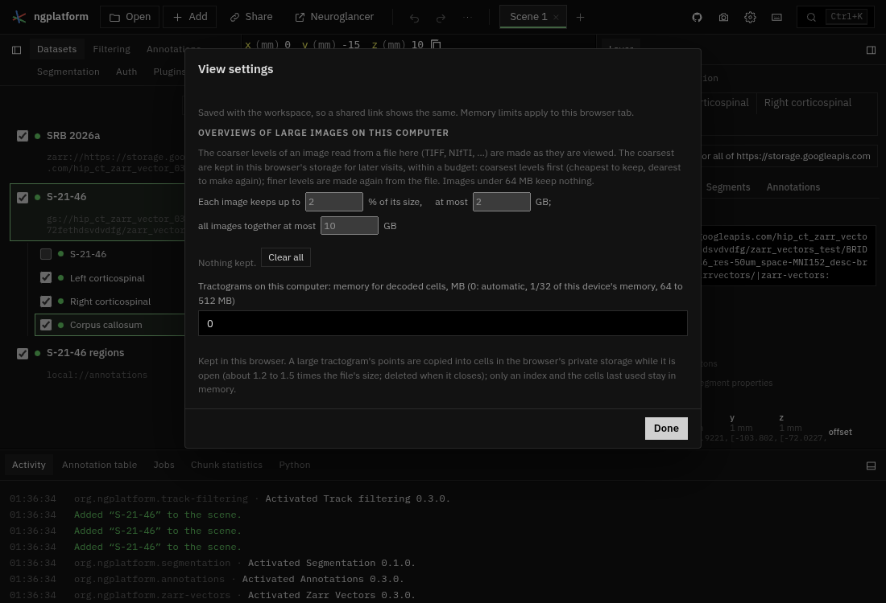
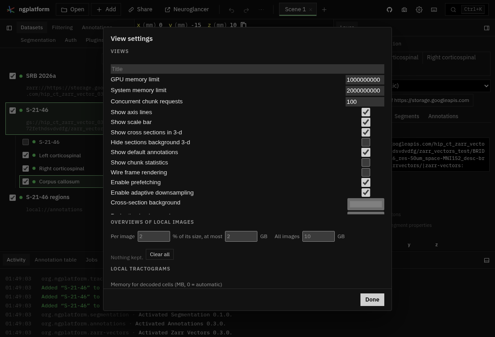

# Audit: the platform and seven plugins

*2026-11-04. The first half of a once-over before the app is shared with
other teams. The second half (Annotations, Segmentation, Registration,
Collections, Time series, Auth, the Python panel, the starters) follows
separately.*

Each area was checked three ways: its README and docs page read for what
they claim; every control used headless (Chrome with SwiftShader, 1100 ×
750) on the default workspace and the plugin's own examples; and its code
read for unhandled errors, listeners and workers not disposed, races and
wrong units. What was fixed is in the commits named after each area.

**Complete** is a judgement of how much of what the area sets out to do
works as a user would expect, polish included. **Left** estimates are
hours of work for one person who knows the code.

## Summary

| Area | Complete | Fixed here | Left (h) |
|---|---|---|---|
| Top bar and menus | 90% | 3 | 2 |
| Scenes and the scene tab bar | 90% | 2 | 0.5 |
| Datasets tab | 90% | 4 | 3 |
| Layer tab (Source, Render, Segments…) | 85% | 4 | 3 |
| View settings | 85% | 2 | 1 |
| Command palette and keyboard reference | 90% | 3 | 1 |
| Activity, Jobs, Chunk statistics | 85% | 5 | 3.5 |
| Local data (Add → Local, drops) | 85% | 3 | 6 |
| Sharing and Neuroglancer links | 90% | 0 | 1 |
| History menu | 95% | 0 | 0.5 |
| Zarr Vectors | 90% | 0 | 2 |
| Track filtering | 85% | 11 | 5 |
| Luxar | 85% | 8 | 9, plus 2–3 days in its README |
| Volume rendering | 85% | 6 | 5 |
| Orientations | 85% | 6 | 3 |
| Atlas | 85% | 5 | 2 |
| Filters | 80% | 4 | 3 |

## Hidden or marked "not yet"

- **The command palette** no longer lists commands that need arguments
  it cannot give (Switch to a scene, Go to a position, Show or hide a
  dataset by number…): chosen there, they failed with "id: is required".
  Keys, buttons and menus still run them.
- **Volume rendering** of images with t or c axes says it reads 3-D
  images only, not yet these (it said "5-D images are not drawn").
- **Track filtering's Run on this computer** for groups that choose by
  tags says it cannot yet, and what to use instead.

Nothing was removed.

## Platform

### Top bar and menus

**What it does.** Open, Add, Share, Neuroglancer, undo and redo, the
history menu, scene tabs, capture, settings, keyboard reference and the
command palette.

**Bugs fixed.**

- A menu opened from a menu item (Settings → View orientation…) closed on
  its first click: the first menu's document listeners stayed after it
  closed and closed the next one.
- Settings menu labels: View orientation…, Reload page and all data,
  Screenshot (Neuroglancer)….
- A binding fired with the platform's unused modifier held (Ctrl+1 on
  macOS toggled dataset 1).

**Left.** The top bar's Neuroglancer button and Share → Open in
Neuroglancer do the same thing; one could go (0.5 h). "3-D" and "3D" are
both used across the app (1 h). `confirmDialog` is always titled
"Confirm"; it could name the action (0.5 h).

### Scenes and the scene tab bar

**What it does.** One tab per scene: add, close, rename, reorder,
duplicate; plugins' scene kinds (Collections) as tabs that make one.

**Bugs fixed.** Only the active tab is in the tab order, so the other
scenes could not be reached from the keyboard; Left and Right now move
between scenes. A scene kind's tab that makes one (Collections) was a
"tab" out of the tab order; it is a button that Enter or Space opens.

**Left.** Closing the last scene could say it leaves a blank one in the
confirm, not only the tooltip (0.5 h).

### Datasets tab

**What it does.** The scene's datasets with visibility, load state and
source, their layers beneath; the other scenes' datasets are offered in Open.

**Bugs fixed.**

- Space or Enter on a row's tick box or ⋯ button also hid or selected
  the row (the row's key handler took its children's keys).
- A source stored as `{url: …}` read "[object Object]".
- The empty state repeated the Add button above it and read like a
  paragraph; it is now "No datasets in this scene. Add one, or drop files
  here." with four buttons.
- The local-data notes say what to do (Allow access; open the files
  again).

**Left.** Remembered local folders are never forgotten (every pick stays
in IndexedDB, and Allow access asks for all of them, not only those the
scene uses): add Forget, and reconnect only what layers read (3 h).

### Layer tab

**What it does.** The selected dataset's Neuroglancer controls (Source,
Render, Segments, Annotations, Schema) under a header that names it, its
views, and the sign-in its data is read with.

**Bugs fixed.**

- Segments: the list drew five rows until scrolled (its height was read
  before it was laid out); it redraws when its size changes.
- Segments: Copy ids and clicking an id said nothing; they now say
  Copied (or why not). No empty black box when nothing is listed. The
  query syntax moved from the placeholder to its tooltip.
- The header's sign-in drop-down shrank to one letter ("N") beside the
  long "Use for all of …" button; it now takes the row.

**Left.** The Segments list stops following colour changes after
colours are linked to another layer (it watches the first colour group
only; 1 h). "Use for all of https://storage.googleapis.com" is long; a
shorter label belongs to the Auth audit (0.5 h). Column headers
(id, label) and the 👁 header could be words or icons (0.5 h).

### View settings

**What it does.** Neuroglancer's view settings (axis lines, scale bar,
memory limits…), the overview budget for large local images, and the
memory for local tractograms.

**Bugs fixed.**

- Neuroglancer's own settings showed nothing: the panel had no height in
  the sheet. They now show, scrolling within it.
- The text: labels with units ("Memory for decoded cells (MB, 0 =
  automatic)", "Per image … % of its size, at most … GB"), the three
  paragraphs of explanation moved to tooltips.

**Left.** Which settings are saved with the workspace and which stay in
this browser is only in a tooltip; a small marker per section would be
clearer (1 h).

{ width=45% }
{ width=45% }

### Command palette and keyboard reference

**What it does.** Every command, searchable (Ctrl+K); every key binding,
and Neuroglancer's own bindings in the views.

**Bugs fixed.**

- The keyboard reference's "In the views" section (Neuroglancer's
  bindings) was empty: zero height, as in View settings.
- Eighteen rows of "Show or hide a dataset by number" and "Select a
  dataset by number" are two rows, 1–9 and Alt+1–9; keys for the same
  action share a row (Redo: Ctrl+Shift+Z, Ctrl+Y); a binding's arguments
  are in its title (Segmentation tool: brush) instead of eight identical
  "Segmentation tool" rows.
- The palette leaves out commands that need arguments (above).

**Left.** Neuroglancer's bindings are shown in its own style (yellow
keys, action ids such as `toggle-show-slices`); restyling them to match
needs its dialog's markup (1 h).

### Activity, Jobs and Chunk statistics

**What it does.** The bottom dock: the activity log, jobs in this page
and on this computer (the runner), and Neuroglancer's chunk statistics.

**Bugs fixed.**

- Cancelling an export in Jobs did nothing: the file was still written
  and "Exported" shown. The worker is now stopped and nothing is saved.
- The runner's job list told its listeners every 1.5 s even when
  nothing changed, rebuilding the Jobs tab (dropping focus, swallowing
  clicks on Cancel); now only on a change or while a job runs.
- Elapsed times read "1 min 60 s".
- Chunk statistics kept updating while its dock was collapsed.
- Shorter empty states ("No jobs running.", "No jobs on this computer
  yet.") and runner note; a failed Convert wait is caught.

**Left.** Job states
("running", "not paired") are lower-case chips (0.5 h). The Jobs tab
still polls the runner while it is hidden, when paired (1 h). Neuroglancer's
chunk statistics table shows raw JSON keys (2 h, or leave it as
Neuroglancer's).

### Local data

**What it does.** Files and folders on this computer read in place
through a service worker: Open from device, Add → Local, dropping on the
window; remembered in Chrome and Edge.

**Bugs fixed.**

- A read the page could not answer (a file changed on disk since it was
  opened) left the service worker waiting 10 minutes before failing; it
  now fails at once, saying why.
- A read that needs permission says to click Allow access.
- Add → Local dropped a dataset's layer settings (Freeview surface
  colours, outlines) that dropping kept.
- Shorter notes; the list of formats in a tooltip and in the error that
  needs it.

**Left.** With two tabs restoring the same folders, the last one to
register answers reads, even when it still needs permission (2 h).
Range edge cases in the service worker: `bytes=500-100` gives an empty
206 rather than 416, and HEAD with a Range reports length 0 (1 h).
Forgetting remembered folders (above, 3 h).

### Sharing and Neuroglancer links

**What it does.** Copy a link to the workspace; copy a scene as a
Neuroglancer link or JSON; open it in Google's Neuroglancer (saying what
it cannot read) or in this site's plain Neuroglancer with Zarr Vectors.

**Bugs fixed.** None found; the menu's labels are shorter (Copy workspace
link, Copy scene as Neuroglancer link / JSON).

**Left.** The share menu and the command palette word the same actions
differently (0.5 h); the Neuroglancer button and Share → Open in
Neuroglancer overlap (above).

### History menu

**What it does.** The tree of changes beside redo: every step, branches
kept after going back, filtered by scene or dataset.

**Bugs fixed.** None found: steps, branches, keys and the filter work
as the guide says.

**Left.** Nothing of note (0.5 h for a keyboard hint in the menu).

## Plugins

### Zarr Vectors

**What it does.** Reads Zarr Vectors stores (streamlines, skeletons,
points, meshes, graphs) in Neuroglancer, local `.trk`/`.tck`/`.trx` and
other formats converted in the page.

**Complete:** 90%. Its abort handling, caches and GPU disposal are
careful; it has no panel of its own (its parts are in the Layer tab).

**Bugs fixed.** None here.

**Left.** Nothing from this audit. (Fixed in E1: a network error while
finding cross-chunk links is warned and tried again on the next read, not
cached as "no links"; per-object values that cannot be read are NaN with a
warning, not 0.)

### Track filtering

**What it does.** TrackVis-style groups of streamlines, segments or
annotations, chosen by spheres, boxes, disks, masks and attribute
ranges; each group a layer, with .trk, density maps, CSV, saving groups
into the store and a job on this computer.

**Bugs fixed.**

- Saving groups into a store wrote object 0 for every object without an
  object id.
- Changing a mask's image and then its threshold put the old image back.
- Deleting a group or switching the plugin off left timers and reads
  going (an exact answer arriving later rebuilt the deleted group).
- A group's own store opened while the group moved on was left open.
- Saving a density map could fail silently; a runner that went away left
  Run on this computer disabled until reload; a store's `zarr.json` that
  could not be read was parsed anyway.
- The "too large to draw whole" note stayed after the group shrank.
- Switching dataset logged a false "Could not draw" error.
- Line stores got their own stores but not Save .trk or the density map.
- Text: Groups (not Track groups), Export CSV, Make density map, Apply;
  shorter, actionable messages; the docs' disk thickness and CSVs.

**Left.** Region sliders send a preview (and for precomputed annotations
a full read) on every input event, never cancelled (2 h). Mask results
are cached without the label volume's version, so a repainted mask gives
the old answer (1 h). The manifest's guide and the README's file table
are behind the code (1 h). Status details start lower-case (0.5 h).

### Luxar

**What it does.** Draws Zarr Vectors lines, points and meshes, and
images as Gaussian splats, the way Luxar does (light added up and tone
mapped) in Neuroglancer's own 2-D and 3-D views.

**Bugs fixed.**

- A block or chunk whose read failed was never counted as read: the
  layer never became ready (screenshots and movies waiting for data
  hung) or the hole stayed for good. A failure now counts as read and is
  asked for again after 15 s.
- Colour by attribute chosen before the store was open drew per-object
  hash colours while the menu showed the first attribute.
- An exception in the 3-D drawing (a shader the GPU cannot compile)
  escaped into Neuroglancer's render loop every frame; it is caught,
  shown, and not retried every frame.
- "Drawing solid lines instead" was wiped the next frame.
- 2-D problems stayed after they passed; a 2-D render could run after
  dispose.
- The toggle command showed the previous layer's settings.
- Text: a one-line intro, an empty state, short labels.

**Left.** In 2-D, automatic brightness mixes the slab in mm with chunk
sizes in store units, so it is off for nm or µm stores, and the slab
slider (0.5–40 mm) cannot go thin enough for microscopy (4 h). Image
splats keep every block's data in memory, unbounded, and redraw on
every Neuroglancer frame (3 h). Objects read whole are not retried after
a failed batch (1 h). The toggle command is hidden for image layers
(0.5 h). The docs leave out that Blending and Tone map apply in 3-D only,
and the 2 000-object limit for points (0.5 h). The README's own list
(soft line caps, mesh picking, partial slab reads): 2–3 days.

### Volume rendering

**What it does.** Ray-marches an OME-Zarr or precomputed image as a
solid in the 3-D view, cut open at the position, with paged bricks and
sharp sections on the cut.

**Bugs fixed.**

- Switching the plugin off left the 3-D view's section background
  hidden, in the state and in shared links.
- An image that failed to open was not asked for again; it is retried
  after a few seconds.
- Switching volume rendering off kept reading bricks and holding their
  128 MB of GPU memory; switching images let the old image's reads land
  over the new one.
- A worker that failed to start left "Opening the image…" for good.
- Text: the intro in a tooltip, Cut open at the position, Fine sections
  on the cut, an empty state; the docs say precomputed images are read
  and that the layout may change to xy + 3-D.

**Left.** OME-Zarr images with t or c axes (most tczyx stores): squeeze
singleton axes, choose a channel and time (3 h). Turning it on changes
the layout and does not put it back when turned off (1 h). A shared
volume worker opens one image at a time (1 h).

### Orientations

**What it does.** ODF, tensor, peak and vector glyphs over the 2-D and
3-D views from an OME-Zarr or 4-D NIfTI with a component axis; a cursor
readout and direction colour.

**Bugs fixed.**

- With no image of orientations the tab showed every control and said
  nothing; it says what to add, and says when no image has a component
  axis or the browser has no WebGL2.
- An image that failed to open was not asked for again.
- A failed remake of a NIfTI's coarser levels was an unhandled rejection.
- A frame queued before switch-off drew with disposed renderers.
- A worker that failed to start left requests hanging.
- Text: shorter labels and errors.

**Left.** The per-view status lines say "View 1", "View 2" in the order
they were drawn, not by the panels' names (1 h). Settings are many for a first look: a
"More" fold for frame, flips and normalisation (2 h).

### Atlas

**What it does.** A region tree from a segmentation's lookup table, with
search, show and go to, the region under the cursor, and volumes counted
in a worker, as CSV.

**Bugs fixed.**

- Go to showed two toasts on a read error, and could use another layer's
  counts or throw when the table changed while it waited.
- Switching layer mid-count left the old count's progress under the new
  layer.
- With no segmentation the tab showed empty controls; it now shows only
  what to add.
- The label worker kept a 128 MB reader for every store opened; it keeps
  two.
- A worker that failed to start left counts hanging.

**Left.** The atlas list is long (dozens of tables in one drop-down); a search
or grouping (2 h).

### Filters

**What it does.** A pipeline of filters (Gaussian, mean, median,
difference of Gaussians, Frangi, threshold, morphology, your own Python)
over an image, added as a layer computed as it is viewed.

**Bugs fixed.**

- Adding the same pipeline twice styled the older layer, leaving the new
  float layer white.
- A Python step whose `#output` says label or mask was added as an image.
- An empty setting (sigma, radius) failed on every chunk; it is caught
  before the layer is added.
- Empty state on its own; shorter labels; an error that says what to do.

**Left.** The last note ("Added …") stays until the next add (0.5 h).
(Fixed in E1: typing in a Python step keeps its focus when layers change;
the steps are kept with the workspace and its link, and read back from a
filtered layer.)

## Screenshots

Before and after each panel changed are in the session's scratchpad
(`c3a/before`, `c3a/after`); the two above are copied into the docs.
