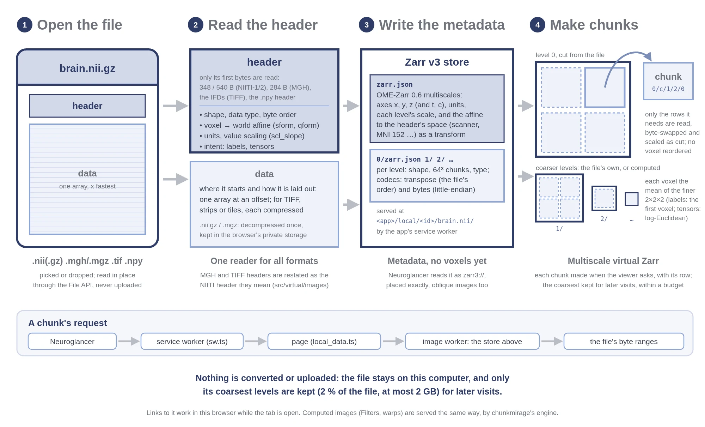

# Loading and exporting data

## Data from a URL

**Add → URL** (or **Open → a link**) takes anything Neuroglancer reads, with
its usual prefixes, plus Zarr Vectors stores:

| Data | Example source |
|---|---|
| OME-Zarr (0.4 to 0.6), Zarr v2 and v3, N5 | `zarr://https://example.org/brain.ome.zarr/` |
| Neuroglancer precomputed: images, segmentations, meshes, skeletons, annotations | `precomputed://gs://bucket/dataset` |
| NIfTI on a web server | `nifti://https://example.org/t1.nii.gz` |
| Zarr Vectors: streamlines, meshes, skeletons, points, graphs | `https://example.org/tracts.zarrvectors/|zarr-vectors:` |
| Others Neuroglancer supports (graphene, DVID, BOSS, render, deep zoom) | as in Neuroglancer |

`gs://` and `s3://` buckets are read directly. Private Google Cloud buckets
are read with a sign-in from the **Auth** tab (`gs+google://` with a Google account,
or `gs+ngauth+https://` with an ngauth server), and CAVE-style servers with
middleauth (`middleauth+https://`): see [Signing in](signing-in.md).

## Data on your computer

**Open → Open from device**, **Add → Local**, or dropping files or folders
anywhere on the window, takes files or a whole folder. Nothing is uploaded: the files are read in place, in your browser,
only where the views need them. Each one is presented to Neuroglancer as a
chunked store made from it on the fly, a *virtual store*, so a large file
is never loaded whole and coarser levels appear first.

| You open | It is shown as | Notes |
|---|---|---|
| NIfTI (`.nii`, `.nii.gz`), Analyze (`.hdr` + `.img`), FreeSurfer (`.mgz`, `.mgh`) | a virtual OME-Zarr image, with a pyramid | Placed by the sform (else qform). A `.nii.gz` is decompressed once and kept in the browser's private storage for later visits. Colour (RGB) NIfTI shows in colour. |
| TIFF stacks (`.tif`, `.tiff`), OME-TIFF, ImageJ hyperstacks | a virtual OME-Zarr image, with a pyramid (the file's own, where it has one) | Classic and BigTIFF; LZW, deflate and PackBits, with either predictor; channels and time points from OME and ImageJ metadata; RGB(A) of 8 or 16 bits a sample shown in colour (16-bit by its top 8 bits). |
| refkv vzip archives (`.vzip`), opened with the files they reference (the folder that holds both, or both dropped together) | the archive's own Zarr hierarchy | A Zarr hierarchy whose chunks reference byte ranges of other files (TIFF, CZI, ND2, HDF5 … zarrified by [refkv](https://github.com/d-v-b/refkv)). References to local files are found beside the archive by name; http(s) ones are read with range requests. Codecs Neuroglancer does not read (refkv's TIFF deflate and LZW, the TIFF predictor) are decoded on the fly; JPEG and JPEG 2000 chunks are not read yet. Format version 0, as refkv 0.2.0 writes it. |
| NumPy arrays (`.npy`, 2-D to 4-D) | a virtual OME-Zarr image, with a pyramid | Indexed [z, y, x] as Python imaging code does (the last axis is x); 1-unit voxels. |
| A FreeSurfer subject folder (with `mri/` and `surf/`) | its T1, aparc+aseg and white and pial surfaces | Surfaces in Freeview's colours, drawn as outlines on the slices. |
| Tractograms (`.trk`, `.tck`, `.trx`) | a virtual Zarr Vectors streamline store | Split into spatial cells, with sample levels (about one streamline in 10, 100, 1000 …) for large files; track groups work on them. A large file is read once, and its cells kept in the browser's private storage while it is open; see [Large tractograms and meshes](#large-tractograms-and-meshes). |
| Meshes (`.obj`, `.stl`, `.ply`), GIFTI and FreeSurfer surfaces (`lh.pial` …) | a virtual Zarr Vectors mesh store | A mesh of more than a million triangles opens in cells with simplified levels. Surfaces are placed in scanner RAS. A surface brings the values beside it (curvature, thickness, `.mgh` overlays, `.annot` and `.label` parcellations, GIFTI shape and label files, and CIFTI beside a GIFTI surface whose name gives its hemisphere: each map of a `.dscalar.nii` or `.dlabel.nii`, and a `.dtseries.nii`'s mean and standard deviation over time and its values at one time point, which the Time series plugin steps through, on that hemisphere's cortex); see [Surfaces](interface.md#surfaces). |
| Neurons (`.swc`, or a folder of them) | a virtual Zarr Vectors skeleton store | One object per tree, with cable length and branch points. |
| Graphs: GraphML (`.graphml`), or an edge list (`…edges.csv`, rows of `source, target`) dropped with its node table beside it (`…nodes.csv`, rows of `node_id, x, y, z`) | a virtual Zarr Vectors graph store | One object per connected component, every edge drawn (cycles too); node positions from `x`, `y`, `z`; each node's degree and other numeric values become properties. |
| Point tables (`.csv`, `.tsv`, `.xyz`, `.parquet`, Feather `.feather`/`.arrow`) and LAS point clouds (`.las`, and compressed `.laz`) | a virtual Zarr Vectors point store | x, y, z from columns named so (or `x_location`, `x_um` …, as Xenium writes transcripts); other numeric columns become properties. Large clouds get coarse levels. |
| A folder of OME-Zarr, Zarr Vectors or precomputed data | the stores themselves | Read file by file. |

### Large tractograms and meshes

A tractogram is read once when it is opened, in a worker. The pass copies
the points into spatial cells in the browser's private storage (OPFS),
kept while the file is open and deleted when it is closed or its tab is.
Memory holds an index of the cells (about 25 MB for 20 million
streamlines) and the cells last used, up to a budget: 1/32 of this
device's memory, between 64 and 512 MB, or what **View settings → Local
tractograms → Memory for decoded cells** sets. While the pass runs the
layer waits (its reads are answered "still reading the file" and asked
again).

**How much is copied.** Copying every streamline takes about 1.5 times the
file's size. **View settings → Local tractograms → Storage for a tractogram**
sets the most a tractogram may copy: 4 GB by default (never more than 10 %
of the browser's quota or 80 % of what is free; 0 copies nothing to disk).
Within it, every streamline is copied. Past it, only a sample is: about 1
in 10 streamlines, or 1 in 100, 1 000 or 10 000, the first that fits
(in memory when it is 256 MB or less). The rest of the file is not copied.

| A 4.6 GB `.trk`, 17 million streamlines (measured headless, file in memory) | Copied | Open |
|---|---|---|
| Every streamline (limit set to 10 GB) | 7.3 GB | 73 s |
| 1 in 10 (the default 4 GB limit) | 0.8 GB | 22 s |
| 1 in 100 (limit 0: in memory) | 0.23 GB | 19 s |

A dropped tractogram past the limit asks first: **Open 1 in 10** (the
dataset is named so, `t17m (1 in 10)`), **Convert it** or **Serve it**
with the runner on this computer (see [Jobs on this computer](local-jobs.md)).
Opened another way (Open from device, a folder, a reload), it opens as the
sample and a notice offers the conversion. With a sample, the view,
regions and groups use only the sampled streamlines; Track filtering's
**Run on this computer** reads the whole file. For every streamline of a
large file without the copy, convert it: the store is read a chunk at a
time.

Coarse views come from sample levels (about one streamline in 10, 100,
1000 …, chosen by a hash of each streamline's number, so each level is a
subset of the one before). Track filtering's regions read only the cells
they touch, a sample level first, then level 0. A group's own streamlines,
and **Save .trk**, read just those streamlines from the file. A group of
more points than the page draws whole (8 million) is drawn from a sample
level, and its note says so.

When the browser's storage refuses to grow (a private window keeps it in
memory, with less room), opening fails with a message to open the file
through the runner on this computer instead (Jobs → This computer).

A mesh of more than a million triangles opens in cells with simplified
levels (by vertex clustering), so the view shows a coarse level first and
finer cells load as you zoom in on a selected object. Surfaces with values
beside them (curvature, labels, time series) are kept whole as one cell.
Binary PLY reads fastest; very large OBJ and STL files still read slowly.

Chrome and Edge remember local files between visits (you are asked to allow
reading them again); links to them work in the same browser while the tab
is open.

### Large images: overviews

A large TIFF or NIfTI is shown without converting it. Its coarser levels
are made when a zoomed-out view asks for them, reading the file once
across. A pyramid the file already holds (a pyramidal OME-TIFF's SubIFDs,
or reduced-resolution pages) is read as it is, not made again.

- **Kept between visits, within a budget.** The coarsest levels are kept in
  the browser's private storage: 2 % of the file by default, at most 2 GB
  an image and 10 GB in all. A 1 TB TIFF keeps 2 GB, a 16 GB one about
  330 MB. Coarse levels cost the most to make again and the least to keep,
  so they are kept first. Finer levels are made again from the file when
  you zoom in. Files under 64 MB keep nothing.
- **Building the overview.** When an image of 1 GB or more is first shown,
  you are offered **Build the overview in the background**. It reads the file
  once and keeps what the budget allows, and it appears in the Jobs tab with
  its progress (you can cancel it). It is also in Datasets → the row's ⋯,
  beside **Clear its kept overview**. A 5 GB uncompressed TIFF (4096 × 4096
  × 160, 16-bit) builds in about 21 s (245 MB/s; reading the file alone
  takes 7 s), and its first zoomed-out view, without the build, takes
  about 21 s; measured headless with the file in memory.
- **Settings.** **View settings → Overviews of local images** sets the
  budget, lists what each image keeps, and clears it.

Converting to OME-Zarr (Export, below) is still the fastest to view. An
overview is for looking at a TIFF straight away, without waiting for a
conversion or making a full copy.

## Exporting

What can be saved today, and where:

| What | How | Format |
|---|---|---|
| A local image | Datasets → the row's ⋯ → **Export as…** | NIfTI (`.nii.gz`, `.nii`), FreeSurfer (`.mgz`, `.mgh`) or an OME-Zarr folder: the whole image at full resolution or a coarser level (up to 2 GB), or a box of 256 voxels a side around the position at any level; or, at any size, every level written into a folder chunk by chunk as OME-Zarr in one pass over the file (gzip-compressed; in browsers that can write folders, such as Chrome and Edge) |
| A local tractogram | the same | TrackVis `.trk` or MRtrix `.tck` |
| A local mesh or surface | the same | OBJ, PLY, STL, or its vertices as CSV |
| A local point table or SWC | the same | CSV |
| A local graph (GraphML or edge list) | the same | GraphML, or its nodes as CSV |
| A track group's streamlines | Filtering → a group → **Save .trk** | TrackVis `.trk` |
| A track group's density | Filtering → a group → **Make density map** | NIfTI |
| Group statistics | Filtering → Statistics → **Export CSV** | CSV |
| A transform | Registration → **Save transform** | FreeSurfer `.lta`, ITK / ANTs `.txt`, plain 4 × 4 |
| A moved (registered) image | Registration → **Save image…** | NIfTI (`.nii`, `.nii.gz`) or OME-Zarr |
| A picture of the views | Camera icon → **Picture…**: magnified, trimmed | PNG |
| A movie of the views | Camera icon → **Movie…**: a sweep through slices or time, or a turn of the 3-D view | GIF, WebM, MP4, PNG frames (zip or folder) |
| The workspace itself | the link in the address bar, or **Share** | link or JSON |

!!! note "Coming"
    Saving large data without making terabyte files: only your edits as a
    small layer over the original (Segmentation does this for label
    volumes); remote images; TIFF and `.trx` output.
