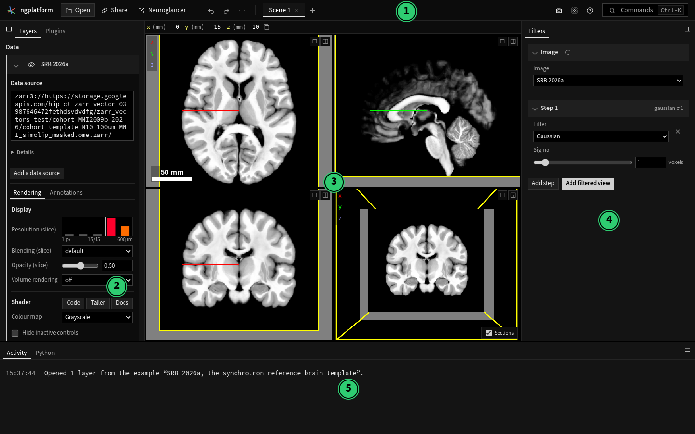
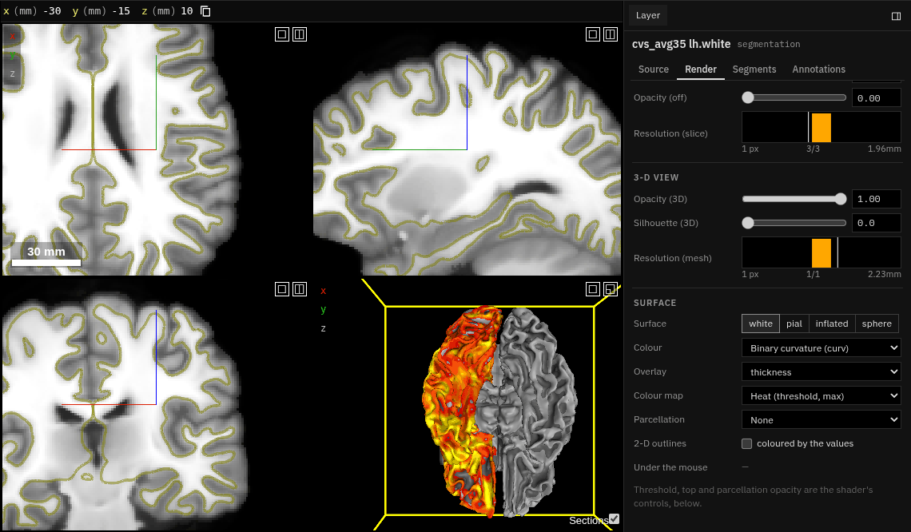

# The window, part by part

The window has a top bar (1), the left dock with the **Layers** and
**Plugins** panels (2), Neuroglancer's views (3), the **Tools** dock on the
right (4), there only while a tool is on, and the **Activity** dock at the
bottom (5). The Tools and Activity docks start collapsed: the Activity dock
is then a single line with the running job or the last message (click it to
open the dock). Docks can be resized by dragging their edges and collapsed
with the icon in their head; their sizes, the panel each shows and which
are collapsed are remembered by your browser.

Open, Settings, Keyboard and mouse, and Capture open as **sheets**: a
window over the app, closed with **Done**, **Cancel** or ++escape++.

The app has one theme, a dark one, in Neuroglancer's black and greys with
square corners; there is no light theme. Its green marks only what is
selected and what is on.

An empty scene shows a card over the views: **Open a file…** and **Paste
a link…**; you can also drop files on the window. The examples are in
**Open** and in the palette (*Open example*).

Almost everything is also a command: **Commands** (++ctrl+k++) searches them
all, and **Help → Keyboard and mouse** lists the keys and clicks most used
(with all of them under *All keys*).

The app works fully in Chrome and Edge. Firefox and Safari work too, but
do not remember local files between visits, cannot write into a folder,
and cannot export MP4: see
[Supported browsers](../index.md#supported-browsers).

## 1. Top bar

| Control | What it does |
|---|---|
| **Open** | Open a file or a folder on your computer, a link or a Neuroglancer state, datasets of the other scenes, or one of two examples: the SRB 2026a template or MICrONS (a new empty scene: **New empty scene** in the palette). Opening replaces the workspace. The app starts as an empty viewer; a link ending `#example=<id>` opens an example (`srb-2026a`, `microns`, and the tractograms `s2146-mni` and `mni-hcp1065`). |
| **Share** | Copy a link to the whole workspace, copy this scene as a Neuroglancer link or JSON state, or open it in Neuroglancer (Google's, or this site's with Zarr Vectors). It says so when the scene holds data plain Neuroglancer cannot read (Zarr Vectors, files on this computer). |
| **Neuroglancer** | Open this scene in Google's Neuroglancer, in a new tab (as **Share › Open in Neuroglancer**). |
| **Undo / Redo** | Undo any change to the workspace: layers, positions, settings, plugin state. |
| **⋯** (beside redo) | The history of changes, as a tree: go to any earlier state, including ones on branches left by going back and changing something else. See [History of changes](#history-of-changes). |
| **Scene tabs** | One tab per scene. **+** adds a scene; each tab has a close button (closing the last leaves a blank scene). Rename, duplicate and delete scenes from the command palette. Each scene works as a viewer of its own: the tools (Filtering's groups, Annotations, Luxar and the rest) show that scene's own; a new scene starts with none, a duplicated one with a copy. |
| Camera icon | **Capture**: a picture of the views (magnified, borders trimmed), or a movie (a sweep through slices or time, or a turn of the 3-D view) as GIF, WebM, MP4 or PNG frames; and Neuroglancer's own screenshot dialog. Labels from the Annotations plugin are painted in. See [Capture](#capture). |
| Gear icon | **Settings**, in five sections: *View* (the views' options, saved with the workspace, their orientation, and whether tools that are off are offered), *Sign-in* (see [Signing in](signing-in.md)), *Compute* (the computers that run jobs and rendering; see [Jobs on this computer](local-jobs.md)), *Storage* (overviews and tractograms kept in this browser) and *Developer* (Neuroglancer's chunk statistics, reloading the layers or the whole page, the state as JSON). |
| **?** icon | Help: the keyboard and mouse reference, the guide, the code on GitHub. |
| **Commands** | The command palette (++ctrl+k++). |

### Capture

The camera icon's menu, or the commands *Capture a picture* and *Capture a
movie*, open one dialog:

- **What**: a **Picture**; a **sweep** along a dimension (z steps through
  the slices; a dimension the views do not show, such as time, plays it),
  from, to and step in that dimension's coordinates; or a **turn of the 3-D
  view** about its own vertical axis, in a number of frames.
- **View**: all the views, or one of them (a cross-section or the 3-D view).
- **Magnification**: pixels per screen pixel. 2 doubles the width and
  height, with the same field of view (as Freeview's `-ss` magnification).
- **Trim empty borders**: crops to what differs from the background colour
  (the corners'), keeping a margin (under **More**); a movie is cropped
  alike in every frame.
- **Format** for a movie: an animated **GIF**, **WebM** video, **MP4**
  (H.264, where the browser has an encoder: Chrome and Edge), or **PNG
  frames** in a zip or written into a folder you choose (Chrome and Edge).
  **Frames a second** sets the speed.
- **Max wait per frame** (under **More**): each frame is taken once
  everything in view has loaded, or after this many seconds (the activity
  log says how many frames were taken early), so a movie's frames are
  complete and consistent.

The job runs in the **Activity** dock, where it can be cancelled. The view
is put back as it was afterwards, and a capture adds nothing to undo.
Labels from the Annotations plugin are painted into every frame.

### History of changes

Every change to the workspace is a step: a layer's settings, the position,
the layout, scenes, datasets, plugin state. Steps are kept as a tree, so
nothing is lost by going back: a change made after going back starts a new
branch, and the steps that were undone stay as another branch.

- **Undo** (++ctrl+z++) goes to the step before. **Redo**
  (++ctrl+shift+z++) goes forward along the branch you were on last (the
  branch you came back from, or the newest change made), as Vim's undo tree
  does.
- ++ctrl+alt+z++ and ++ctrl+alt+shift+z++ go to the previous or next branch
  at the nearest fork above the current step (branches in the order they
  were made), landing on that branch's first step; redo then follows it.
- The **⋯** beside redo (or *History of changes…* in the command palette)
  shows the tree, newest at the top: the path from opening the workspace
  to the state shown now (marked ●, in bold), then what redo would bring
  back (struck through). Where other changes were made from a step on it, a
  row **↳ 3 other changes** sits just above that step; choosing it (or →)
  opens those branches, indented, and ← closes them. Choosing any step
  goes to it and restores everything as it was then: scenes, datasets,
  layers, plugin state. The view stays open and follows, until ++escape++ or
  a click elsewhere.
- Each step says what changed, and in which scene once the workspace has
  more than one: "Scene 2 · SRB 2026a: colour map viridis". A dataset the
  words do not name (a change to a second view of it, say) follows after a
  dot. Hover a step for its scene, datasets and date.
- The menu at the top shows only the steps made in one scene, or to one
  dataset, from every branch.
- Keys in the view: ++arrow-up++ ++arrow-down++ move, ++home++ ++end++ go to
  the ends, ++enter++ or ++space++ chooses.

What a plugin does on your behalf (a track group's layer, a time series
playing) joins the current step rather than making its own, and so does
whatever follows opening before your first click or key. Segmentation's
strokes undo in turn with the workspace's steps, by time; they
are the painted volume's own, not steps in this tree, so going to another
branch leaves painted voxels as they are.

**Where it is kept.** The link in the address bar, and any link you share,
holds only the current state: links stay small. The tree is kept in this
browser (its IndexedDB storage), filed under the link the page last showed.
Reloading the page, or opening the same link in this browser later, brings
the tree back; another browser, or a link edited by hand, starts a new
one. The trees of the last 12 workspaces are kept. A tree holds up to 400
steps and 32 MB; past either, the oldest step that is not on the current
path goes first (a branch's end, or the very first step). Steps store what
they share with other steps once, so 400 steps of the default workspace
take about 0.1 MB rather than 2.3 MB.

## 2. Left dock: Layers and Plugins

| Panel | What it holds |
|---|---|
| **Layers** | What the scene shows: one card per dataset, its row with its visibility, load state and where it is (the bucket or host and the file's name; the whole address in its tooltip). A dataset shown through several layers (a tractogram and its track groups, say) lists them beneath it. **+** adds data: a URL, a file or folder on this computer, or a new annotation layer. Datasets that other scenes show are offered in **Open** (and in **Add a dataset**). *Tools for this data* lists up to three plugins that are off but work with this data (the rest under **More…**): click one to turn it on (it opens in the Tools dock), × for "Not now". Pasting a data URL on the window (++ctrl+v++) adds it here; see [Data from a URL](data.md#data-from-a-url). Selecting a dataset opens its card on its settings (see [Layer controls](#layer-controls)). |
| **Plugins** | Every plugin, grouped by what it does, with a one-line description, a switch and an *About* guide. Only Zarr Vectors is on by default; a tool turns on at once, and turning one off reloads the page with the same link. **Add** loads a plugin from your computer or a URL. See [Plugins](../plugins/index.md). |

## 3. The views

Neuroglancer's own views, unchanged: cross-sections and the 3-D view, in
whichever layout the scene uses. The position (in the scene's units) is at
the top left; click it to type a position. Each panel has buttons to make
it fill the view or to open it in a new window, and the 3-D panel has
switches along its bottom: **Sections**, and those of tools that draw there.

Neuroglancer's mouse controls apply: drag to pan, scroll to move through
sections, ++ctrl++ + scroll to zoom, drag in 3-D to rotate, and
++shift++ + drag to rotate a cross-section to any angle.

## 4. Right dock: Tools

The panel of a tool that is on (a plugin): one at a time, chosen by the
tabs at the top of the dock (the arrow keys move between them), kept
together by what they work on:
*Image* (Filters, Anatomical rendering, Orientations), *Labels*
(Annotations, Segmentation, Atlas), *Space* (Registration, a collection's
panel) and *Vectors* (Track filtering, Luxar). Turning a tool on opens it
here; with no tool on, the dock is not there. Long panels are in cards
that fold away (Registration's Transform, Landmarks…; Settings' sign-ins),
each kept open or closed as you left it.

## Layer controls

Each dataset in the Layers panel is a card. Selecting a dataset (its row,
or in the views) opens its card on its settings; the arrow at the left of
the row opens and closes it, and several cards may be open at once. Its
settings are its layer's own tabs (Neuroglancer's), the tab chosen kept
with the layer; a layer opens on **Rendering**. For a dataset shown
through several layers, they are those of the view selected in its list.
Its sign-in shows only when its data is not public (or did not load);
otherwise it is in Settings › Sign-in.

| Tab | What it holds |
|---|---|
| **Rendering** | How it is drawn: resolution, opacity, blending; for images the **Colour map**, then the shader's controls (contrast, with a histogram and Min-Max, 1-99% and 5-95% buttons) above its code; for segmentations the **Lookup table**; for surfaces the **Surface** controls. |
| **Source** | Where the data comes from; under **Details**, its parts (subsources), its **transform** (the matrix that places it in the scene, editable), and an OME-Zarr image's coordinate systems and levels. |
| **Segments** | For segmentations: search segments by id, label or property, show and hide them, colours. |
| **Annotations** | The tools that draw points, lines, boxes, ellipsoids and polylines (the one place to draw: the Annotations plugin's **Draw…** opens it), and the list of annotations. |
| **Schema** | For annotation layers: the properties each annotation carries. |

### Colour maps

An image layer's **Rendering → Shader → Colour map** writes the shader for a
colour map, keeping the contrast (the `normalized` range and its histogram):
grayscale, heat, jet, GE colour, NIH, PET, binary colour, hot, cool, viridis,
magma, inferno, plasma, cividis, turbo, cubehelix and a diverging red-blue.

- **Heat** works as Freeview's: the contrast's range is *min* to *max* of the
  value's magnitude, and **mid** (a fraction of the way) is where red turns
  to yellow. Below min nothing is drawn, so the image underneath shows;
  between min and mid the colour fades in. For signed data (float, signed
  integers) negative values are drawn in blue to cyan. **opaque** draws
  black below min instead.
- **Binary colour** draws one colour (chosen beside it) wherever the value
  is above the contrast's minimum; **shade** darkens it with the value.
- GE colour, NIH and PET approximate the scales of those names.
- Editing the code makes the map **Custom**; choosing Custom changes
  nothing, so a shader of your own is kept.

### Lookup tables

A segmentation layer's **Display → Colour → Lookup table** names and colours
its labels from an atlas's table: FreeSurfer (all labels, Desikan-Killiany,
Destrieux, Yeo networks), Harvard-Oxford, Schaefer 2018 (100 to 1000
parcels, 7 or 17 networks), and the Allen Mouse CCFv3 (2017) structures,
which are fetched from the Allen Institute when chosen. **File…** loads a
table from your computer: FreeSurfer's format (`index name R G B A`),
FSLeyes and ITK-SNAP tables, FSL atlas XML, the Allen structure graph
(JSON), or a plain `index name` list (colours are made up). The colours
become the layer's segment colours; the names show in the Segments tab
(search them, list them by label), and under the mouse. Both travel with the
link, a table from your computer included. **None** takes them off again.
Where each table comes from, and its licence:
[`data/lookup-tables/`](https://github.com/AllenInstitute/ngplatform/tree/main/data/lookup-tables).

### Outlines

A segmentation layer's **Display → 2-D views → Draw** shows its segments
**Filled** or as **Outlines** in the 2-D views, each in its own colour
(its lookup table's, or the colour from its id), at any angle and zoom.
Outlines are drawn by an image layer added just above the segmentation,
"*name* outlines", which reads the same labels; the segmentation's own 2-D
opacity is set to 0 meanwhile (its meshes are untouched), and **Filled**
removes the outline layer and gives the opacity back. The outline layer's
**Rendering** tab sets the line width in screen pixels (`outline_width`), the
lines' opacity, and an optional faint fill (`fill_opacity`). It follows the
segmentation's colours and its shown segments by itself.

Limits: a boundary lying exactly on the face of a data chunk is not drawn
(the outline has gaps there), and with more than 4,096 coloured or shown
segments the outlines use the hashed colours or show every segment.

### Surfaces

A cortical surface is drawn as Freeview draws it: filled and lit in the 3-D
view, as its outline where it crosses each 2-D view (white yellow, pial red),
and coloured by the values on its vertices. A FreeSurfer surface opened from
your computer brings the files beside it: the morphometry in `surf/`
(`lh.curv`, `lh.sulc`, `lh.thickness`, `lh.area`, `lh.volume` and the rest of
FreeSurfer's curvature-format files), overlays as `.mgh`/`.mgz` with one value
per vertex, the parcellations in `../label/` (`lh.aparc.annot`,
`lh.aparc.a2009s.annot`, `lh.BA_exvivo.annot`), and the `.label` files there,
put together as one parcellation named `labels` (a vertex in several labels
takes the smallest, so V1 shows inside cortex). A GIFTI surface brings the
same hemisphere's `.shape.gii`, `.func.gii` and `.label.gii` files beside it.
Only files with the surface's vertex count are used. A Zarr Vectors surface
store written by zarr-vectors-tools (`zvtools convert` of a FreeSurfer
subject or GIFTI files) works the same, its parcellations' names and colours
coming from the store.

A surface with curvature opens showing it in two greys, Freeview's binary
curvature (sulci dark, gyri light). Its layer's **Display → Surface** section
holds Freeview's surface controls:

| Control | What it does |
|---|---|
| **Surface** | Which of the hemisphere's surfaces is drawn: white, pial, inflated, sphere, orig, smoothwm (those in the folder; for a store, those it keeps as `coords_*`). They share their vertices, so the values stay. |
| **Colour** | Under the overlay: **Binary curvature** (from `curv`, else `sulc`) or the layer's own colour. |
| **Overlay** | A value drawn in colour where it passes the threshold: thickness, sulcal depth, an overlay. Maps the store holds but does not show at first are listed with "(load)". |
| **Colour map** | **Heat** as Freeview's (red to yellow from the threshold to the top, blue to cyan for negative values), or jet, viridis and the other maps, from the threshold to the top. |
| **Parcellation** | An `.annot`, the labels or a GIFTI label file in its own colours, over the rest. |
| **2-D outlines** | Coloured by the values too, rather than in the layer's colour. |
| **Under the mouse** | The values of the vertex under the mouse, and its parcel's name. |

The overlay's **threshold** and **top**, and the parcellation's opacity, are
sliders among the shader's controls below: dragging them is immediate.
The controls write the layer's shader, so the choices are saved with the
workspace and travel in a link; editing the shader by hand keeps working,
as `prop_<name>()` gives a value on the vertex and `lut_<name>(code)` a
parcellation's colour.

Limits: Freeview's overlay settings beyond threshold and top (mid point,
truncate, inverse, custom colour scales), label outlines, and several
overlays at once are not there.

## 5. Activity dock

Collapsed to one line at first: the running job and its progress, else the
last message. Click the line (or the icon at its end) to open the dock.

| Panel | What it holds |
|---|---|
| **Activity** | Jobs, while there are any: long tasks from plugins (filters, statistics, saving), with progress and a cancel button, and, for a paired computer, the jobs run as Python processes on it through the runner, with their process id, progress, log, Cancel and Open (see [Jobs on this computer](local-jobs.md)). Below them, a log of what the workspace did, newest first: datasets added, errors. |
| **Python** | A Python console running in the page (Pyodide). `ngp` drives the workspace; `await ngp.show(array, voxel_size=…)` shows a numpy array as a layer; `ngp.show_points(xyz, values=…)`, `ngp.show_lines(lines)` and `ngp.show_mesh(vertices, faces)` show points, streamlines and meshes made in Python (as Zarr Vectors, so Track filtering works on them), and `ngp.annotate(points=…, lines=…, boxes=…, ellipsoids=…)` adds an annotation layer. |

Tools put what they make here too when it is used: the Annotations plugin's
table, the Time series plot.
