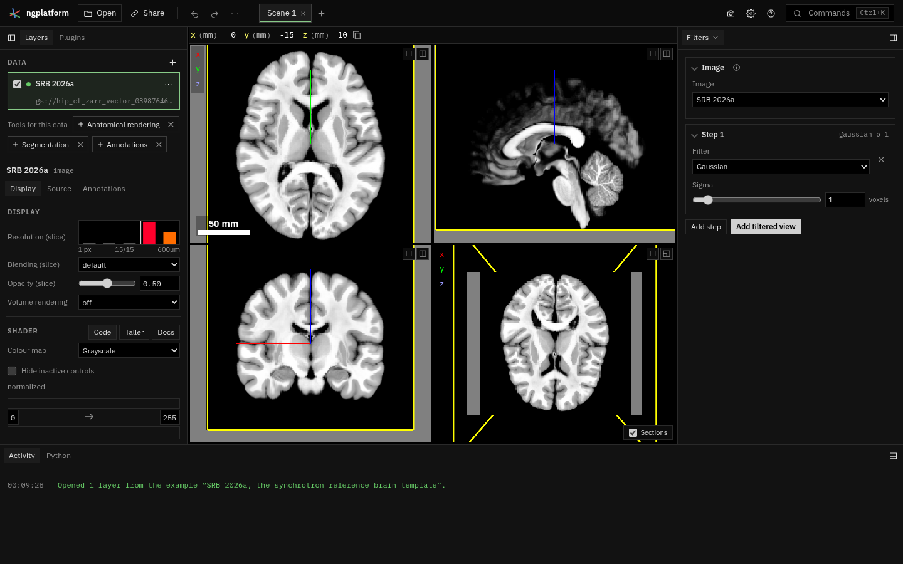

# ngplatform

**A workspace around [Neuroglancer](https://github.com/google/neuroglancer),
extended by plugins.** It runs in the browser, with nothing to install:
[open it live](https://alleninstitute.github.io/ngplatform/).

## What it does

Neuroglancer is a fast, scalable viewer for volumetric data: it streams
multiscale images, segmentations, meshes, skeletons and annotations from the
cloud, from a few megabytes of MRI to petabytes of electron microscopy. What
it does not try to be is an application: a place to organise data, keep
several views of it, open files from your own computer, or add tools.

ngplatform is that application, with Neuroglancer kept whole inside it:

- **Neuroglancer stays the renderer.** The views in the middle of the window
  are Neuroglancer's own, and every scene is still a Neuroglancer state; the
  **Neuroglancer** button opens it in Google's Neuroglancer at any time.
- **Datasets and scenes.** A *dataset* is a piece of data; a *scene* is one
  view of some datasets (a tab in the top bar). The link in the address bar
  holds the whole workspace, so sharing it shares everything.
- **Your own files, without uploading them.** NIfTI, TIFF stacks,
  tractograms (`.trk`, `.tck`, `.trx`), meshes, neurons (SWC) and point tables
  open straight from your computer. They are read in place and served to
  Neuroglancer as chunked, multiscale OME-Zarr or Zarr Vectors stores, made
  on the fly ("virtual" stores), so a large file is never loaded whole.
- **Plugins.** Everything beyond viewing is a plugin: new data formats (Zarr
  Vectors), and tools (track filtering, labels for figures, registration,
  volume rendering). Plugins can be switched on and off, loaded from your
  computer while you write them, or loaded from a URL.

## Who it is for

- **Neuroglancer users** who want their scenes, local files and tools in one
  place. See [Coming from Neuroglancer](guide/from-neuroglancer.md).
- **Freeview, TrackVis and other desktop users** working with data too large
  for a desktop viewer, or wanting to share a view with a link. See
  [Coming from Freeview](guide/from-freeview.md).
- **Developers** who want to add a tool or a data format to Neuroglancer
  without forking it. See [Plugins](plugins/index.md).

## Where to go next

- [The window, tab by tab](guide/interface.md)
- [Loading and exporting data](guide/data.md)
- [Plugins](plugins/index.md), and [ideas for new ones](plugins/ideas.md)
- [Contributing](contributing.md): ngplatform is meant to be a community
  project, and every plugin has a page anyone can add notes to.
