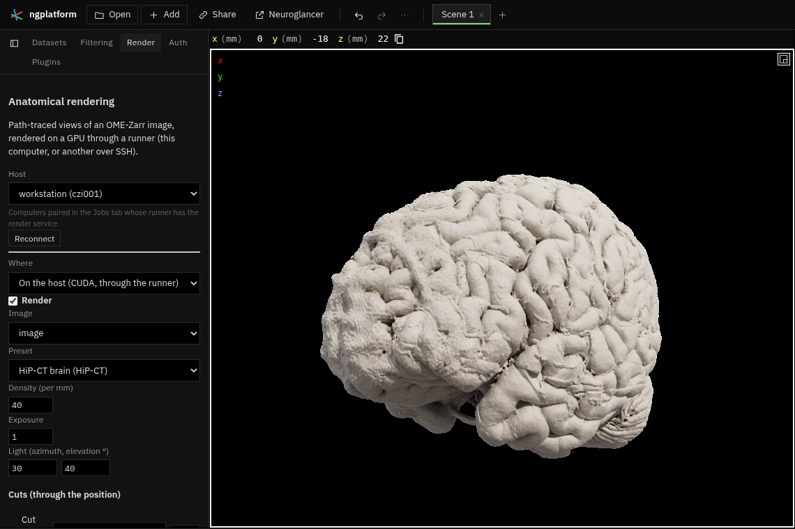

# Anatomical rendering



**Kind:** tool · **Off by default** (offered when you open an image; or turn it on in the Plugins tab) · a
**Render** switch beside **Sections** in the 3-D view, and a **Render** tab ·
[Source and developer README](https://github.com/AllenInstitute/ngplatform/tree/main/plugins/anatomical-rendering)

Photorealistic views of an OME-Zarr image, path-traced on a GPU and drawn in
Neuroglancer's 3-D view. Light is followed through the tissue as it
scatters, so surfaces get soft shadows and depth and translucent tissue
glows, in the manner of "cinematic rendering". The image is read straight
from its OME-Zarr store; nothing is converted.

It renders in one of two places:

- **On a host**: the runner's **render** service, on a computer with an
  NVIDIA GPU (CUDA): this computer, a workstation or a cluster node reached
  over SSH (see [Jobs on this computer](../guide/local-jobs.md)). Frames come
  back as they refine; the browser only draws them.
- **In this browser**: the same path tracer in WebGPU, on this computer's own
  GPU, for a laptop with a GPU and no host. It holds a coarser level (up to
  64 million voxels) and has no region colours.

## Starting it

1. Where the GPU is, start a runner with the render service, in a Python
   with `numpy`, `zarr` (3), `fsspec`, `aiohttp`, `pillow` and `cupy`:
   ```
   cd ngplatform/runner
   python -m ngplatform_runner --root ~/data \
     --service render="python -m ngplatform_render.server"
   ```
   On another computer, add `--public-url http://localhost:7000` and open the
   tunnel from the computer with the browser:
   `python -m ngplatform_runner tunnel me@workstation` (it prints the pairing
   link). On a cluster, start the runner inside an interactive GPU job and
   tunnel through the login node (`--jump`).
2. Pair the app with that runner (its link, or Jobs → **Add a computer…**).
3. Turn the plugin on, open the **Render** tab: the **Host** list shows the
   paired computers whose runner has the render service. Choose the image,
   then switch on **Render** (also beside **Sections** in the 3-D view).

## What you can set

- **Preset**: a look per modality: MR T1, HiP-CT, histology (BigBrain), a
  translucent one for any image, and **Regions** (each label in its
  colour). A preset is a transfer function (colour and opacity from the
  image's values) with material and light; its values are percentiles of
  the tissue, so one preset suits scans of different scaling.
- **HiP-CT organs**: a preset for each organ in the Human Organ Atlas (brain,
  heart, lung, kidney, liver, spleen, colon, eye, placenta, prostate, testis,
  uterus), its colours measured on photographs of real organs (each preset
  lists them, with their authors and licences). These presets spread their
  colours over a **Window** of the image's values, as a window is set in a
  viewer. HiP-CT organs lie in a mounting medium (ethanol and agar) that can
  fill most of the scan and be denser or less dense than the tissue, so
  percentiles do not suit them. The host guesses the window: from just past
  the medium (seen in a ring inside the scan's sides), on the side of it
  where the tissue is, with the tissue's commonest value at the window's
  middle. Change the two values if the guess misses; **Guess** goes back to
  it. **Hide the jar** renders only a cylinder about the scan's axis, which
  leaves out the jar's wall (as dense as tissue).
- **Density** (opacity per mm), **Exposure**, and the key light's direction
  (relative to the camera, so the light follows as you turn the view).
- **Light map** (on a host): image-based light from an HDR panorama
  (studio, photo studio, sky; CC0 images from [Poly Haven](https://polyhaven.com),
  reduced to 256 × 128), turned about the view's vertical; or the preset's
  sky colours.
- **View**: Left, Right, Anterior, Posterior, Superior and Inferior turn the
  3-D view to those sides (for images in RAS: x right, y anterior, z up).
- **Cuts**: planes through the current position across x, y or z, keeping
  either side, with an offset in mm (a slider or a number). A **clip box**
  keeps a box of the volume (six sliders, as fractions of it). Regions listed under **Kept through cuts**
  stay whole (vessels through a cut brain, say).
- **Regions**: colour by a co-registered OME-Zarr segmentation (its labels'
  FreeSurfer colours), how much of the region's colour to use, and regions
  to hide.
- **Detail**: how many voxels the host holds (400 million by default: the
  finest stored level within it). When a store has no level near the
  budget, a level is made by downsampling a finer one as it is read (means
  for images, majority vote for labels) and kept in a cache on the host.
- **Samples per pixel**: when a still view stops refining.
- **Load a preset file…**: a preset (or a list) as JSON, in the form of
  `runner/ngplatform_render/presets/*.json`; it is kept with the scene.
- **Save still (PNG)**: the view now, path-traced on the host at the movie's
  size and twice its samples.
- **Render rotation**: a turn about the position from the view now, about
  the vertical or the horizontal, a full or half circle, by a step in degrees.
- **Movie**: **Add keyframe from the view** as you move, set each one's
  time, then **Render movie on the host**: every frame is path-traced to the
  sample count and the frames are encoded as an MP4 (H.264) on the host,
  then **Download**. Between keyframes the camera turns around the position;
  cuts, density, exposure and the light change smoothly.

## The HiP-CT organ presets

Each organ's tissues were given colours measured on openly licensed
photographs of real organs. The colours inside the organ were clustered
(k-means in Lab), each cluster was named as a tissue, and photographs with
something neutral in them (a steel table, paper, a white background) were
white-balanced on it. Each colour was then made into a material colour by
rendering a flat slab of tissue under the renders' light (the photo-studio
map and the key light) and tone curve, and changing the material until the
slab shows the photograph's colour relative to its white. Multiple
scattering darkens and saturates colour, so the material colours are
darker than the photographs'. Each preset lists its photographs (author,
licence, what they show, and caveats) under `reference`, and the colour
measured for each tissue under `measured`.

Few photographs of normal fresh human organs are openly licensed. Animal
organs stand in for the kidney and eye (pig) and the testis (bull). The
brain and uterus are fixed specimens, as HiP-CT organs are. The colon was
measured on colonoscopy views of its lining. The heart, liver and spleen
photographs have warm or pink casts. Tissues no usable photograph shows
were given a colour by hand and are marked "not measured".

| Organ | HiP-CT scan (Human Organ Atlas) | Photographs the colours were measured on | Not measured |
|---|---|---|---|
| brain | LADAF-2021-64 brain | [Human brain frontal (coronal) section.JPG](https://commons.wikimedia.org/wiki/File:Human_brain_frontal_(coronal)_section.JPG) (John A. Beal, PhD, Dept. of Cellular Biology & Anatomy, LSU Health Sciences Center Shreveport, CC BY 2.5, fixed (appearance of a formalin-fixed brain slice; not stated on the file page)) | — |
| heart | LADAF-2021-17 heart | [Пересаженное сердце в грудной клетке реципиента.JPG](https://commons.wikimedia.org/wiki/File:%D0%9F%D0%B5%D1%80%D0%B5%D1%81%D0%B0%D0%B6%D0%B5%D0%BD%D0%BD%D0%BE%D0%B5_%D1%81%D0%B5%D1%80%D0%B4%D1%86%D0%B5_%D0%B2_%D0%B3%D1%80%D1%83%D0%B4%D0%BD%D0%BE%D0%B9_%D0%BA%D0%BB%D0%B5%D1%82%D0%BA%D0%B5_%D1%80%D0%B5%D1%86%D0%B8%D0%BF%D0%B8%D0%B5%D0%BD%D1%82%D0%B0.JPG) (Vasily I. Kaleda, CC BY-SA 3.0, fresh (living, in situ)); [Human heart male adult autopsy.jpg](https://commons.wikimedia.org/wiki/File:Human_heart_male_adult_autopsy.jpg) (Jebulon, CC0 1.0, unknown (autopsy specimen; fixation not stated)) | valves and fibrous tissue |
| lung | LADAF-2020-27 left lung | [Normal lung (3661495238).jpg](https://commons.wikimedia.org/wiki/File:Normal_lung_(3661495238).jpg) (Yale Rosen, CC BY-SA 2.0, formalin-fixed (formalin-perfused, autopsy)); [Lungs filled with air.jpg](https://commons.wikimedia.org/wiki/File:Lungs_filled_with_air.jpg) (Pöllö, CC BY 3.0, fresh) | — |
| kidney | LADAF-2020-27 left kidney | [Pig-kidney.JPG](https://commons.wikimedia.org/wiki/File:Pig-kidney.JPG) (Thor-Rune Hansen, Public domain (PD-self), fresh) | — |
| liver | LADAF-2021-17 liver | [Human Hepar.jpg](https://commons.wikimedia.org/wiki/File:Human_Hepar.jpg) (Suseno, Public domain (PD-self), fresh (autopsy)) | — |
| spleen | LADAF-2020-27 spleen | [Gross pathology of an accessory spleen.jpg](https://commons.wikimedia.org/wiki/File:Gross_pathology_of_an_accessory_spleen.jpg) (Mikael Häggström, M.D., CC0 1.0, partially fixed (fixed grey outer rim, unfixed red-purple centre, per file description)); [Spleen.jpg](https://commons.wikimedia.org/wiki/File:Spleen.jpg) (Hic et nunc, CC BY-SA 3.0, fresh (living, in situ)) | — |
| colon | LADAF-2021-17 colon | [Colonoscopy splenic flexure.jpg](https://commons.wikimedia.org/wiki/File:Colonoscopy_splenic_flexure.jpg) (melvil, CC BY-SA 4.0, fresh (living, colonoscopy)); [Rectum-2016-12.jpg](https://commons.wikimedia.org/wiki/File:Rectum-2016-12.jpg) (melvil, CC BY-SA 4.0, fresh (living, colonoscopy)) | — |
| eye | LADAF-2024-38 right eye | [Eye pig cut open.jpg](https://commons.wikimedia.org/wiki/File:Eye_pig_cut_open.jpg) (Carsten Niehaus, Public domain (PD-self), fresh); [Schweineauge.jpg](https://commons.wikimedia.org/wiki/File:Schweineauge.jpg) (Honge, Public domain (PD-user-de), fresh (2 days after slaughter)) | — |
| placenta | MR-1 placenta | [Human placenta baby side.jpg](https://commons.wikimedia.org/wiki/File:Human_placenta_baby_side.jpg) (Habj, Public domain (PD-self), fresh (minutes after birth)); [Human placenta uterine side.jpg](https://commons.wikimedia.org/wiki/File:Human_placenta_uterine_side.jpg) (Ravedave, Public domain (PD-self), fresh (minutes after birth)) | — |
| prostate | LADAF-2021-17 prostate | [Prostate middle lobe orig.jpg](https://commons.wikimedia.org/wiki/File:Prostate_middle_lobe_orig.jpg) (Steven Fruitsmaak, CC BY-SA 3.0, fresh (surgical specimen)) | glandular tissue, calcification |
| testis | LADAF-2021-17 testis | [Bull testicles Бычий семенник 1.jpg](https://commons.wikimedia.org/wiki/File:Bull_testicles_%D0%91%D1%8B%D1%87%D0%B8%D0%B9_%D1%81%D0%B5%D0%BC%D0%B5%D0%BD%D0%BD%D0%B8%D0%BA_1.jpg) (Jurfeld, CC BY-SA 4.0, fresh) | parenchyma |
| uterus | AUMC-005 uterus | [Uterus in museum.jpg](https://commons.wikimedia.org/wiki/File:Uterus_in_museum.jpg) (Tiia Monto, CC BY-SA 3.0, fixed/preserved museum specimen (method not stated)) | — |

The brain has two presets. **Brain (fixed)** is a formalin-fixed brain, as
HiP-CT's are (tan grey matter, cream white matter). **Brain (fresh frozen)**
shows the same scan as fresh or fresh-frozen tissue looks: pink-tan grey
matter, pink-white white matter and red vessels. It was measured on the
unfixed centres of a part-fixed brain (Häggström, CC0); the cortex takes
the unfixed deep grey matter's colour, and the vessels take blood measured
on the heart photograph. Both brain presets were calibrated on a cut face
(light scattered within the tissue), since their photographs are slices;
the others were calibrated on a surface.

Lungs: at the 0.34 mm of a whole-organ scan the alveoli are finer than a
voxel and the parenchyma has the mounting medium's value, so the lung
preset shows the vessels and airways, with the parenchyma only as a faint
haze.

## How it works

The renderer follows the published methods of Monte Carlo volume
rendering: free paths sampled by delta tracking against a grid of the
largest extinction in each 8³ brick (empty space is skipped), shadow rays by
ratio tracking (Novák et al. 2018); at each collision either surface
scattering with the gradient as normal or volume scattering with a
Henyey–Greenstein phase function, chosen by the gradient's magnitude (Kroes
et al. 2012); a directional key light and a sky-like environment; a thin-lens
camera; a filmic tone curve. Where a preset asks for it (`surface_inset`, in
voxels), a collision takes its colour a voxel or two inwards along the
gradient, on the more opaque side, so a surface shows the tissue beneath it
rather than the values between it and the medium around it (which would
otherwise colour a kidney's capsule as fat). Each pass adds one sample per pixel and the
image is their mean, so it refines while the view is still. While the
camera moves, frames are rendered at half size, and for the first 12
samples after a change the host smooths the image with an edge-avoiding
wavelet filter guided by the distance to the tissue (about half the error at
4 samples; **Smooth the first frames** switches it off).

On an RTX A6000 a 834 × 684 view of a 135-million-voxel brain takes about
45 ms a pass (some 200 samples in 10 s); with region colours and a cut,
about 100–150 ms.

## Limits

- The image is placed by its OME-Zarr transforms in Neuroglancer's x, y, z
  (as the volume view does); a layer's own transform in the viewer is not
  applied yet.
- One image (and one segmentation) at a time; images with t or c axes are
  not rendered.
- Rendering is for looking, teaching and figures, not for reading values.
