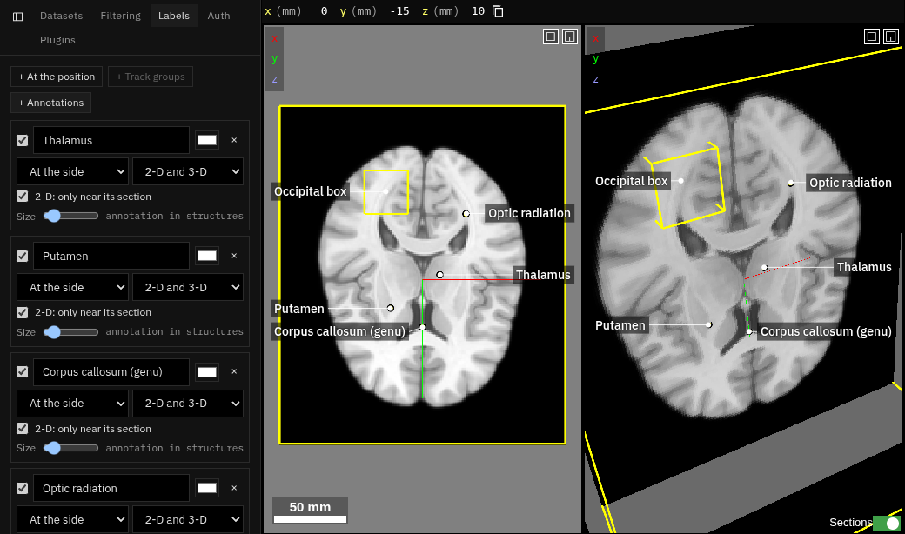
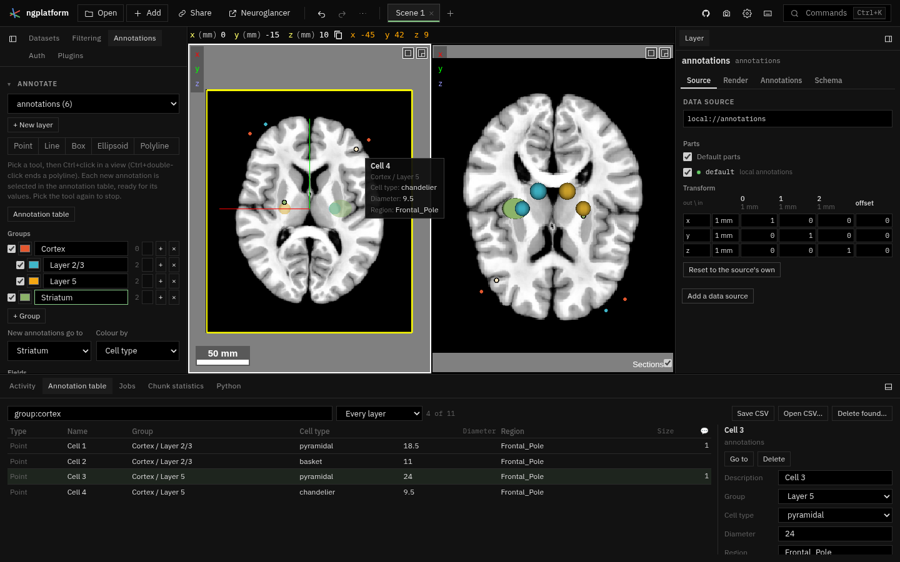
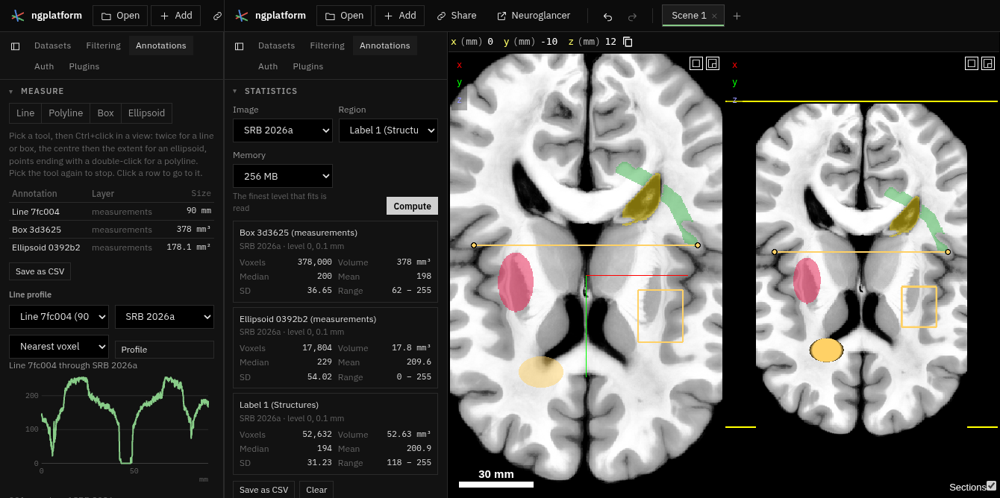
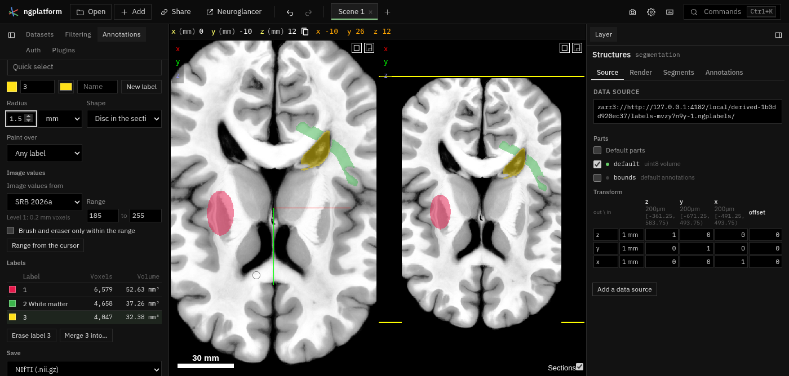

# Annotations

**Kind:** tool · **On by default** · the **Annotations** tab and the **Annotation table** (bottom dock) ·
[Source and developer README](https://github.com/AllenInstitute/ngplatform/tree/main/plugins/annotations)

Everything you add to annotate a dataset, in one tab with five sections:
**Annotate** (annotations with groups, values and comments, listed in the
**Annotation table** in the bottom dock), **Labels** for figures,
**Measure**, **Statistics** and **Segmentation** (label volumes drawn by
hand). Each section folds; the tab remembers which are open. (This plugin
was called *Labels*; links made then still open.)

## Annotate and the annotation table

A basic, single-user version of how [WebKnossos](https://home.webknossos.org/)
organises its trees and [Neuroglass](https://www.neuroglass.com/) its
annotations: points, lines, boxes, ellipsoids and polylines in a local
annotation layer, each in a group, with values from your own lists or an
ontology, and comments, all in a table you search.

### Drawing

- Choose the **layer** new annotations go to, or **+ New layer** (a local
  annotation layer, kept in the link).
- Pick a tool, **Point**, **Line**, **Box**, **Ellipsoid** or
  **Polyline**, then ++ctrl++ + click in a view: once for a point, the two
  ends of a line, two corners of a box, the centre then the extent of an
  ellipsoid, the points of a polyline (++ctrl++ + double-click ends it).
  Pick the tool again to stop.
- Each new annotation is selected in the **Annotation table** (opened if
  it was not), ready for its values, in the group chosen under **New
  annotations go to**.

### Groups

- **+ Group** makes a group; **+** beside a group makes one within it;
  the small menu beside the count moves a group into another, or to the top;
  **×** removes a group (its annotations go to the group it was in).
- Untick a group to hide its annotations in the views (and those of the
  groups within it); pick its colour, and **Colour by** *Group* to see it.
- **Colour by** also takes a list field (a colour for each value) or a
  number field (blue to yellow from its lowest to its highest value).
  Hiding and colours are the layer's shader: a shader you wrote yourself is
  replaced while they are on.

### Fields

**+ Field** adds a value every annotation of the layer has:

- **List of values**: a value a line (cell types, say).
- **Number**: a measurement, a count (0 when not set).
- **Text**: a note.
- **Ontology term**: a term from a lookup table (the Allen mouse brain
  structures, the Harvard-Oxford atlases, FreeSurfer's tables…) or from a
  file: a plain list (one term a line, or `id` tab `name`), an OBO file, or
  JSON (a list of names, of `{id, name, parent}`, or a tree with
  `children`, as the Allen structure graph is). Type a few letters to find a
  term.

Lists and numbers are kept as Neuroglancer annotation properties (so
Neuroglancer's own selection panel shows them, and shaders can use them);
text and terms are kept by this plugin, in the link. The list of fields
says which. **Edit** renames a field or changes a list's values (each
annotation keeps its value by name); **×** removes the field and its values.

### The annotation table

- Every annotation of the scene's local annotation layers: type, name,
  group, the fields' values, size (length, area or volume) and the number
  of comments. Choose one layer, or every layer.
- **Find**: type words found anywhere, or name a column: `celltype:basket`
  (contains), `celltype=basket` (is), `group=` (in no group), `diameter>10`,
  `size<2` (mm, mm² or mm³), `comments>0`, `-axon` (not), `note:"two
  words"`. A term is also found by the structures it is within: `region:cortex`
  finds every term under it.
- Click a heading to sort by it (again for the other way). Click a row to
  go to the annotation and select it.
- Beside the table, edit the selected annotation: its **description**
  (its name in the table and in Labels), its **group**, its values, and its
  **comments** (++ctrl+enter++ adds one); **Go to**, **Delete**.
- ++ctrl++ + right-click an annotation in a view selects it in the table
  too. Pointing at one shows its group, values and latest comments beside
  the pointer.
- **Save CSV** writes the rows found, with coordinates and comments.
  **Open CSV…** reads one back: rows naming an annotation of the scene update
  it, others are added (to the layer chosen, if theirs is not in the scene);
  missing groups and fields are made. **Delete found…** deletes the
  annotations found (not track filtering's regions).
- Track filtering's regions show in the table too; set them in the
  Filtering tab (here they can be gone to, commented and deleted).

Undo (++ctrl+z++) undoes each change. Groups, fields, values and comments
are the scene's: each scene has its own.

## Labels

Labels on the views for figures, as an anatomy atlas draws them: a pin on
what is named, a thin leader line, and the name beside it or lined up at the
view's side.

- **+ At the position** pins a label at the current position; **+ Track
  groups** labels every group; **+ Annotations** labels the annotations of
  an annotation layer that have a description.
- Each label: text, colour, placement (beside the pin or at the side), and
  whether it shows in 2-D, 3-D or both. Drag labels in the views to move
  them; drag a corner or use the size slider to resize them; double-click
  puts one back.
- Labels are kept in the link and painted into screenshots (camera icon).

## Measure

- **Line**, **Polyline**, **Box**, **Ellipsoid** pick Neuroglancer's own
  annotation tool in a *measurements* layer (made the first time). Then
  ++ctrl++ + click in a view: twice for a line or a box, the centre then the
  extent for an ellipsoid, points ending with a double-click for a
  polyline. Pick the tool again to stop.
- Every line and polyline in the scene's annotation layers is listed with
  its **length**, every box and ellipsoid with its **volume**, or its
  **area** when it is flat (drawn in one section), in physical units through
  the layer's transform. Click a
  row to go to it; **Save as CSV** writes them all.
- **Line profile**: choose a line (or polyline) and an image, then
  **Profile**: the image's values along it, about one sample a voxel
  (nearest voxel or trilinear), as a plot that reads out the value under
  the pointer. **Save profile as CSV** writes distance, position, voxel and
  value.

## Statistics

As Freeview's label statistics: choose an **image** and a **region** (a box
or ellipsoid annotation, a label of a label volume drawn here, or a label
of any segmentation layer whose voxels can be read, such as an atlas in
NIfTI or OME-Zarr, by its number), then
**Compute**: the voxel count, volume (mm³), mean, standard deviation
(n − 1), minimum, maximum and median of the image inside. The finest level
of the image whose box round the region fits the **memory** chosen is read
(the result says which). Results gather as cards; **Save as CSV** writes
them.

## Segmentation

Label volumes drawn by hand, as in WebKnossos, ITK-SNAP or Freeview's voxel
edit (see [the survey](segmentation-survey.md) for what is here and what
is to come).

- **New**: choose an image and one of its levels: the label volume has the
  same voxels and placement. 8-bit labels go to 255, 16-bit to 65,535.
  **Open NIfTI…** reads a label image from your computer to edit.
- **Draw in the views** turns drawing on: the left button draws with the
  tool, everything else stays Neuroglancer's (the wheel moves through
  sections); hold ++space++ to move the view with the left button.
  ++escape++ stops drawing.
- Tools (keys while drawing):
    - **Brush** (++b++): a disc in the section, or a ball; its radius in mm or µm
      (round in space whatever the voxels) or in voxels; ++bracket-left++
      and ++bracket-right++ change it. **Paint over** any label, or only
      unlabelled voxels.
    - **Erase** (++e++): any label, or only the active one.
    - **Fill 2-D** (++f++) fills the region clicked in its section; **Fill
      3-D** (++shift+f++) in a box a chosen reach round the click. A fill
      follows the label clicked (fill inside an outline) or an intensity
      range of the image.
    - **Pick** (++i++) takes the label clicked.
    - **Quick select** (++q++): drag a box round a structure in a 2-D view
      (Otsu's threshold inside it; the side its middle is on) or click one
      (values within the tolerance of the one clicked). Other methods (an
      AI model) can be added by plugins.
- **Interpolate** (++v++): draw a label in two sections a few apart (in
  the same 2-D view), then fill the sections between: each takes a shape
  between the two drawn (shape-based interpolation), on unlabelled voxels
  only. Check the result, as with any interpolation.
- **Image values**: the image whose values limit the tools (by default the
  one the grid came from), a **range**, and whether the brush and eraser
  keep to it. **Range from the cursor** sets it round the value under the
  pointer.
- **Undo** and **Redo** strokes: ++ctrl+z++ and ++ctrl+shift+z++ while
  drawing (the workspace's own undo otherwise).
- **Labels** lists the labels painted, with voxels and volume; click one to
  draw with it. Choose each label's colour and name beside the label number;
  **New label** takes the next unused one. **Erase label** removes the
  active label everywhere, **Merge into…** gives its voxels another label
  (both undoable).
- **Save**: NIfTI (.nii.gz, marked as labels) or an OME-Zarr folder (in a
  zip where the browser cannot write folders). **Only the painted box**
  saves the box round what is painted, placed where it was. OME-Zarr writes
  only the painted chunks, so it suits large grids, and carries the labels'
  names and colours (OME-NGFF `image-label`); NIfTI holds every voxel.

!!! warning "Save before you leave"
    A label volume lives in the page until saved. While you draw it is also
    kept in this browser, so a reload brings it back into its layer, and a
    volume whose page was closed is offered again under **New** (*Kept in
    this browser*: Open or Discard). That copy is not a save: the browser may
    clear it, and the link does not carry it to another computer. **Close**
    forgets it.

## Notes from users

*Add your tips, workflows and problems here (edit this page on GitHub).*
