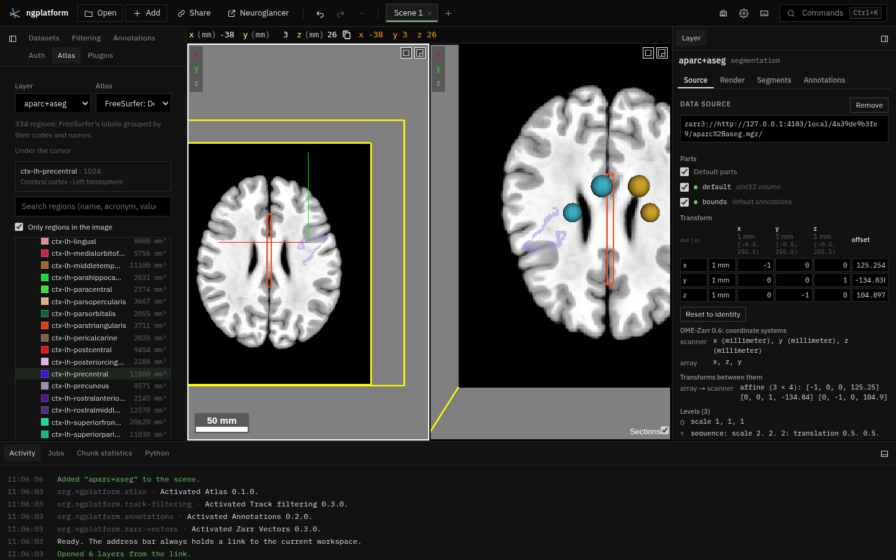

# Atlas

**Kind:** tool · **Off by default** (offered when you open a segmentation with a lookup table; or turn it on in the Plugins panel) · the
**Atlas** panel in the Tools dock, under *Labels* ·
[Source and developer README](https://github.com/AllenInstitute/ngplatform/tree/main/plugins/atlas)

The regions of a segmentation (a label image) as a tree, from its lookup
table: the Allen Mouse CCF ontology's hierarchy, FreeSurfer's labels
grouped, or a table's list. Search for a region, show it with all its
parts, go to it, see which region is under the pointer and where it sits
in the hierarchy, and read each region's volume.

## Using it

1. Open a segmentation: a FreeSurfer `aparc+aseg.mgz` or `aseg.mgz`, a
   NIfTI label image, an OME-Zarr or precomputed segmentation. With none,
   the panel offers **Open data…**.
2. **Atlas** card: choose the **Layer**, and its **Atlas** if it has
   none: the tables that come with the app (FreeSurfer, Schaefer, Yeo,
   Harvard-Oxford) or the Allen Mouse CCFv3 structures, downloaded from the
   Allen Institute when chosen. The table becomes the layer's own (the same
   as Render › Lookup table): its colours and names show in the views and
   the Segments tab. A line under it says how the tree is made.
3. **Regions** card (its badge is the number of regions):
   - **Under the cursor** names the region the pointer is over and its
     path, e.g. "Isocortex › Somatomotor areas › Primary motor area".
   - **Search** filters by name, acronym or label value. **Only regions in
     the image** hides those with no voxels in this label image. While the
     counts come from a coarser level than the finest, a line under the
     tree says how many regions were not seen there: they may be smaller
     than a voxel at that level, not absent.
   - The tree; the caret beside a region opens it. By keyboard, Tab
     reaches the tree; Up and Down move, Right opens a region or goes to
     its first child, Left closes it or goes to its parent, Home and End
     go to the first and last, typing a letter goes to the next region
     starting with it, and Enter chooses.
     - **Allen CCF**: the ontology's hierarchy (Basic cell groups and
       regions › Cerebrum › Cerebral cortex › … › Isocortex › Somatomotor
       areas › Primary motor area › Layer 1), with acronyms.
     - **FreeSurfer's labels**: grouped by their codes and names into
       cerebral cortex, cerebral white matter, subcortical grey matter,
       cerebellum, brain stem, ventricles and CSF, and other; each split
       into left and right hemisphere.
     - **Schaefer's parcellations**: by hemisphere, then network.
     - **Other tables** (Harvard-Oxford, Yeo, a file of your own): a flat
       list.
4. Click a region to choose it; the **Region** card shows its name, path
   and volume, and:
   - **Show only**: the region and everything under it become the layer's
     visible segments; **Add to shown** adds them to those shown; **Show
     all** lists every segment again (the table's and the image's), so
     the 3-D view draws all their meshes.
   - **Go to**: moves the views to the region's voxel nearest its centre.
     It shows its progress, with **Cancel**; clicking Go to again stops the
     one under way and starts anew.
   - Double-click a region in the tree to show only it and go to it.
5. **Volumes** card: the label image is counted in the background, first
   at its finest level of at most 64 million voxels, so the tree and the
   volumes show soon. When regions of the table are not seen at that
   level, it is counted again at the finest level that can be read in
   about a minute (at the first count's speed), and that count replaces
   the first. The card says which grid and level were counted, and shows
   the progress with **Cancel** (the counts already made stay). The counts
   are also in Activity. When the finest level was not read, the card says
   how many regions were not seen; **Count at full resolution** reads every
   voxel of the finest level, however long that takes, so no region is
   missed. A cancelled first count starts again with **Count again**, or
   when Go to needs it. Each region's volume, with everything under it,
   shows in the tree; **Save CSV** writes every region's voxels and volume,
   its own and with its parts.

## Notes from users

*Add your tips, workflows and problems here (edit this page on GitHub).*
