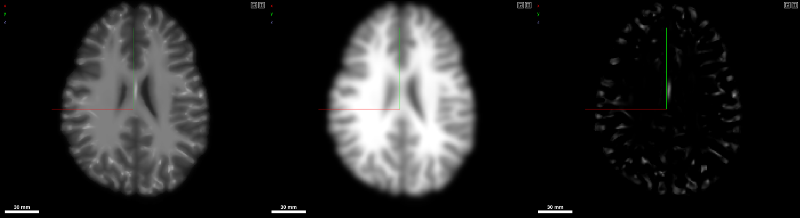

# Filters

**Kind:** tool · **Off by default** (offered when you open an image; or turn it on in the Plugins panel) · the
**Filters** panel ·
[Source and developer README](https://github.com/AllenInstitute/ngplatform/tree/main/plugins/filters)

Any image filtered as you view it, added as a layer of its own beside the
original. Nothing is saved: each piece of the view is computed when it is
needed, at the resolution being shown, by
[chunkmirage](https://github.com/JaneliaSciComp/chunkmirage)'s engine
running in the page, so zooming in computes only what is in view. Sizes are
in voxels of the resolution shown, so a zoomed-out view is a preview of the
full-resolution result.

## Using it

1. Add an image: a file from this computer (NIfTI, FreeSurfer `.mgz`,
   TIFF, NumPy) or an OME-Zarr, N5 or precomputed volume at a URL. It
   must be 3-D, with one channel and one time point: the panel lists
   the images it cannot filter (2-D, several channels such as RGB, a
   time series) and why.
2. In the Filters panel choose it, then one or more steps, run in order:
   - **Gaussian** (sigma) and **Mean** (radius): smoothing.
   - **Median** (radius): removes speckle and keeps edges.
   - **Difference of Gaussians** (sigma): blobs and edges about that size.
   - **Frangi vesselness** (sigma from, to; bright or dark): how much each
     voxel looks like part of a tube (vessels, fibres, axons), 0 to 1.
   - **Threshold** (from, below): a mask, added as a segmentation.
   - **Morphology** (open or close, radius): cleans a mask.
   - **Python (your own)**: code with `apply(block)`, run on each block
     (a NumPy array, z, y, x). Its first lines say what it needs:
     `#halo 2` (voxels of context on each side), `#output float32 image`
     (what it returns: a dtype, then image, label or mask). NumPy is `np`;
     SciPy and scikit-image can be imported.
   Sizes have upper limits (sigma 10 voxels, 6 for a difference of
   Gaussians and 10 for Frangi; radius 15), so that no step reads more
   than half a 64-voxel chunk around each chunk.
3. **Add filtered view**. The layer's link carries the steps, so it opens
   wherever the image can be read. Median and Frangi load Python (SciPy,
   scikit-image) in the page the first time, which takes a few seconds.
   Someone opening a link with your own Python is shown the code and asked
   before it runs.

To tune a filtered view, select its layer: the panel shows its image and
steps, and **Update the view** changes that layer in place (one step to
undo) rather than adding another. **Add as a new view** keeps it and adds
one beside it.

The panel's image and steps are kept with the workspace: a reload, undo or a
shared link brings them back. To save a filtered view as a file, use the
Layers panel: the row's ⋯ → **Export as…** (NIfTI, `.mgz` or OME-Zarr). Opening a link from before that, the panel
shows the steps of its newest filtered layer. A filtered layer lies where
its image does, oblique and flipped files included.

## Notes from users

*Add your tips, workflows and problems here (edit this page on GitHub).*
