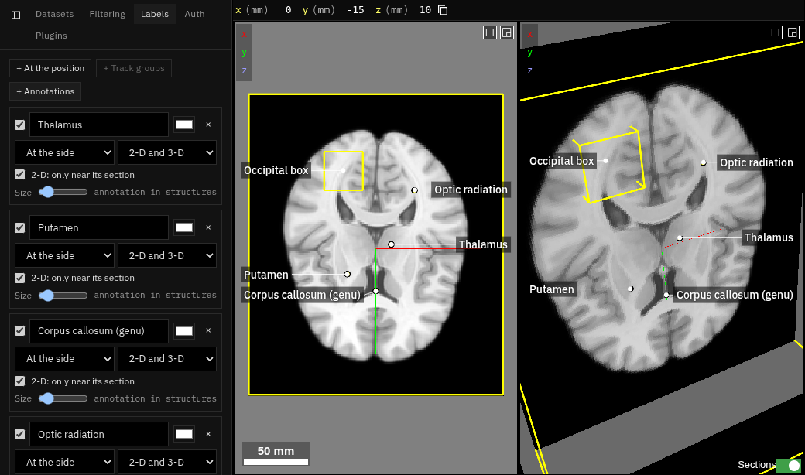

# Labels

**Kind:** tool · **On by default** · the **Labels** tab ·
[Source and developer README](https://github.com/AllenInstitute/ngplatform/tree/main/plugins/annotations)

Labels on the views for figures, as an anatomy atlas draws them: a pin on
what is named, a thin leader line, and the name beside it or lined up at the
view's side. A label is pinned to a point, a track group's centre, or an
annotation (its description).

## Using it

- **+ At the position** pins a label at the current position; **+ Track
  groups** labels every group; **+ Annotations** labels the annotations of
  an annotation layer.
- Each label: text, colour, placement (beside the pin or at the side), and
  whether it shows in 2-D, 3-D or both. Drag labels in the views to move
  them, and resize them with the size slider.
- Labels are painted into screenshots (camera icon).

!!! note "Coming"
    This plugin is to grow into **Annotations**: labels, measuring tools,
    contours, label statistics and manual segmentation in one place.

## Notes from users

*Add your tips, workflows and problems here (edit this page on GitHub).*
