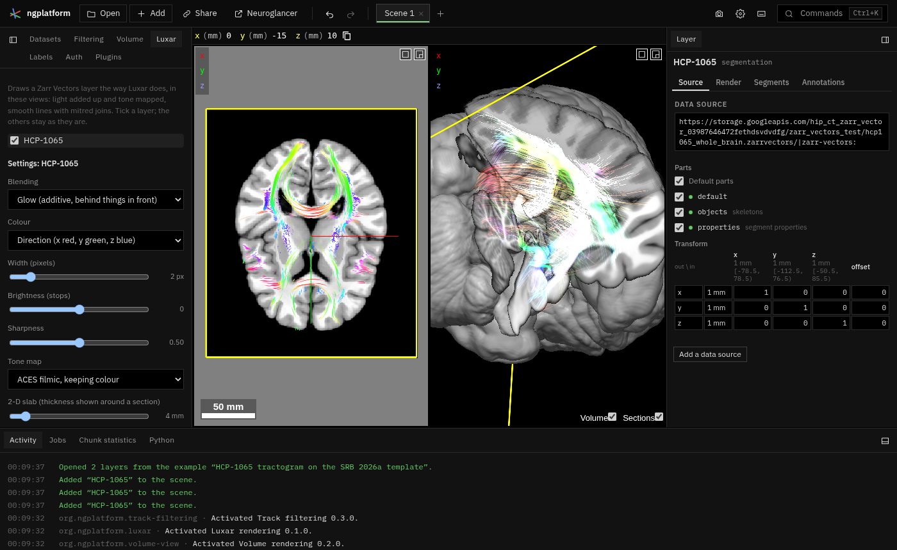

# Luxar rendering

**Kind:** tool · **Off by default** (offered when you open a tractogram or Zarr Vectors store; or turn it on in Plugins) · a
**Luxar** panel in the Tools dock (under Vectors), and a command ·
[Source and developer README](https://github.com/AllenInstitute/ngplatform/tree/main/plugins/luxar)

Draws a Zarr Vectors layer (a tractogram, skeletons, a point cloud, a mesh, or a
`.trk`, `.tck`, `.trx` or SWC file opened in place) the way the
[Luxar](https://github.com/royerlab/luxar) viewer draws lines: as light,
added up and tone mapped, with smooth thick lines and mitred joins. It
does this inside Neuroglancer's own 2-D and 3-D views, for the layers you
choose, so a Luxar tractogram sits on a plain or volume-rendered image in
one viewer. The data is read in place, level by level as you zoom; nothing
is converted.

## Using it

- Switch the plugin on, open the **Luxar** panel and switch a layer on
  (each is listed by its name). Or select the layer and run *Toggle Luxar
  for the selected layer* from the command palette.
- With more than one layer, **Settings for** chooses whose settings the
  cards below show: **Look**, **Lines** (or **Points**, or **Surface**),
  **2-D sections** and **Detail**.
- **Blending**: *Glow* adds the light of overlapping lines (bundles glow),
  hidden by what is in front of it; *Glow through* shows it over everything;
  *Emission and absorption* also darkens what is behind dense bundles;
  *Solid tubes* draws opaque, shaded lines.
- **Colour**: by direction (x red, y green, z blue), each streamline its own
  colour, a vertex attribute through a colormap (with its range), or one
  colour.
- **Width** in pixels, **Brightness** in stops, **Sharpness** (soft glow to
  hard edge) and the **Tone map**. **Automatic brightness** dims lines where
  many crowd the view, so a whole brain glows rather than turning white and
  zooming in (finer levels, more lines) keeps the picture's brightness.
- **Bloom**: a glow around bright light, as Luxar has: the brightest
  parts, blurred, are added back around them (0 is off). For lines,
  points and images drawn as splats, in 2-D and 3-D.
- **Slab thickness** (2-D sections): in a 2-D view, lines within half
  this distance of the section show, fading away from it, as Luxar slices
  by proximity. It follows the data's size, a fortieth of it (about 4 mm
  for a human brain's tractogram, tens of micrometres for EM in
  nanometres), and reads in the unit that suits the data (mm, µm or nm),
  until you set it; **Reset** follows the data again.
- **Detail**: about how many vertices a view reads. The coarsest level shows
  first; finer levels replace it as you zoom in, only for the chunks in view.
- **Momentum** (the **3-D view** card): let go of a rotation in the 3-D view while
  moving and it keeps turning, slowing to a stop.
- **Segments**: when the layer shows only some objects (segments chosen in
  its Segments tab or in the link, or another tool's choice, such as a
  track-filtering group), only those are drawn. Up to about 8 million
  vertices of them (four times the Detail; at most 100 000 objects) are
  read whole, by id, at full resolution, so all of them show at any zoom
  and nothing else is read; the status line shows how many have been read. A
  view draws about the Detail of them: zoomed out on a big group, the 3-D
  view draws an even sample of its streamlines, each whole; raise the
  Detail to draw them all. More than
  that are drawn from the level's chunks, as when every object shows. *Colour: the layer's segment colours* colours each object as
  Neuroglancer does.
- **The others, faintly**: with the layer's *Opacity (off)*
  (notSelectedAlpha, in its Display tab) above 0, the objects not chosen
  are drawn too, that much fainter, as Neuroglancer does (not with Solid
  tubes). While Luxar draws the layer the slider springs back to 0
  (Neuroglancer's own drawing is kept off that way), but the value you
  set is what Luxar draws with, what the link keeps, and what the layer
  has again when Luxar is switched off for it.
- **Track filtering's groups**: switch a group's layer on and it is drawn in the
  group's colour, its streamlines read by id from the whole tractogram
  until track filtering has made the group a store of its own, then from
  that store; the drawing by id stays until the group's own store has
  loaded, so the group does not blink out in between. The group's answer
  can change (move a region) and Luxar follows it, reading only the
  streamlines it has not read yet.
- Hiding the layer hides its Luxar drawing too. A link opened where the
  plugin is off shows the layer drawn by Neuroglancer as usual.
- **Meshes** (surfaces): lit in the 3-D view and, with Glow or Emission,
  added up as light the way lines are (so other Luxar layers' lines and
  splats mix with them); Solid draws them opaque. In Glow the light of
  surfaces behind the nearest one fades with how far behind they are
  (**Glow depth**, a share of the layer's size; 2 % by default, about 4 mm
  for a cortex), so a folded surface such as FreeSurfer's `lh.white` shows
  as a surface with a glow from its folds rather than a white blob; at 0
  every fold adds up as lines do. In the 2-D views the outline where the
  section cuts them glows.
- **A segmentation's meshes** (an EM segmentation such as MICrONS'): switched
  on, the meshes of the segments the layer shows are drawn, read from its
  precomputed meshes, coarse levels first. At most 2,000 segments: with
  more shown, the panel says so under the layer (*Showing 2,000 of 14,203
  segments*).

Not yet: fitted Gaussian splats (Luxar's GPU fit, which makes new files).

## Images as splats

Switch an image layer on and it is drawn as Gaussian splats made from its voxels
as they are read, in place of Neuroglancer's drawing of it: in the 3-D view
as a glowing or absorbing cloud, and in the 2-D views as the splats cut by
each section, which look like the image itself. Switch it off and
Neuroglancer draws it again. The link keeps the layer as it was (its opacity
included).

## Notes from users

*Add your tips, workflows and problems here (edit this page on GitHub).*
