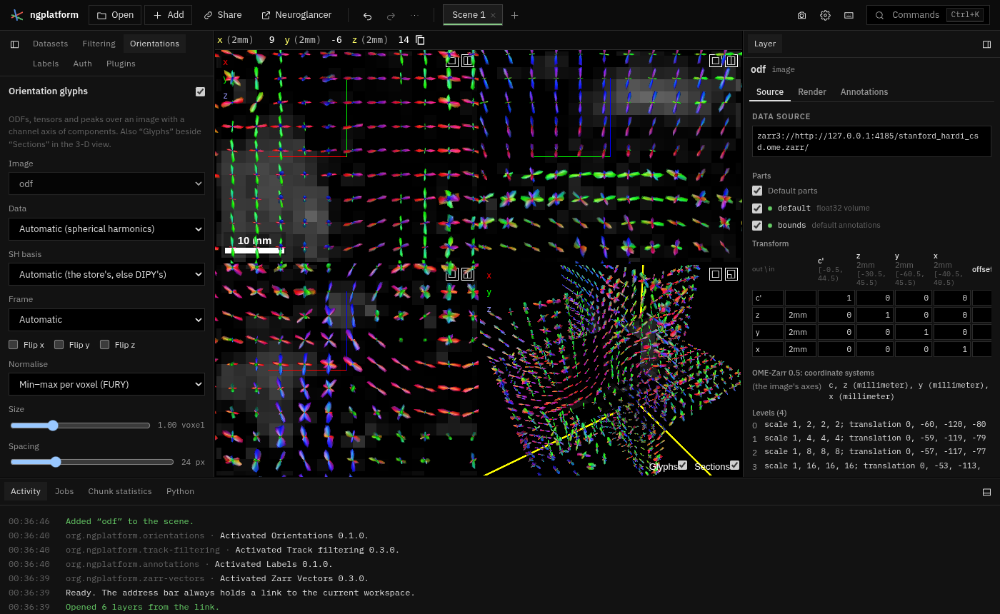

# Orientations

**Kind:** tool · **Off by default** (offered when you open a tensor, SH or peaks image; or turn it on in the Plugins tab) · an
**Orientations** panel in the Tools dock, and a **Glyphs** switch beside **Sections** in the
3-D view ·
[Source and developer README](https://github.com/AllenInstitute/ngplatform/tree/main/plugins/orientations)

Draws orientation glyphs over an image whose voxels hold directions: fibre
ODFs from spherical harmonics (as DIPY and MRtrix write them), diffusion
tensors as ellipsoids, and peaks or vectors as lines, one glyph per voxel,
as FURY's slicers and MRtrix's `mrview` show them. With a multiscale image
(each level holding coarser values), zoomed out you see the coarse glyphs;
zoom in and the finer level's glyphs load in and take their place.

## Using it

- Open an image with one axis of components per voxel: an OME-Zarr with a
  channel axis `c` (shape c, z, y, x; or t, c, z, y, x with one time point,
  as bioformats2raw writes it), or a 4-D NIfTI (its fourth axis holds the
  components; read in place, with coarser levels made as means).
  Neuroglancer shows the image itself: the first component. With no image
  in the scene the panel offers **Open data…**.
- Switch on **Orientation glyphs** at the top of the Orientations panel (or
  **Glyphs** in the 3-D view). The first image with components is drawn.
  The panel's controls are in four cards: Image, Glyphs, Views and Voxel.
  The (i) beside a control explains it.

### Image

- **Image** picks another image when there are several.
- **Voxels hold** says what the components are. Automatic reads the
  store's own `orientations` attributes, else goes by their number: 3 a
  vector, 6 a tensor, 15, 28, 45 … spherical harmonics, other multiples of
  3 peaks. Six can also be order-2 harmonics: choose them here. The line
  under the card's controls says what was taken and the image's levels.
- **SH basis** (spherical harmonics): DIPY writes `descoteaux07` (its
  legacy form unless told otherwise), MRtrix3 `tournier07`. A wrong basis
  gives scrambled glyphs.
- **Tensor order** (tensors): FSL (Dxx Dxy Dxz Dyy Dyz Dzz), DIPY (Dxx Dxy
  Dyy Dxz Dyz Dzz) or MRtrix (Dxx Dyy Dzz Dxy Dxz Dyz). Automatic takes the
  store's word, DIPY's for a NIfTI whose header says symmetric matrix
  (intent 1005), else FSL's.
- **Frame**: directions along the voxel axes (DIPY, FSL) or along the
  world's x, y, z (MRtrix). **Flip x, y, z** when glyphs point the wrong
  way.

### Glyphs

- **ODF glyph** (spherical harmonics): the ODF's shape, or lines along its
  peaks (up to three, each over half the largest). Shapes are drawn exactly
  (each pixel's ray meets the ODF's surface), not as a mesh of triangles,
  so lobes are smooth at any size and thousands draw quickly.
- **Tensor glyph**: an ellipsoid, or a line along the principal direction.
  Ellipsoids are drawn exactly too, so many thousands draw quickly.
- **Scale glyphs to**: each voxel's range (as FURY), each voxel's maximum,
  or the view's largest, so sizes compare.
- **Size** (1 fills a voxel), **Spacing** (glyphs at least this many pixels
  apart: the level is the finest that keeps them so).
- **Hide below anisotropy**: leave out glyphs whose GFA (spherical
  harmonics) or FA (tensors) is lower, outside the white matter say.
- **Glyph limit per view**: beyond it, a coarser level; beyond the
  coarsest, none until you zoom in (the Views card says so).

### Views

- **2-D views**, **3-D view**: where glyphs are drawn. In the 3-D view they
  sit on the 2-D views' sections; with only a 3-D view, on three planes
  through the position.
- **Colour image by direction** sets the image layer's colours to the
  principal direction (red left-right, green front-back, blue up-down),
  weighted by the anisotropy, as Freeview's `-dti` display. Its Display tab
  has a brightness slider.

### Voxel

What the voxel under the cursor holds: a tensor's FA, MD, eigenvalues and
principal direction; an ODF's GFA and peaks; a vector's direction and
length.

### When something fails

An image that cannot be read is tried again twice, after a few seconds;
then the panel shows the error with **Retry**. A read of glyphs that fails
shows its error with **Retry** too. The 2-D glyphs draw with a WebGL
context of their own; if the browser takes it back (it allows only so
many, and other 3-D tools use some), the panel says so, and the glyphs
return when the browser gives it back, or on **Retry**.

Glyphs are drawn into screenshots taken with Neuroglancer's screenshot
button, and follow the layer when it is moved (Registration).

A 4-D NIfTI opened from this computer works too (its coarser levels are
means, which for spherical harmonics are mean ODFs); its fourth axis is
made the layer's own (`t'`) so the views do not step through components.
For tensors the coarser levels are log-Euclidean means instead (the mean
of the matrix logarithms), which do not swell crossing tensors into fat
discs as a plain mean does: when the header says symmetric matrix, or
once the plugin draws the image as tensors (it tells the app, which makes
the levels again in the chosen **Tensor order**). The Image card says which the
coarser levels are. Voxels that are not positive definite (the background)
are left out of a coarse voxel's mean.
Direction colour works on it when its header does not mark the fourth axis
as time (no time unit and step), since the app then keeps up to 128
components together in each chunk; otherwise write it as OME-Zarr with
whole chunks along `c` (the plugin's README says how).

## Notes from users

*Add your tips, workflows and problems here (edit this page on GitHub).*
