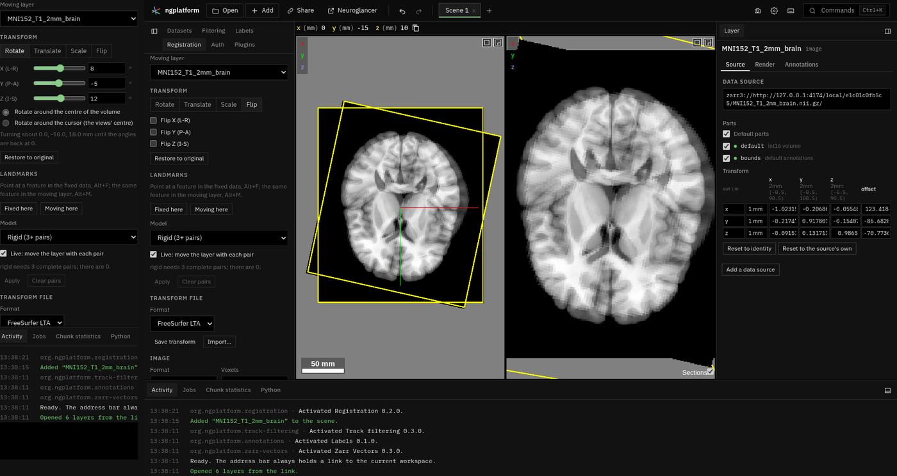

# Registration

**Kind:** tool · **Off by default** (offered when you open two images; or turn it on in the Plugins tab) · the
**Registration** tab ·
[Source and developer README](https://github.com/AllenInstitute/ngplatform/tree/main/plugins/registration)

Places a moving layer onto the others: by hand, as Freeview's Transform
Volume tool; from landmark pairs; or from a transform file. Then saves the
transform, or the moved image.

## Using it

- **By hand:** the Rotate, Translate, Scale and Flip tabs, along X (L-R),
  Y (P-A) and Z (I-S), each a slider and a typed value. The layer moves as
  you drag. Rotate about the volume's centre or the cursor (the views' centre); **Move centre to
  cursor**; **Restore to original**. **Apply to all visible volumes** moves
  every other visible image and segmentation with it (clear it to put them
  back).
- **Straighten with landmarks** (as Freeview's): mark four points on the
  image, then turn the line #1 → #2 onto an axis (the AC to the PC onto
  P → A, say) and #3 → #4 as near another as it can, about the volume's
  centre.
- **Landmarks:** ++alt+f++ places a fixed point and ++alt+m++ the matching
  moving point. Fit as translation, rigid, similarity or affine, with the
  residual of each pair.
- **Warp through the pairs:** a new layer of the moving image bent so each
  fixed point lands exactly on its pair and smoothly between (a thin-plate
  spline; four pairs or more, not all in one plane). It is computed as you
  view it, nothing written, and its link carries the pairs. The moving
  layer stays as it was.
- **Transform files:** save or import FreeSurfer `.lta` (RAS to RAS with
  both volumes' geometry), ITK / ANTs `.txt`, or a plain 4 × 4 matrix;
  import MNI `.xfm` (FreeSurfer's `talairach.xfm`), ANTs' binary `.mat`
  (`0GenericAffine.mat`), FreeSurfer `register.dat` (tkregister,
  bbregister) and FSL FLIRT `.mat` too. The last two are relative to both
  images' voxel grids: choose the fixed image under *Onto the grid of*
  before importing.
- **Save image:** NIfTI, FreeSurfer `.mgz`/`.mgh` or OME-Zarr, resampled
  (nearest, trilinear or cubic; onto its own grid, its own grid enlarged to
  hold all of the moved image, or another image's) or with the voxels
  unchanged and the new placement in the header. Saved into a file or
  folder you choose (Chrome, Edge), the image is made at full resolution
  however large: NIfTI and FreeSurfer files slab by slab, gzipped as they
  are written, and OME-Zarr block by block, each part reading only the
  source it needs. Downloaded instead, it is made from the finest level
  that fits in memory (512 MB).

Checked against FreeSurfer 7: `lta_convert` reads the transforms, and
`mri_vol2vol` resamples to the same image.

## Notes from users

*Add your tips, workflows and problems here (edit this page on GitHub).*
