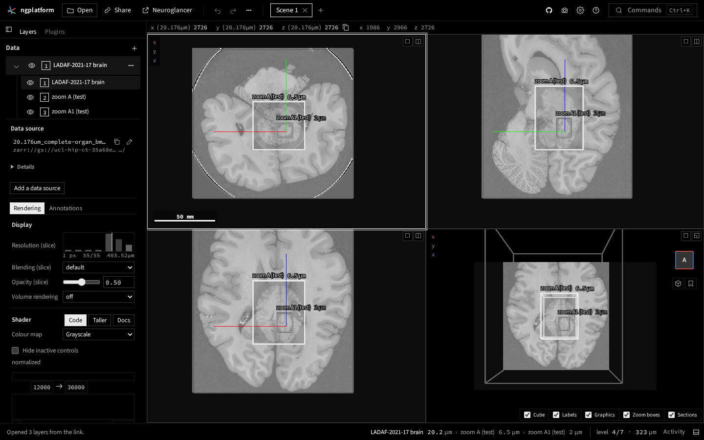

# Scale navigator

*The LADAF-2021-17 brain (Human Organ Atlas, 20.2 µm, OME-Zarr) with the
same image added twice more, scaled to 6.5 and 2 µm voxels and placed
inside it as stand-ins for zooms (the atlas's own zooms carry no
registration to the overview), the pointer on the 6.5 µm box; in a
headless browser (software WebGL), 2026-11-14.*

**Kind:** tool · on by default · in the status line (the breadcrumb and
the level, right of the activity message) and in the views (zoom boxes);
the switch **Zoom boxes** beside **Sections**; ++alt+arrow-up++ and
++alt+arrow-down++; every action is also in the command palette ·
[Source and developer README](https://github.com/AllenInstitute/ngplatform/tree/main/plugins/scale-navigator)

HiP-CT scans one specimen at several resolutions: the whole organ at about
20 µm, and local zooms (VOIs) at 6.5, 2 or 1 µm inside it, each a dataset
of its own and each a pyramid of levels. The scale navigator shows where
you are in that hierarchy and moves between its layers. It works for any
image layers that nest in space: it reads only where each layer lies in
the scene and how fine its voxels are.

## Breadcrumb

On the right of the status line: the image layers whose boxes hold the
position (the centre of the views), coarse to fine, each with its voxel
size:

`LADAF-2021-17 brain 20.2 µm › zoom A 6.5 µm › zoom A1 2 µm`

- The layer the views are on (the selected layer, else the finest one
  shown) is in white; a hidden layer is quieter.
- **Click** a layer to frame it: the views centre on it and zoom so it
  fills them, it is shown if it was hidden, and it becomes the selected
  layer. Moving and zooming are one undo step.
- A chain too long for the line is cut short at its left (…); its tooltip
  holds all of it.
- Nothing shows where no image layer holds the position.

## Level

Beside the breadcrumb: which level of a pyramid Neuroglancer draws at this
zoom, and its voxel size, for the selected image layer (else the finest
one shown at the position):

`level 4/7 · 323 µm`

is level 4 of 7, counted from 0, the finest, as the stores name their
levels (`s0`, `0`…). It is read from what Neuroglancer drew in the
sections in its last frame, as **Resolution (slice)** in the layer's
Rendering tab shows it; while a finer level is still loading, the tooltip
says which. When no section draws the layer (the 3-D layout, which shows
no sections, or volume rendering), the level is worked out from the zoom
as Neuroglancer would choose it, and marked `≈`, from the levels last read;
until any have been read, the chip shows `level –`. The chip stays in
every layout and is never cut short.

## Zoom boxes

In the 2-D and 3-D views, a grey box where each image layer lies inside a
coarser one, labelled with its name and voxel size. A box shows while a
layer it lies in is shown, and only where it is more than a few pixels
across.

- **Point** at a box's line or label to highlight it; **click** it to
  frame that layer, as the breadcrumb does. A click inside a box is the
  view's, as usual.
- **Zoom boxes** beside **Sections** in the 3-D view (or *Show or hide
  zoom boxes* in the palette) turns them off and on; the choice is kept in
  the scene.

## Keys and commands

| Key | Command | What it does |
|---|---|---|
| ++alt+arrow-up++ | *Go to the coarser layer of the hierarchy* | Frames the layer the views' layer lies in. |
| ++alt+arrow-down++ | *Go to a finer layer of the hierarchy* | Frames the next finer layer at the position; outside every zoom, the zoom nearest the position inside the views' layer. |
| | *Frame the selected layer* | Centres and zooms the views on the selected image layer. |
| | *Show or hide zoom boxes* | As the switch. |

## When layers nest

A layer lies inside another when its box, along every dimension both
have, is within the other's (give or take half a voxel at an edge) and its
voxels are finer. Layers at the same resolution never nest, so two
channels of one scan are not a hierarchy.

The navigator takes the layers as they lie in the scene and does not read
a dataset's metadata about other datasets. In the Human Organ Atlas a
zoom's own coordinates start at its origin, as the overview's do: opened
side by side, a zoom sits in the overview's corner, not where it was
scanned, and the navigator shows it there. Place it first (its layer's
transform, for instance with [Registration](registration.md)).
