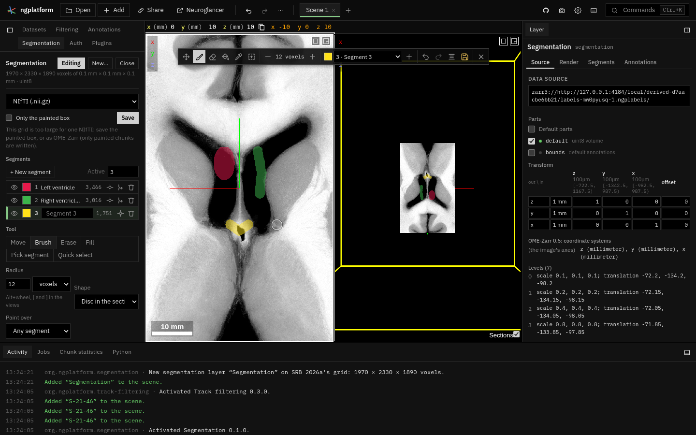

# Segmentation

**Kind:** tool · **On by default** · the **Segmentation** tab and a tool
bar over the views ·
[Source and developer README](https://github.com/AllenInstitute/ngplatform/tree/main/plugins/segmentation)

Label volumes drawn by hand, as in WebKnossos's volume annotation: a new
segmentation layer on an image's grid (or a copy of a segmentation to
edit), painted with a brush, fills and quick select, its segments named,
coloured, hidden, merged and deleted, and saved as NIfTI or OME-Zarr. (It
was the last section of the Annotations tab.) See
[the survey](segmentation-survey.md) for how it compares with WebKnossos.

## A new segmentation layer

In the Segmentation tab, under **New segmentation layer**:

- **On the grid of**: an image or a segmentation in the scene, and a
  **Level** of it. The new layer has the same voxels and placement.
- On an image's grid (or **Start: Empty** on a segmentation's), the layer
  starts empty; choose **Labels**: 8-bit (segments up to 255), 16-bit (up
  to 65,535) or 32-bit. **Create** makes it.
- On a segmentation's grid, **Start: A copy of its labels** and **Copy and
  edit** copy its labels at that level into the new layer, with the names
  and colours of its lookup table if it has one. The original is hidden and
  not changed. Copies are limited to 512 million voxels: choose a coarser
  level for a larger segmentation. Labels copy exactly up to 4,294,967,295
  (32 bits; 64-bit labels within that range too); a label past 32 bits
  stops the copy with an error.
- **Open NIfTI…** reads a label image from your computer to edit.

The new layer opens with the tool bar shown and the brush chosen. Each
scene has its own segmentation layers; the tab shows the scene you are in.

## The tool bar

While a segmentation layer is edited, a tool bar shows at the top of the
2-D views (in a layout with a 3-D view, such as xy-3d, it stays over the
2-D view). Hover a button for its name and key.

| Tool | Key | What it does |
|---|---|---|
| **Move** | ++m++ | The views as usual: drag to move, wheel through sections. ++escape++ comes back here |
| **Brush** | ++b++ | The left button paints the active segment: a disc in the section (or a ball). A ring shows its size |
| **Erase** | ++e++ | Paints 0: any segment, or only the active one |
| **Lasso** | ++l++ | Hold the left button and draw round a structure in a 2-D view: when you let go, the outline closes and its inside is painted with the active segment in that section (as **Paint over** says, and within the image's range when that is on). **Erase** on the bar erases inside it instead |
| **Fill** | ++f++, ++shift+f++ | Fills the region clicked with the active segment: **2-D** in its section (++f++), or **3-D** in a box round the click (++shift+f++) |
| **Pick segment** | ++i++ | The segment clicked becomes the active one |
| **Quick select** | ++q++ | Drag a box round a structure in a 2-D view, or click it. **Threshold** (on the bar): Otsu's threshold inside the box, or values near the one clicked. **AI (MobileSAM)**: a Segment Anything model run in the page; ++shift++ + click or ++alt++ + click marks what is not wanted (see below). The mask shows first, tinted with its outline: ++enter++ (or ✓ on the bar) paints it with the active segment, ++escape++ (or ×) drops it; pressed while it is still being worked out, they apply as soon as it is |

- **Brush size**: ++alt++ + wheel over a 2-D view, ++bracket-left++ and
  ++bracket-right++, or **−** and **+** on the tool bar. The size is in
  voxels by default (in mm or µm in the tab).
- ++w++ and ++shift+w++ step through the tools.
- Hold ++space++ to move the view with the left button while a drawing
  tool is on.
- The tools draw in the 2-D views only; the 3-D view rotates as usual.
- On the right of the bar: the **active segment** (its colour, a list of
  the others) and **New segment** (++c++); **Undo** (++ctrl+z++) and
  **Redo** (++ctrl+y++); **Interpolate** (++v++); **Save**; and **×**,
  which hides the bar. **Edit** in the tab shows it again.

**Undo and redo** while the tool bar shows: ++ctrl+z++ undoes whichever
came last, the last stroke or the last change to the workspace (a layer
hidden, the view moved, a segment hidden), so strokes and other changes
undo as one history; ++ctrl+y++ (or ++ctrl+shift+z++) redoes them in the
order they were undone. Hover **Undo** on the bar to see what it will
take back. Merge, Delete, fills, quick select and interpolation are
strokes too. Strokes are the volume's own and are not in the workspace's
history tree (the ⋯ beside redo): going to another branch there changes
the workspace's state and leaves the painted voxels as they are.

**Quick select** shows its mask before painting it, as WebKnossos does:
check it, then ++enter++ paints it and ++escape++ drops it; a new box or
click replaces it, and the active segment can be changed (++c++, or the
list) before ++enter++. **Preview** / **At once** on the bar (or
**Result** in the tab) switches to painting at once, as before; undo
takes a mask painted at once back.

### AI quick select

**AI (MobileSAM)**, chosen on the bar or under **Method** in the tab,
segments with [MobileSAM](https://github.com/ChaoningZhang/MobileSAM), a
small Segment Anything model (Apache-2.0), run in this page with ONNX
Runtime Web.

- **First use**: the model (44.7 MB: an image encoder and a prompt
  decoder, from [Hugging Face](https://huggingface.co/Acly/MobileSAM)) is
  downloaded with a progress bar and kept in this browser; the tab shows
  the size kept and **Forget**, or **Download now** before the first
  prompt. The runtime (ONNX Runtime Web 1.30.0, MIT, 14 MB, or 27 MB with
  WebGPU) comes from jsDelivr.
- **Click** what you want in a 2-D view; ++shift++ + click or ++alt++ +
  click what you do not; each click redraws the mask in that section
  (green and red dots show the clicks). Or **drag a box** round it.
- The first prompt in a region computes the image's embedding ("Computing
  the image's embedding…" on the bar): a few seconds on the CPU, much less
  on a GPU. Further clicks near it take a fraction of a second.
- The model sees the section round the prompt, at least **Context**
  voxels across (256; in the tab), with the image's values as its layer
  shows them (the layer's window).
- **Run on** (in the tab): WebGPU when there is a GPU, else WASM (the
  CPU); the tab shows which, and the last timings.
- ++escape++ drops the clicks and the mask; ++enter++ paints it.

**Spread** (on the bar while a mask shows, or **Spread to sections** in
the tab): the mask is proposed in the next sections each way too, each
section prompted with the box round the mask in the one before; it stops
where nothing is found or the size jumps. ++enter++ paints all the
sections as one stroke, which one undo takes back. It works with
Threshold too.

**Interpolate**: draw the active segment in two sections a few apart (in
the same 2-D view), then press ++v++: each section between gets a shape
between the two drawn. Check the result, as with any interpolation.

While the tool bar shows, the keys above are the tools'. Some are
Neuroglancer's otherwise (++b++ scale bar, ++e++ rotate, ++l++ new segment
colours, ++v++ default
annotations, ++space++ layout, ++escape++, ++alt++ + wheel); hide the tool
bar to have them back.

## Segments

The **Segments** list shows each segment of the layer: whether it shows
(the eye), its colour, id, name and voxels (hover for the volume). The
active segment, the one the tools paint, is marked; its name can be typed
in its row.

- Click a row to paint with that segment; **+ New segment** (++c++) makes
  one with the next id (one more than the largest used).
- The colour square changes its colour.
- **Go to** moves the views to the segment (its voxel nearest its centre).
- **Merge** gives a segment's voxels to the active segment; **Delete**
  erases them. Both can be undone.

**Groups**, as in WebKnossos's segment list:

- **+ New group** makes an empty group (*Group 1*, …); type in its name to
  rename it.
- Drag a segment's row onto a group to put it there (onto *No group* to
  take it out), or choose the active segment's group under the list. A
  segment is in one group at most.
- The group's eye hides or shows all its segments; its colour square gives
  them all that colour; ▾ folds its rows away; the bin deletes the group
  (its segments stay, in no group).
- Groups belong to the scene, are kept in the link, and can be undone like
  other changes. A saved OME-Zarr keeps each segment's group, with its
  name and colour; a NIfTI file has no place for them.

## Tool settings and image values

Under **Tool**, the active tool's settings: the brush's radius, unit and
shape and whether it **paints over** other segments or only empty voxels;
what a fill follows (the segment clicked, or a range of the image's
values) and a 3-D fill's reach; whether the lasso paints or erases
inside, and over what; quick select's method, tolerance, result
(preview first, or paint at once) and what it paints over.

**Image values**: the image whose values limit the tools (by default the
one the grid came from), a **range**, and whether the brush, eraser and
lasso keep to it. **Range from the cursor** sets it round the value under the pointer.

## Saving

**Save** is at the top of the tab (and on the tool bar): NIfTI (.nii.gz,
marked as labels) or an OME-Zarr folder (in a zip where the browser cannot
write folders). **Only the painted box** saves the box round what is
painted, placed where it was. OME-Zarr writes only the painted chunks, so
it suits large grids, and carries the segments' names and colours; NIfTI
holds every voxel.

!!! warning "Save before you leave"
    A segmentation layer drawn here lives in the page until saved. While you
    draw it is also kept in this browser, so a reload brings it back into
    its layer, and one whose page was closed is offered again under **New…**
    (*Kept in this browser*: Open or Discard). That copy is not a save: the
    browser may clear it, and the link does not carry it to another
    computer. **Close** forgets it.

## Notes from users

*Add your tips, workflows and problems here (edit this page on GitHub).*
