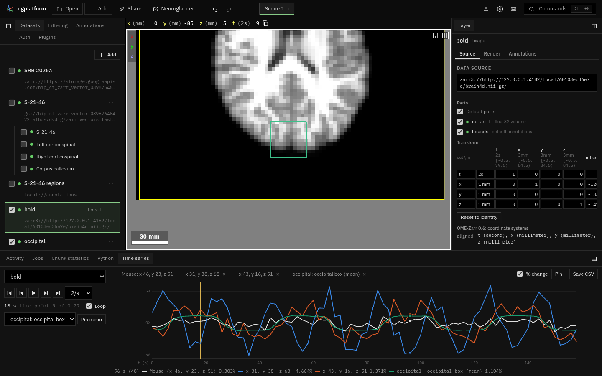

# Time series

**Kind:** tool · **Off by default** (switch it on in the Plugins tab) · the
**Time series** tab in the bottom dock, and **Alt+P** to pin ·
[Source and developer README](https://github.com/AllenInstitute/ngplatform/tree/main/plugins/time-series)

The values of an image along time: the time course of the voxel under the
mouse, of voxels you pin, and the mean over a region, plotted against time
with the time shown in the views marked; and playing through time. It works
on images with a time axis: a 4-D NIfTI opened from this computer (fMRI,
say: its fourth axis is time, one step every repetition time) and OME-Zarr
images with a `t` axis. Neuroglancer shows time as the dimension `t`, and
`[` and `]` step through it.

## Using it

1. Switch the plugin on, open a 4-D image, and open the **Time series** tab
   at the bottom (drag the dock's top edge up for a taller plot).
2. Choose the **Image** if there are several. Move the mouse over the
   image: the plot shows that voxel's values at every time point. The x
   axis is in the image's time unit (seconds for NIfTI); the yellow line
   is the time the views show.
3. **Pin** (or **Alt+P** with the mouse over the views) keeps the voxel's
   series in a colour of its own; **×** in the legend removes it. Up to
   eight pins; they are kept in the link.
4. For a region, draw a box or an ellipsoid in an annotation layer, choose
   it under the transport buttons and **Pin mean**: the mean, at each time
   point, of the voxels whose centres are inside it. Moving the annotation
   reads it again.
5. Point at the plot to read every series at that time; click it to show
   that time in the views.
6. **Play** steps through time at the chosen rate (time points a second),
   from the start again when **Loop** is on; the other buttons go to the
   first, previous, next and last time point. **Alt+Shift+P** plays and
   pauses. The readout gives the time and the time point (from 0).
   Playing makes no undo steps: undo after playing undoes what you did
   before it (the buttons for one time point are steps, as other moves).
7. **% change** plots each series as its change from its own mean, in
   percent, so series with different baselines can be compared.
8. **Save CSV**: a row per time point (its number and time) and a column
   per plotted series, with the values as read (not the percent change).

To save a movie of the time-lapse, use the camera icon → **Movie…** with a
sweep along `t`.

The finest resolution is read, chunk by chunk along time; the first voxel
in a new part of a long series takes a moment (the tab shows the
progress), and voxels near it are then immediate.

## Notes from users

*Add your tips, workflows and problems here (edit this page on GitHub).*
