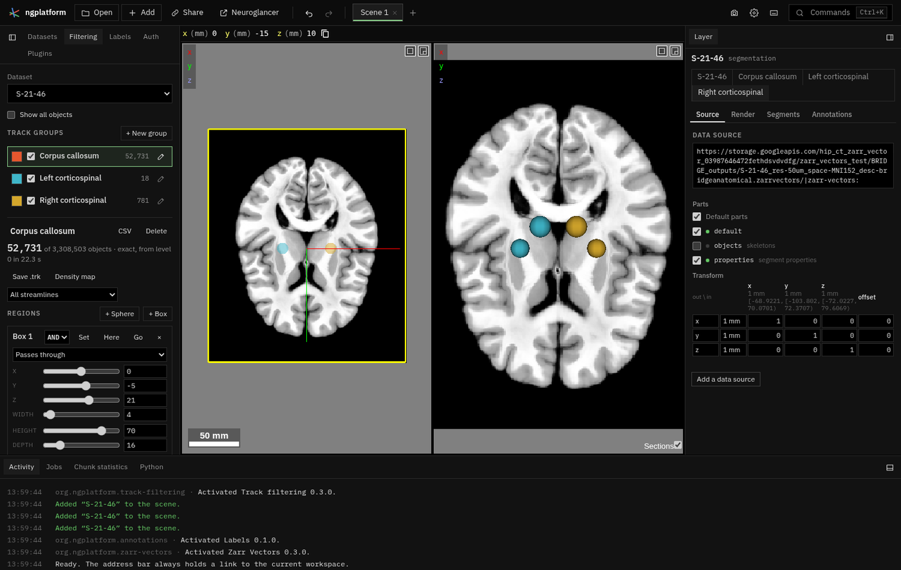

# Track filtering

**Kind:** tool · **Off by default** (offered when you open a tractogram or Zarr Vectors store; or turn it on in the Plugins panel) · the **Filtering** panel in the Tools dock, under *Vectors* ·
[Source and developer README](https://github.com/AllenInstitute/ngplatform/tree/main/plugins/track-filtering)

TrackVis-style track groups. A group keeps the objects that pass through its
regions (spheres, boxes, disks and masks, combined with AND, OR and NOT),
whose attributes are in range and whose tags it keeps, and shows them as a
layer of its own colour. It works on any dataset that is not an image: Zarr
Vectors streamlines, skeletons and points (local `.trk` files included),
precomputed segmentations, and annotation layers.

The panel is a column of cards: **Dataset**, **Groups**, **Regions**,
**Attributes**, **Stored groups**, **Output** and **Statistics**. Each card
remembers whether you left it open; the (i) beside a title explains it.

## Using it

1. **Dataset**: pick the dataset to filter. *Show all objects* shows or
   hides the dataset's own layers beside its groups.
2. **Groups**: **+ New group**, or simply add a region: with no group, the
   first region makes one. Point at a place in a view and press
   ++alt+shift+s++ for a sphere there, ++alt+shift+b++ for a box. Click a
   group's row to edit it (choosing one is not an undo step); its checkbox
   shows or hides it; rename it with the pencil or by double-clicking its
   name. The count is a quick preview from a coarse level (marked ~), then
   the exact answer.
3. **Regions**: **+ Sphere**, **+ Box**, **+ Disk** or **+ Mask**, at the
   centre of the views. Move a region with its sliders, or type a value in
   the box beside one: it applies when you press Enter or leave the box.
   **Move here** puts it at the views' centre, **Go to** takes the views to
   it, and Alt-drag moves it in a view.
    - On streamlines and skeletons, a region can ask for *pass through it*,
      *either end in it* or *both ends in it*.
    - **+ Disk** is TrackVis's disk: a flat region across x, y or z that a
      track must cross within its radius. An *angle limit* keeps only the
      tracks that cross it within that angle of its normal (90° or more:
      any). On segmentations and annotations it is tested as a flat box
      half of its radius thick.
    - **+ Mask** (Zarr Vectors stores): an image's voxels that a track must
      pass through. A label volume (painted in Annotations, or opened from
      a file): any label but 0, or the one typed. An image: voxels at or
      above the value typed (blank: not 0). It is read once, at the finest
      level of at most 64 M voxels, where the layer places it.
4. **Attributes** (Zarr Vectors): a minimum and a maximum for each of the
   objects' attributes (length, FA, …), over a histogram of every object,
   with the group's in colour.
5. **Stored groups** (Zarr Vectors stores with groups or categories): for
   each, **Keep** (only objects in at least one kept group), **Leave out**
   (no object in a left-out group) or **Either**.

## Output

For the group being edited:

- **Export CSV**: the group's objects and their attributes, once its count
  is exact.
- **Save .trk** (streamlines): the whole streamlines as TrackVis, all of
  them or a level's sample (*Streamlines*). In Chrome and Edge it is written
  straight to the file you choose, in batches, so a large group takes time
  but not memory. Other browsers build it in memory and download it, up
  to 1 GB; a larger group is refused before anything is read (use Chrome
  or Edge, or **Run on this computer**).
- **Make density map** (streamlines): streamlines per voxel, at the
  *Density voxel* size you choose (1 mm for a brain by default), shown as a
  heat map; **Save .nii** keeps it as a NIfTI file.
- **Run on this computer** (streamlines, with the runner on this computer
  paired in Settings › Compute): a Python job filters the whole tractogram
  there, with the group's regions, attribute ranges and tags, and writes a
  new `.trk`, a Zarr Vectors store with coarser levels and/or a density map
  (at the voxel size you give), then opens them here. The job shows in
  Activity. Use it for tractograms too large to save from the browser.
- **Save groups into the store** (a Zarr Vectors folder opened from this
  computer, in Chrome or Edge): every group with its exact answer is written
  into the store's level 0 `groups`, where other tools, and the viewer as
  tags, see them. A stored group of the same name is replaced. The new
  groups are written beside the old ones and swapped in last, so a failed
  save leaves the old groups as they were.

**Statistics**: each group's count and one attribute's mean ± SD and
median; **Export CSV** writes each group's count and each attribute's n,
mean, SD, median and range.

## Speed

The first exact answer in a new area takes seconds (the download); moving a
region around an area already read is exact at 10–20 updates a second. The
corpus callosum box on S-21-46 (3.3 M streamlines) is exact in about 20 s
from a cold start.

Moving a region stops the tests for where it was. Answers are kept for
asking again, up to about 200 MB. If the region reader stops (out of
memory, say), it is started again and the count runs once more; if that
fails too, the panel shows why, with **Retry**. Each streamline group's
own store is written off the page's thread, made again only when the
group's streamlines change, and let go when Track filtering is switched
off (its layer goes back to the dataset, showing the same streamlines).

## Files

The plugin's files, for developers: see the
[developer README](https://github.com/AllenInstitute/ngplatform/tree/main/plugins/track-filtering)
for each (`plugin.ts`, `filter.ts`, `roi*.ts`, `labels*.ts`,
`annotation_regions.ts`, `density.ts`, `trk.ts`, `runner_job.ts`,
`zv_groups.ts`). The runner's side of **Run on this computer** is
`runner/ngplatform_runner/tasks/filter.py`.

## Notes from users

*Add your tips, workflows and problems here (edit this page on GitHub).*
