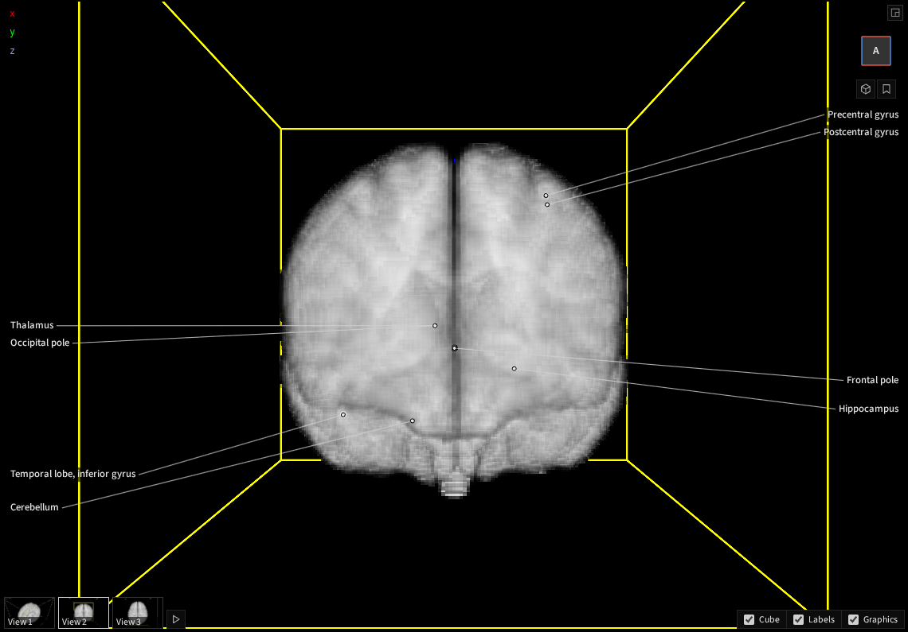

# View aids

*The SRB 2026a example with volume rendering on and eight point
annotations, the 3-D panel maximised, in a headless browser (software
WebGL), 2026-11-14.*

**Kind:** tool · on by default · in the 3-D view: the cube (top right), the
bookmark strip (bottom edge), the switches **Cube**, **Labels** and
**Graphics** beside **Sections**; every action is also in the command
palette · [Source and developer README](https://github.com/AllenInstitute/ngplatform/tree/main/plugins/view-aids)

Aids for finding your way in Neuroglancer's 3-D view, after those of
Siemens' Cinematic Anatomy: an orientation cube, labels with leader lines,
one switch to hide the graphics, and bookmarks of the camera. They work in
every scene, whatever the data.

## Orientation cube

A small cube in the 3-D view's top right, turned exactly as the view is
and seen in perspective as the view sees the data, so its near faces are
larger than its far ones and it matches the data's turn at any angle.

- **Faces** are lettered by the data's sides when its space reads as
  anatomy (x, y and z in micrometres or more, taken as RAS): **R** and
  **L**, **A** and **P**, **S** and **I**. Other data is lettered by axis:
  ±x, ±y, ±z. Each letter is turned to read as upright as it can.
- **Edges**, thin, are in the axes' colours: red along x, green along y,
  blue along z; the only colour on the cube.
- **Click** a face, an edge or a corner to look at the data from there.
  The view turns over about a third of a second, and stands upright:
  superior up (anterior up when seen from above or below); for other data,
  Neuroglancer's own way up.
- **Realign** (the cube button below it) turns to the nearest of the six
  standard views. **Bookmark** (beside it) keeps the view (below).
- **Quarter turns** (the arrows below): turn the data 90° left, right, up
  or down as you see it, or clockwise or anticlockwise on the screen.
  Clicked again while turning, the turns add up to whole quarters.
- The palette has *3-D view: look from …* for each face and *3-D view:
  realign*.

## Labels

Every point annotation that has a description, in the scene's visible
annotation layers, is named at the left or right side of the 3-D view,
with a thin line to its point.

- A label goes to the side its point is on. Down each side the labels keep
  the order of their points as seen from the far side, so the lines fan out
  and do not cross, and they are spaced so they never overlap.
- When a side is full, the points nearest you keep their labels.
- Labels are drawn into captures and Neuroglancer's screenshots; the cube
  and the strip are not.
- **Labels** beside **Sections** shows or hides them, and with them every
  name drawn beside a shape in the views (the zoom boxes' names, say).
- Only annotations kept in the layer (local annotation layers) are read,
  not precomputed annotation sources. A point hidden behind tissue is not
  greyed.

For labels you place and style yourself, in the 2-D views too, see the
[Annotations](annotations.md) plugin's Labels section.

## Hide graphics

**Graphics** beside **Sections**, off, hides Neuroglancer's axis lines,
the data's bounding box (its default annotations, in the 2-D views too),
the scale bar, these aids and every tool's shapes in the views (Track
filtering's regions, cut planes, landmarks, zoom boxes), for a clean
picture. On again puts back
exactly what was shown before. It is in the link and undone with undo.

## Bookmarks

- **Bookmark this view** (below the cube, or in the palette) keeps the
  camera: the position, the 3-D view's orientation, zoom and depth, the
  sections' orientation and scale, and the panel layout, with a small
  picture of the 3-D view, whatever the layout, taken once what it shows
  has loaded. With no 3-D view shown, the bookmark is its name alone.
- The bookmarks are a strip along the 3-D view's bottom edge, left of the
  switches, while there are any. Click one to fly there; right-click (or
  the context-menu key) to go to it, rename it, replace it with the view
  now, or delete it.
- **Play** (after the bookmarks) moves through them in order, holding at
  each. A click, a scroll or a key in the page stops it.
- Bookmarks are kept in the scene: in the link, and undone with undo. Each
  picture adds about 4 kB to the link.
- The palette has *Bookmark this view*, *Go to bookmark …* for each one,
  *Go to the next* or *previous bookmark*, *Play the bookmarks*, *Rename a
  bookmark…* and *Delete a bookmark…*.

With reduced motion asked for in the system settings, the view jumps
instead of turning or flying.

## In Neuroglancer's 3-D-only layout

Neuroglancer shows no **Sections** switch when the 3-D view is alone (the
layout a panel's maximise button chooses), so the three switches appear in
a group of their own in that corner.

## On a narrow panel

On a 3-D panel narrower than 560 px (a phone, or four panels in a small
window) the switches beside **Sections** (**Cube**, **Labels**,
**Graphics**, the scale navigator's **Zoom boxes**, any plugin's) fold into
one **View** button before **Sections**: it opens a small menu of them, so
the row never wraps.

## Notes from users

*Add your tips, workflows and problems here (edit this page on GitHub).*
