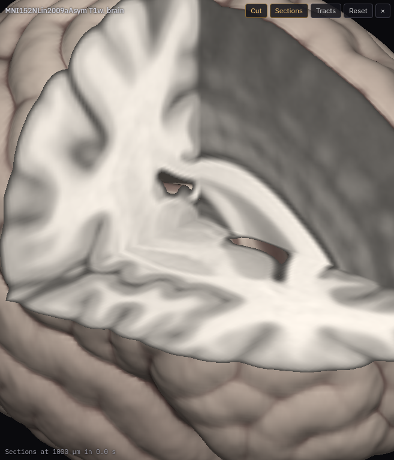

# Volume rendering

**Kind:** tool · **Off by default** (offered when you open an image; or turn it on in the Plugins tab) · a
**Volume** switch beside **Sections** in the 3-D view ·
[Source and developer README](https://github.com/AllenInstitute/ngplatform/tree/main/plugins/volume-view)

Draws an image as a solid in Neuroglancer's 3-D view, ray-marched from its
pyramid, with the octant facing the camera cut away at the position so the
sections show on the cut faces. Tracts and annotations are drawn in the same
view, depth-tested against it.

## Using it

- Switch the plugin on, then **Volume** in the 3-D panel.
- It draws the selected image: a 3-D OME-Zarr image (local NIfTI included) or a
  precomputed one. Images with t or c axes are not drawn yet. A layout
  without a 3-D view changes to xy + 3-D.
- The whole image is drawn from the finest level up to 384 voxels a side,
  with bricks (boxes of 32 voxels) of the finer levels over it: finer near
  the camera and the cut, coarser further away, within 128 MB of the GPU's
  memory. They load nearest first and sharpen the solid as they arrive; a
  moment after the view stops moving, they are chosen again for the new
  view. The Volume tab counts the bricks held and loading.
- **Cut open at the position** cuts away the octant facing the camera.
- **Detail**: Automatic uses bricks down to the image's finest level. A
  level that fits whole (384 voxels a side) is drawn whole, without bricks;
  a larger one is the finest level bricks come from.
- Where the GPU cannot hold the bricks, the Volume tab says so, and a level
  over 384 voxels a side is drawn as a 256-voxel box around the position,
  which follows it, inside the whole image from the finest level that fits.
- The cut's faces show three sections of their own, as sharp as the 3-D
  view's zoom can show, down to the image's finest level: zoom into the cut
  to see fine structure over the coarse solid. **Fine sections on the cut**
  in the Volume tab turns this off, to show the 2-D views' sections instead
  (as does switching **Sections** back on in the 3-D view).

## Notes from users

*Add your tips, workflows and problems here (edit this page on GitHub).*
