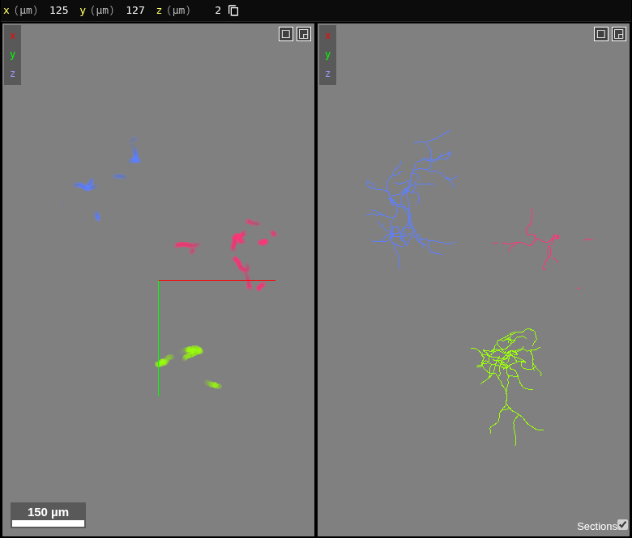

# Zarr Vectors

**Kind:** data type · **On by default** (the only plugin that is) ·
[Source and developer README](https://github.com/AllenInstitute/ngplatform/tree/main/plugins/zarr-vectors)

[Zarr Vectors](https://github.com/AllenInstitute/zarr_vectors) is a chunked,
multiscale format for geometry: points, streamlines, polylines, skeletons,
graphs and meshes, with per-vertex and per-object attributes. This plugin
reads it into Neuroglancer as a segmentation layer, one segment per object,
so objects can be searched, shown, hidden and coloured like any segments.

## Using it

- Add a store by URL with the `|zarr-vectors:` suffix, for example
  `https://example.org/tracts.zarrvectors/|zarr-vectors:` (a store ending
  in `.zarrvectors` is recognised without it): **+** beside Data in the
  Layers panel opens **Open**, where it can be pasted; or paste it on the
  window.
- Open a store folder, or one of the files below, with **Open → Open a
  file…** or **Folder…**, or drop it on the window. A file becomes a
  virtual Zarr Vectors store, made on the fly as the views ask for it:
  nothing is converted or uploaded.
- Object properties (length, orientation, a neuron's cable length…) appear
  in the layer's **Segments** tab, where they can be searched (`length>50`).
- **Vertex colour**, in the Display tab, colours the vertices by:
  - **Segments**.
  - **A group they belong to**: a tier of the store's taxonomy, such as
    class or cluster in an ABC atlas store, or the objects' own groups.
    Each group is drawn in the store's colour or a palette's. The groups
    shown are picked from a searchable list, and **Within** narrows it
    to the groups under one group of a coarser tier.
  - **Any attribute**, vertex or object: type to search, and one the
    layer does not show yet is loaded. The colour map runs from a low to
    a high value, and values outside that range can be hidden (a
    threshold).

  A store with a taxonomy opens coloured by its coarsest tier. The
  choices are written as the layer's shader, which can also be edited by
  hand with `prop_<name>()`.
- Coarser levels load first and finer ones as you zoom in; click an object
  to load it whole.

## What it reads

| Data | Files or source | As | Notes |
|---|---|---|---|
| Zarr Vectors stores | a URL with `|zarr-vectors:`, or a folder | the store itself | Format 0.9.0 to 0.9.4: points, streamlines, polylines, skeletons, graphs, meshes. Codecs zstd, blosc, gzip, zlib, crc32c; sharded or not. Not yet: Draco-encoded vertices, 0.9.4's dense manifests (opens without objects), attribute-chunked levels. |
| Tractograms | `.trk`, `.tck`, `.trx` | streamlines | In RAS+ mm, as nibabel reads them. A large file is copied into the browser's storage within a limit; past it, a sample (1 in 10, 100 …). |
| Meshes | `.obj`, `.stl`, `.ply` | meshes | One object per `.obj` object, else per file. Over a million triangles: cells with simplified levels. |
| Surfaces | GIFTI `.gii`, FreeSurfer `lh.pial`, `rh.white` … | meshes with values | Placed in scanner RAS. Brings the curvature, thickness, `.mgh` overlays, `.annot` and `.label` files, and GIFTI shape and label files beside it. |
| CIFTI | `.dscalar.nii`, `.dlabel.nii`, `.dtseries.nii`, beside a GIFTI surface | values on the surface | Each map, a parcellation's labels, or a time series' mean, SD and values at a time point (the Time series plugin steps through them). The surface's name must give its hemisphere. |
| Neurons | `.swc`, or a folder of them | skeletons | One object per tree, in µm; radius, type, cable length and branch points. |
| Graphs | GraphML `.graphml`; an edge list (`…edges.csv`) dropped with its node table (`…nodes.csv`) | graphs | One object per connected component; node degree and other numeric values as properties. |
| Point tables | `.csv`, `.tsv`, `.xyz` | points | x, y, z by name (`x`, `x_location`, `x_um` …) or the first three columns; other numeric columns as values. Up to 250,000 points each is an object, so Track filtering can select them. |
| Parquet | `.parquet` | points | As a point table (spatial transcriptomics, cell tables); the usual compressions. Text columns are skipped. |
| Arrow | Feather / Arrow IPC `.feather`, `.arrow` | points | As a point table: numeric columns, uncompressed, LZ4 or ZSTD. |
| LAS point clouds | `.las`, compressed `.laz` | points | Large clouds get coarse levels. |
| EM meshes | Neuroglancer precomputed segment meshes (legacy or multi-resolution) | meshes | Read as a Zarr Vectors mesh store for [Luxar rendering](luxar.md), the chosen segments only, with the meshes' own levels of detail. |

The data on this computer, and how large files are handled, is in
[Loading and exporting data](../guide/data.md#data-on-your-computer).

## Making stores

[zarr-vectors-tools](https://github.com/AllenInstitute/zarr-vectors-tools)
(`zvtools convert`) writes stores from tractograms, meshes, SWC, point
tables, LAS/LAZ point clouds, GraphML and more, with the levels and
attributes this plugin reads.

## Troubleshooting

- **A store at a URL does not load (CORS).** The browser reads the store
  directly, so its server must allow this site's address (CORS) and range
  requests: a `GET` and `HEAD` rule for the app's address, allowing the
  `Range` header. Give a bucket's store by its web address
  (`https://storage.googleapis.com/bucket/path/|zarr-vectors:`): the
  reader does not find a store through `gs://` yet. The Activity log names
  the request that failed.
- **A store behind a sign-in.** Sign in under **Settings › Sign-in** first;
  see [Signing in](../guide/signing-in.md). A server that refuses the
  request (401 or 403) on the store's `zarr.json` makes the layer fail;
  on a chunk, it is read as empty (below).
- **A store or file that is too big.** A store at a URL is read a chunk at
  a time, so its size does not matter, but without coarser levels every
  view reads level 0: build them with `zvtools pyramid`. A local tractogram
  past **Settings › Storage → Local tractograms** opens as a sample; for
  every streamline, convert it or serve it with the runner (see
  [Jobs on this computer](../guide/local-jobs.md)), or raise the limit.
- **Missing chunks or objects.** A chunk the server answers with 404 (or
  403) is taken as empty, so a store copied in part shows gaps rather than
  an error: check the copy is whole. Objects, properties and the Segments
  tab need the store's object index; without it only the overview is
  drawn. A mesh whose faces cross chunks needs the server to list
  directories (a bucket, or a server's index page); otherwise the faces
  across chunks are missing, with a warning in the Activity dock. Levels
  or features the plugin cannot read yet (above) are skipped with a
  warning there, given once per store.
- **A local file stops loading after a reload.** In Firefox and Safari,
  and in Chrome and Edge when you did not allow the file again, open it
  again: links to local files work only in the browser that opened them.

## Notes from users

*Add your tips, workflows and problems here (edit this page on GitHub).*
