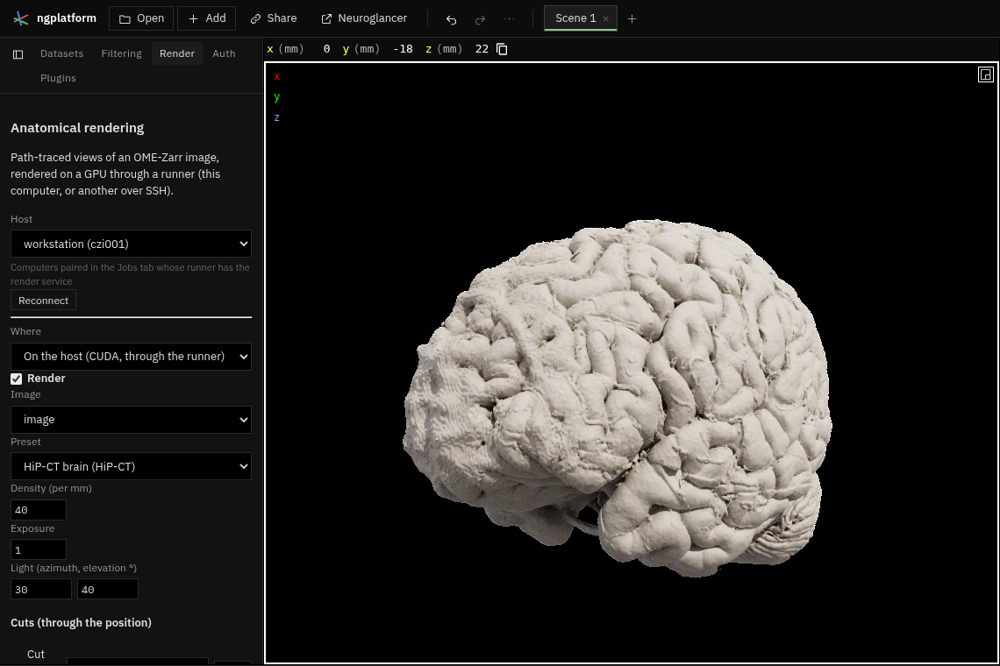

# Anatomical rendering

Path-traced views of an OME-Zarr image in Neuroglancer's 3-D view. The
rendering runs in the runner's render service (`runner/ngplatform_render`,
CUDA through CuPy) on this computer or on one reached over SSH, or in the
page with WebGPU (`local/`). The user page is
[docs/plugins/anatomical-rendering.md](../../docs/plugins/anatomical-rendering.md).

| File | What |
|---|---|
| `manifest.ts` | The Render tab, the toggle command and the state slice |
| `plugin.ts` | The tab; the session with the service for the chosen image (and segmentation); views sent from Neuroglancer's frames (half size while the camera moves, the full size a moment after it stops); the frame loop; keyframes and movies |
| `client.ts` | The service's HTTP API: through a paired host (`ctx.hosts`, `/svc/render/…`) or at an address |
| `view.ts` | Pure functions of a frame: physical mm to display coordinates, cut planes, the light's direction, a layer's OME-Zarr source |
| `draw.ts` | The frame in the 3-D view (`draw3d`): colour, and depth where each ray first meets tissue, so other layers are hidden behind it |
| `local/pathtrace.wgsl` | The path tracer in WGSL: the same method and parameters as the CUDA kernels |
| `local/local.ts` | WebGPU in the page: one level of the image (through the volume view's reader), brick bounds, presets, the progressive loop |

The parameter block both renderers read is laid out once, in
`runner/ngplatform_render/params.json`; the presets are
`runner/ngplatform_render/presets/*.json`, read by both.

## The service

`python -m ngplatform_render.server` (started by the runner with
`--service render=…`), 127.0.0.1 only, the service token from the runner:

| Request | What |
|---|---|
| `GET /info` | Its GPU and presets |
| `GET /presets` | The presets in full |
| `POST /sessions` `{volume: {url, budget?, level?}, labels?: {url}}` | Loads the image (and labels) and puts it on the GPU; `GET /sessions/<id>` says how far it is, then the level and its placement |
| `PUT /sessions/<id>/view` | A view: `inv_view_projection` (column-major), `width`, `height`, `scale`, `world_from_physical`, `unit_mm`, `preset`, `overrides`, `light`, `clips`, `labels`, `background`, `max_samples`, `aperture`, `focus`, `orbit_center` |
| `GET /sessions/<id>/frame?after=N` | The next frame after N (long poll): WebP with alpha, `X-Frame`, `X-Samples`, `X-Version`, `X-Width`, `X-Height` |
| `GET /sessions/<id>/depth` | The view's depth (GL 0..1, float16, zlib) |
| `POST /sessions/<id>/movies` `{keyframes, fps, width, height, samples}` | A movie; `GET /movies/<id>` for progress, `/movies/<id>/file` for the MP4 |

## Tests

`npm test` runs `tests/view.test.ts`; the service's are
`runner/tests/test_render.py` (levels, made levels, presets, keyframes, and,
with a CUDA GPU, the renderer and the service).
