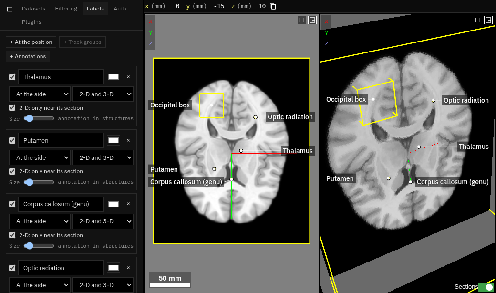
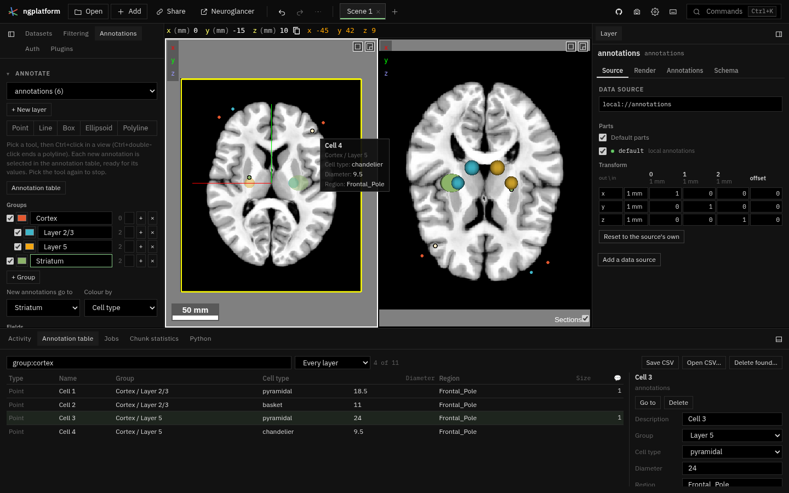

# Annotations

Everything added to annotate a dataset, in the **Annotations** tab (four
folding sections), and the **Annotation table** in the bottom dock. Label
volumes drawn by hand are the [Segmentation plugin](../segmentation/README.md).

- **Annotate**: points, lines, boxes, ellipsoids and polylines in local
  annotation layers, organised as WebKnossos and Neuroglass organise them,
  for one user: named, nested **groups** (shown or hidden, coloured),
  **fields** (a list of values, a number, text, or a term of an ontology),
  and **comments**. The **annotation table** lists every annotation of the
  scene's local annotation layers with its group, values, size and comments:
  found by a query, sorted, gone to, edited and deleted from the table,
  saved as CSV and read back.
- **Labels**: names on the views for figures, as an anatomy atlas draws
  them: a pin, a thin leader line, and the name beside it or lined up at the
  view's edge. Pinned to a point, a track group's centre (from the track
  filtering plugin's `trackFiltering.groups` service) or an annotation's
  description. Shown in 2-D, 3-D or both, dragged and resized in the views,
  painted into Neuroglancer's screenshots.
- **Measure**: lengths of Neuroglancer's line and polyline annotations,
  volumes (areas when flat, as a box or ellipsoid drawn in one section is)
  of boxes and ellipsoids, in physical units
  through each layer's transform; an image's profile along a line, plotted
  and saved as CSV. Drawing is Neuroglancer's own annotation tools, in a
  `measurements` layer this section makes.
- **Statistics**: an image's voxel count, volume, mean, SD, min, max and
  median inside a box, an ellipsoid, a label of a label volume drawn in the
  Segmentation tab, or a label of any readable segmentation layer (an atlas), read at the finest level
  that fits a memory budget (as Registration's save picks a level). Label
  volumes drawn in the Segmentation tab come from that plugin's
  `segmentation.labelVolumes` service.

It was the Labels plugin: the id (`org.ngplatform.annotations`), the tab's
id (`annotations.labels`) and the state's key (`labels`, version 1) are
unchanged, so links and docked tabs from then still open. The slice holds
the labels (`labels`) and the Annotate section's record (`annotate`).

| File | What |
|---|---|
| `manifest.ts` | The tab and the annotation table, commands, the state slice |
| `plugin.ts` | Activation; the tab's folding sections |
| `values.ts` | Fields and their values: which are annotation properties, which the plugin keeps (pure) |
| `groups.ts` | Groups: the tree, the `group` property, the shader that hides and colours (pure) |
| `ontology.ts` | Term lists: plain, OBO, JSON, a lookup table; finding a term (pure) |
| `table.ts` | The table's rows, queries, sorting, CSV out and in (pure) |
| `annotate.ts` | The scene's annotation layers and the plugin's record of them: writing both, tools, selection, new annotations, the tooltip |
| `annotate_panel.ts`, `table_panel.ts` | The Annotate section; the annotation table and its editor |
| `labels.ts` | Labels: layout (beside the pin, or callouts at the sides), the overlay, screenshots, the section |
| `geometry.ts` | Placing a grid of voxels or an annotation layer in the global space through its layer's transform; lengths in mm; a 2-D view's pixel back to a position |
| `measure.ts`, `measure_panel.ts`, `plot.ts` | Measurements and profiles (pure), the section, the profile plot |
| `statistics.ts`, `statistics_panel.ts` | Regions and summaries (pure, run in the worker), the section |
| `voxel_worker.ts`, `voxels.ts` | A worker reading images (through the volume view's reader): levels, values at points, blocks on another grid, statistics in a region |
| `scene.ts`, `ui.ts`, `style.ts` | Shared helpers (also used by the Segmentation plugin) |
| `tests/` | `npm test` runs them |

## Where annotations, values, groups and comments are kept

Annotations stay Neuroglancer's: each local annotation layer holds them in
the state (`annotations`), and the table reads and writes that list. What
the plugin adds is kept where Neuroglancer can keep it:

| What | Where | As |
|---|---|---|
| A **list** field (cell types…) | the layer's `annotationProperties`, each annotation's `props` | an enum property: `uint8` (or `uint16` past 254 values), 0 for none, 1, 2, … for the values, the values as `enum_labels` |
| A **number** field | the same | a `float32` property; 0 when not set |
| The **group** | the same, property `group` | a `uint16` enum: 0 for none, then each group's number, labelled with its path (`Cortex / Layer 5`); its `default` is the group new annotations go to |
| **Text** and **ontology** fields | the plugin's state (`annotate.layers[<layer>].values[<id>]`) | text; a term as `{id, name}` |
| **Comments** | the plugin's state (`…comments[<id>]`) | `{time, text}`, time in ISO 8601 (UTC) |
| Fields' titles and kinds, the group tree (parents, colours, hidden), the colouring | the plugin's state (`…fields`, `…groups`, `…colourBy`) | |
| Hidden groups, colours by group or value | the layer's `shader` | made here, marked by its first line, rewritten when they change |

So Neuroglancer's own panels show a list's value and the group by name, and
its shaders can use them (`prop_cell_type()`, `prop_group()`). Properties a
layer had already (from Neuroglancer, or another program) are fields too:
an enum as a list, a number as a number, a colour shown only. New
annotations take the properties' defaults, which is how a new annotation
goes to the chosen group without being written again. Changing a field's
list keeps each annotation's value by name.

An edit rewrites the layer's annotations in the state; while an annotation
is being drawn in steps (a polyline, a line, a box: the platform's
`viewer.annotationInProgress()`), edits wait and are applied, with the
annotation drawn added, once it is finished, so drawing is never cut short.

The plugin's state is the scene's (each scene keeps its own slice), keyed by
layer name; a layer renamed (in Neuroglancer or the platform) keeps its
record: the new name holding the same annotations, by id, takes it over. Values and comments of annotations deleted are dropped the
next time the layer is written. Track filtering's regions layer (`<dataset>
regions`, written from its groups) is listed and can be gone to, commented
and deleted, not edited.

An ontology field names a lookup table (`lut://…`, read when first needed:
the Allen structures are fetched from the Allen Institute) or keeps the
terms of a file with it, in the link (up to 5,000 terms). A term found by a
query is also found by the names of the structures it is within.

### The table's queries

Words a row must all match: plain text anywhere; `column:text` (contains),
`column=text` (is; `column=` is empty), `column!=text`, `column>n`,
`column<n`, `>=`, `<=`; `-word` for rows that do not match; quotes round
text with spaces. A column is named by its title without spaces or case
(`celltype`, `group`, `size`, `comments`, `type`, `layer`, `id`). `size`
compares millimetres, mm² or mm³; `comments>0` finds annotations with
comments.

### CSV

Columns: `layer, id, type, description, group, <each field>, size, unit,
comments, point, point_a, point_b, center, radii, points`. Coordinates are
the layer's own, space-separated (`points`: points separated by `;`);
comments are a line each, `time text`. Reading a CSV: a row whose layer and
id the scene has updates that annotation (description, group, values; new
comments are added); any other row with a type and coordinates is added, to
its layer when the scene has it, else to the layer chosen. Groups are made
from their paths (` / ` between groups), columns without a field become one
(a number when every value is one, a list otherwise), and lists gain the
values they lack.

### Selection and new annotations

A new annotation drawn in a layer (one id more than the state had) is
selected and the table shown. An annotation pinned in Neuroglancer's
selection (Ctrl+right-click) is selected in the table, and one selected in
the table is pinned there (in the state's `selection`, quietly: it is not an
undo step). The tooltip reads the annotation under the pointer from
Neuroglancer's layer values (`viewer.cursor().values[layer].annotationId`).

## What it uses from the platform

`ui.overlay()`, `ui.screenshotOverlay()`, `ui.showPanel()`, `ui.form()`,
`viewer.panels()`, `viewer.lookupTables` (ontologies),
`viewer.onRendered()`, `viewer.cursor()` (and the annotation under the
pointer), `viewer.layerTransform()`, `viewer.patchState()`, `services`
(`segmentation.labelVolumes`, when the Segmentation plugin is on), `jobs`,
`settings`.

The worker (`voxel_worker.ts`) reads through the volume view's reader
(`../volume-view/volume_reader.ts`); the Segmentation plugin uses it too.
