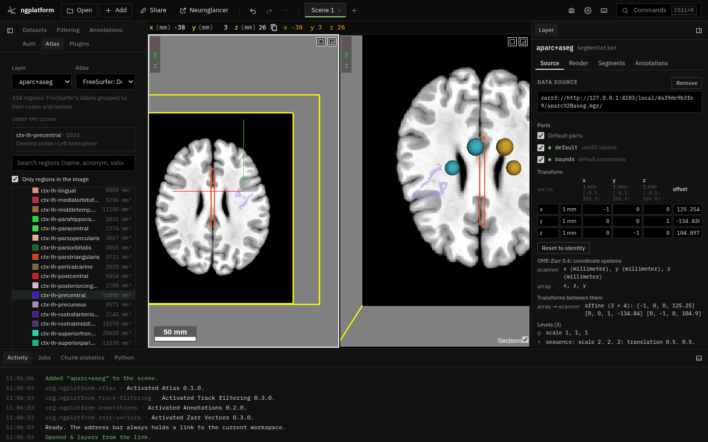

# Atlas

A segmentation's regions as a tree, from its lookup table: search a region,
show it with all its descendants, go to it, read the region under the
cursor with its path, and each region's volume. Off by default.

| File | What |
|---|---|
| `manifest.ts` | The Atlas tab |
| `plugin.ts` | The tab: the layer and its table, the region under the cursor, the tree, the chosen region's actions, volumes and the CSV |
| `hierarchy.ts` | The tree a lookup table makes (`Atlas`): paths, descendants, search, totals per region |
| `labels.ts` | Passes over a label volume chunk by chunk: each label's count, position sums and bounds; a region's voxel nearest a point |
| `label_worker.ts`, `label_client.ts` | The worker running those passes through the volume view's `VolumeReader`, and its main-thread side |

## The table and the tree

The atlas is the layer's lookup table, which the platform keeps as a
`lut://` source of the layer (Render → Lookup table; see
[`data/lookup-tables/`](../../data/lookup-tables/README.md)). The tab reads and
sets it through `ctx.viewer.lookupTables` (`catalogue`, `load`, `of`,
`apply`), so a table chosen here is the layer's table: its colours become
the segment colours and its names show in the Segments tab and on hover.

`Atlas.fromTable` makes the tree:

| Table | Tree |
|---|---|
| With parents: the Allen structure graph (`lut://AllenCCF2017`, fetched from api.brain-map.org when chosen, read once a visit) | Its own hierarchy. The core parser (`src/core/lookup_table.ts`) gives each structure its `parent`; full names show with acronyms. |
| FreeSurfer's (any table with aseg's or aparc's names) | Grouped by code and name: cerebral cortex (1000–2999, 11000–12999, and aseg's cortex), cerebral white matter (3000–4999, 5001–5002, 13000–14999, white matter, hypointensities, corpus callosum), subcortical grey matter, cerebellum, brain stem, ventricles and CSF, other; each split into left and right hemisphere by code or name (`Left-`, `ctx-lh-`, `wm_lh_`…), labels on neither side directly under the group. |
| Schaefer 2018 (`<N>Networks_<LH/RH>_<network>_…`) | Hemisphere, then network. |
| Any other (Harvard-Oxford, Yeo, AAL, a file) | Flat, in the table's order. |

Groups the table does not number (FreeSurfer's "Cerebral cortex") have no
value; a region's segments are its own value and its descendants'. A table
from a file travels in the link as names, descriptions and parents
(`lut://inline/…`, its parents as `#parents` lines), so an Allen structure
graph loaded from a file keeps its tree when the link is opened.

## Showing and going to a region

**Show only** sets the layer's `segments` to the region's values (as one
undo step, kept in the link); **Add** adds them to those listed; **Show
all** removes the list. **Go to** moves to the region's voxel nearest its
centre (the centre of a region on both sides is on the midline, outside
it): the mean position of its voxels from the counts, then a second pass
over the chunks within the region's bounding box for the nearest voxel of
its labels. Voxels are placed through the layer's transform with
`placement` from the Annotations plugin's `geometry.ts`.

## Counting

When a layer and its table are chosen, the label image is read once in a
worker, at its finest level of at most 64 M voxels (2^26), as a job in the
Jobs tab: per label, its voxel count, the sums of its voxels' x, y, z and
its bounds. Runs of one label along x are added at once. Volumes are counts
times the level's voxel volume (the determinant of its voxel-to-RAS
matrix); a region's volume includes its descendants'. **Save CSV** writes
every region: value, acronym, name, path, voxels and mm³ of its own, and
with its descendants.

The reader is the volume view's `VolumeReader`: OME-Zarr (uint64 labels as
32-bit), NIfTI and MGH read as virtual Zarr, and precomputed segmentations
(raw or compressed_segmentation, uint32 or uint64, sharded or not, read as
32-bit), which this plugin added to it, with `eachRawChunk` (a level's own
values chunk by chunk). Labels past 2^32 are refused.

The region under the cursor is Neuroglancer's selected value for the layer
(`ctx.viewer.cursor().values`), looked up in the tree.

## Tests

`tests/hierarchy.test.ts`: the Allen tree from a 22-structure excerpt of the
structure graph (`tests/fixtures/allen_structure_graph.json`, from
`structure_graph_download/1.json`; Allen Institute data, used under its
terms of use for non-commercial research), paths, descendants, search,
totals; FreeSurfer's grouping on the bundled tables; Schaefer's; a flat
table. `tests/labels.test.ts`: counting and the nearest voxel on a small
volume, chunk by chunk in another array order, and through the reader on a
NIfTI (ids past 2^24) and a precomputed uint64 segmentation.
