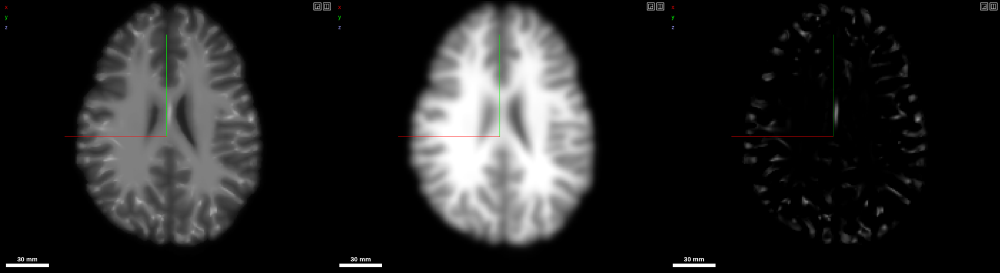

# Filters

Any image filtered as it is viewed, as a layer of its own: a pipeline of
steps (Gaussian, mean, median, difference of Gaussians, Frangi's
vesselness, threshold, morphology) run by
[chunkmirage](https://github.com/JaneliaSciComp/chunkmirage)'s browser
engine in the page. Nothing is written. Each chunk Neuroglancer asks for is
the pipeline run on the image's voxels around it, at the level shown, so a
zoomed-out view is a preview; chunks the viewer stops waiting for are
dropped. The image can be any 3-D image layer (one channel, one time
point): a file on this computer, or an OME-Zarr, N5 or precomputed volume
at a URL. The new layer's source carries
the whole pipeline, so its link works wherever the image can be read.

| File | What |
|---|---|
| `manifest.ts` | The Filters panel |
| `pipeline.ts` | Steps as chunkmirage ops, their sizes within `LIMITS` (no step reads more than half a 64-voxel `CHUNK` around each chunk): its own (`gaussian`, `uniform`, `dog`, `threshold`, `morphology`), median and Frangi as `python` ops (SciPy, scikit-image) whose code is the plugin's, their settings as the code's sliders and their `#halo` set from them, and a Python step of one's own (the code as written); ops back to steps (`stepsOf`), and steps read back from the workspace (`readSteps`) |
| `plugin.ts` | The panel, built from the SDK's cards and controls and updated in place: an image (3-D images only, `unfilterable` saying why the others are not offered), a card per step, **Add filtered view**. The new layer is shown as the image when the steps keep its values, in a range of its own for vesselness and a difference of Gaussians (`displayOf`). With a filtered layer selected, its steps are shown and **Update the view** points that layer at the new steps (one undo step). The image and steps are kept in the workspace (`appState` `filters`), so a reload, undo or link brings them back; a link without them reads the steps of its newest filtered layer |
| `tests/pipeline.test.ts` | Steps to ops and back, and their limits |
| `tests/plugin.test.ts` | The images offered, how a layer is shown, and the panel: empty state, controls, adding, tuning in place |

The engine is the platform's (`workspace.computed`, `src/virtual/computed.ts`).
A file on this computer (NIfTI, MGH, NumPy, TIFF) is read through its
store's z, y, x view (`src/virtual/images/zyx.ts`), as chunkmirage reads
only images whose last axes are z, y, x, and the filtered layer is placed
by the file's own affine.
Sizes are in voxels of the level computed (chunkmirage runs each level's own
voxels), not millimetres kept from level to level as the earlier filters
were; old `.vfilter` layers still open.
