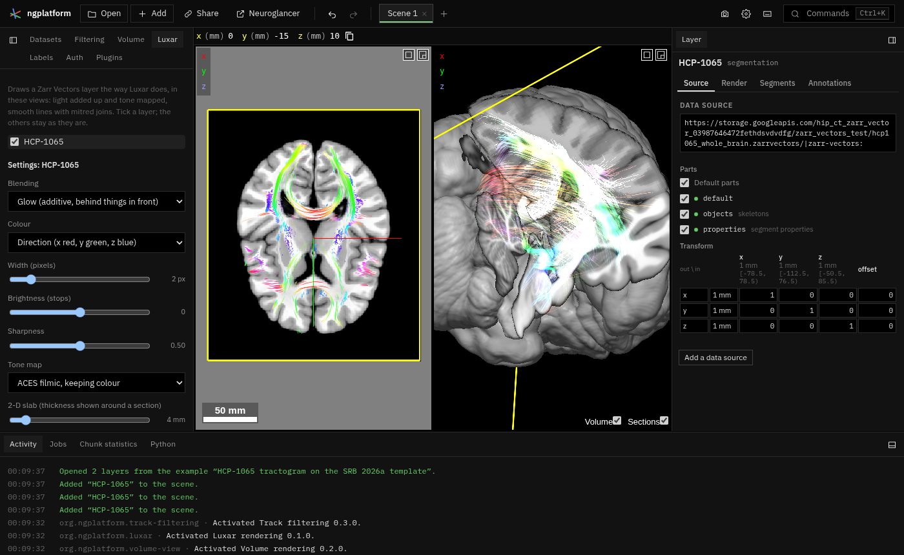

# Luxar rendering

Draws chosen Zarr Vectors layers the way the [Luxar](https://github.com/royerlab/luxar)
viewer draws lines and points (light added up in HDR and tone mapped,
smooth thick lines with mitred joins, emission and absorption) **inside
Neuroglancer's own 2-D and 3-D views**. One viewer: the Luxar look is
switched on per layer, and everything else in the scene (the image under a
tractogram, plain or volume rendered, annotations, other layers) is drawn
by Neuroglancer as before and composited with it.

It reads the data in place: multiscale Zarr Vectors stores, the files
the platform serves as Zarr Vectors stores (`.trk`, `.tck`, `.trx`, SWC,
point tables), and a precomputed segmentation's meshes, presented as a Zarr
Vectors mesh store (below). Nothing is converted and no files are written.

| File | What |
|---|---|
| `manifest.ts` | The Luxar panel, its commands, context key and state slice |
| `plugin.ts` | The panel (cards from the SDK's parts, updated in place); which layers are drawn; setting Neuroglancer's own drawing of them aside |
| `layer_view.ts` | One layer drawn Luxar-style: its worker, its 3-D and 2-D drawing, the uniforms from its style |
| `view3d.ts` | The 3-D view, through `viewer.draw3d`: the float target, tone mapping, depth |
| `view2d.ts` | The 2-D views, on a canvas over them (the platform's overlay), with each panel's camera |
| `render_gl.ts` | WebGL2: the line and point shaders, upload, the tone-mapping composite |
| `mesh_gl.ts` | A mesh's shaders: lit triangles in 3-D, the outline where the section cuts them in 2-D |
| `bloom.ts` | Bloom: the bright pass and the separable Gaussian blur at three scales |
| `chunks.ts` | Levels of detail and which chunks a view reads and draws; the per-context GPU cache |
| `client.ts`, `luxar_worker.ts` | Reading a store's chunks with the Zarr Vectors reader, in a worker; and a layer's chosen objects whole, by id (`ObjectReader`) |
| `objects.ts` | Whether a layer's chosen objects are read whole (`objectPlan`), in which batches, and what has been read, by object (`ObjectSets`) |
| `chunk_build.ts` | A decoded chunk made ready to draw: a vertex texture, (previous, start, end, next) segments, and each vertex's object as a slot in the chunk's list of objects; objects read whole built the same way, their segments sorted into pieces of space |
| `segments.ts` | Which of a chunk's objects show, how strongly (the others at the layer's notSelectedAlpha) and their colours: the table the shaders look each vertex's object up in |
| `sources.ts` | Which of a layer's sources it draws (a source with its parts off draws nothing) |
| `mesh_layers.ts` | Segmentations with precomputed meshes: whether a volume has them, the virtual mesh store's URL for the segments a layer shows, and which segments it holds |
| `precomputed_meshes.ts` | Reading a segmentation's precomputed meshes (manifests, sharded or not; fragments; Draco) as a virtual Zarr Vectors mesh store, in the worker; the store itself is `../zarr-vectors/src/virtual/precomputed_meshes.ts` |
| `view_math.ts` | Matrices, frustum and slab tests, level choice |
| `camera.ts` | Optional momentum on rotating the 3-D view |
| `style.ts` | The per-layer style kept in the workspace |
| `fork/draws-after-sections.patch` | A proposed Neuroglancer change (not applied): layers that draw after the 3-D view's sections |
| `tests/` | `npm test` runs them |

## Why a renderer in Luxar's style, not Luxar's viewer

Luxar's viewer (`@luxar/viewer`) is a three.js application that reads only
its own compiled `.luxar.zarr` archives, draws only in 3-D, and owns its
canvas and camera. Using it would mean a second viewer beside Neuroglancer
(what the user did not want) and converting the data first. Its rendering
ideas are small enough to carry over instead, so this plugin is a renderer
in Luxar's style working inside Neuroglancer's frame, reading Neuroglancer's
data formats directly:

- **Lines** are one instanced quad per segment, widened in screen space to
  a width in pixels. At a joint between two segments the quad's end edge is
  turned onto the mitre line (where the two segments' offset edges meet),
  so the quads tile with no wedge on the outside of a bend and no
  double-bright lens inside it. Both segments compute the mitre from the
  same three projected points, so they agree exactly. Past a 120° turn
  both square off, as Luxar's mitre limit does.
- **The cross-section** is Luxar's shifted, truncated super-Gaussian:
  `max(exp(-K p^β) - C, 0) / (1 - C)`, `K = ln 100`, `C = 0.01`,
  `β = 2^(6s - 2)` for sharpness `s` (0.5 is a Gaussian, 1 a hard edge).
  Points are round sprites with the same profile. A line thinner than
  1.5 px is drawn that wide and dimmer, so its light is kept.
- **Blending**: *glow* adds light in a float (RGBA16F) target and tone maps
  it (ACES filmic on the brightest channel, keeping the colour where many
  lines add up, the default; ACES per channel, as three.js does, which
  turns bright light white; Reinhard; or a clamp), Luxar's "luminous" (depth-tested)
  and "additive" (over everything) modes; *emission and absorption* adds
  emission and optical depth in the same target and composites with
  Luxar's self-screening `(1 - e^-τ)/τ` and transmittance `e^-τ`. Luxar
  sorts lines back to front for this; adding both terms up is the
  order-independent approximation, which needs no sort and is exact where
  bundles do not overlap in depth; *solid* draws opaque, shaded tubes.
- **Colour** by direction (RGB of |tangent|, in the layer's physical x, y,
  z, smoothed across joints), by object (a hashed hue per object id), by a
  vertex attribute through a colormap (viridis, magma, inferno, plasma,
  turbo, grey; polynomial fits), or one colour.
- **2-D views**: Luxar slices the dimensions it does not show by
  proximity. Here a 2-D view shows the lines within half the slab's
  thickness of its section, fading with distance (the same 1% Gaussian
  window), the thickness being a per-layer control. It follows the
  data's size unless set (`style.autoSlab`: a fortieth of the store's
  mean extent in millimetres, from its bounds, scales and units, to one
  significant figure: 4 mm for a human brain's tractogram, tens of µm
  for EM in nanometres), and its slider reads in the unit that suits
  (`style.slabScale`: mm, µm or nm). The state keeps a slab set, in mm;
  a style saved before (`readSaved` without `version: 2`) with the old
  default of 4 mm follows the data.

`@luxar/viewer` is not a dependency: nothing of three.js is bundled.

### Meshes

A Zarr Vectors `mesh` store (a surface) is drawn from the reader's dense
chunks, whose faces include those reaching into a neighbour chunk (their
corners there as copies). Each chunk keeps its triangles and a normal per
vertex (the area-weighted mean of its faces' in the chunk), an RGBA32F
texture beside the vertex texture (`chunk_build.ts`, `mesh_gl.ts`). The
faces that span chunks are found only by listing the store's link arrays,
so the worker reads with listing on (`httpAccess(url, { listing: true })`
in the Zarr Vectors reader: a Cloud Storage bucket's JSON API, or the
HTML index a server or the app's local data gives for a directory); where
a server gives neither, those faces are missing and the surface shows
gaps along chunk faces.

- **3-D**: each triangle drawn (two-sided) and lit by a light at the eye
  (the eye found from the view's matrix: the point it maps to clip
  x = y = w = 0, or for an orthographic view, the direction it looks
  along). *Glow* adds `0.2 + 0.6 f + 0.6 (1 - f)^3` of the colour (`f`
  how squarely the surface faces the eye: lit, with a rim where it turns
  away) into the same float target as lines and points, tone mapped and
  depth-tested the same way, so the surface reads as a lit, glowing shell
  and other Luxar layers composite with it. A folded surface would add
  every fold up: through FreeSurfer's `lh.white` a ray crosses ten to
  twenty layers, each adding 0.2–0.8 of the colour, and the hemisphere
  turned into one saturated blob (automatic brightness, counting the
  surface's area over the view, dimmed it by about half, far from
  enough, and evenly, where the folds are uneven). So in glow a mesh
  layer is first drawn into a depth texture of its own (the nearest
  surface at each pixel), and each fragment's light is then multiplied by
  `e^(-d/L)`, `d` its distance (store units) behind that surface (the
  pixel's depth taken back through the inverse of the view's projection),
  `L` the *Glow depth* times the diagonal of the layer's bounds (2 % by
  default: 4.4 mm for a 220 mm hemisphere). The nearest surface keeps all
  its light, a fold 1.5 mm behind it 70 %, one 10 mm behind 10 %; layers
  spaced `s` apart add up to at most `1 / (1 - e^(-s/L))` (`layeredLight`
  in `view_math.ts`), so the light at a pixel stays near one surface's
  however deep the folds (it is the per-pixel coverage, weighted by depth,
  rather than a gain for the whole view). The surface's area no longer
  counts in automatic brightness then. Glow depth 0 is the old sum. The
  depth pass costs a second draw of the triangles; *emission and
  absorption*
  also absorbs `absorption / max(f, 0.2)` (a longer path through a surface
  seen edge on); *solid* draws it opaque (`0.25 + 0.75 f`, a highlight),
  depth-written, into the view. Colour by direction is by the normal.
  Automatic brightness counts a surface's area on screen (half of it,
  seen at all angles), except in glow with a glow depth, where the fade
  above keeps the light.
- **2-D**: each triangle the section cuts is drawn as the segment where it
  crosses (one instanced quad per triangle, as Neuroglancer draws a mesh in
  a section), the layer's width across, with the line's cross-section:
  the surface's outline, glowing.

The layer's chosen segments and colours apply as for lines.

### A segmentation's precomputed meshes

A precomputed segmentation whose `info` names a `mesh` directory (an EM
segmentation such as MICrONS') is listed in the panel by its name.
Switched on, the
layer is drawn from the meshes of those segments, through the mesh path
above, and Neuroglancer's own drawing of it (its meshes and its 2-D
segmentation) is set aside as for any layer drawn here. Nothing is
converted: the meshes are presented as a virtual Zarr Vectors mesh store
(`../zarr-vectors/src/virtual/precomputed_meshes.ts`) made in the layer's
reading worker from the precomputed files as they are read
(`precomputed_meshes.ts`); its URL, `precomputed-meshes:<volume>#segments=…`,
names the volume and the segments.

- **Opening** reads the volume's `info` (the mesh directory, the finest
  scale's resolution), the mesh `info`, and each segment's manifest:
  `<id>.index`, or a sharded directory's entry for the id
  (`neuroglancer_multilod_draco`, sharded or not), or `<id>:0` (legacy).
  No geometry is read.
- **Levels**: store level *i* is level of detail *first + i* of the
  meshes (a segment with fewer levels gives its coarsest to the coarser
  ones), so Luxar reads the coarsest first and finer ones as its Detail
  allows. The finest kept is the finest whose fragments come to about
  8 M vertices or fewer over the segments (`VERTEX_BUDGET`, estimated
  from their encoded sizes at 0.4 vertices a byte, as MICrONS measures). A
  legacy mesh is one level, read whole at opening (at most 256 MB).
- **Cells**: each stored fragment (an octree node) goes whole to the cell
  of its level holding its box's centre (cells a power of two at least a
  node across), one vertex fragment and face group per segment per cell,
  as the app's large-mesh store lays them out, with no cross-cell links. A
  cell's fragments are read (a byte range of the data file or shard) and
  decoded (Neuroglancer's Draco decoder) when the cell is first read.
- **Place**: a fragment's positions are dequantized as `meshes.md` says,
  taken through the mesh `info`'s transform to nanometres, then over the
  finest scale's resolution: the volume's voxels, Neuroglancer's space for
  the layer's source, so the layer's own transform places them.
- **Segments**: the store holds the segments shown when it was made, with
  the segmentation's ids; letting a segment go only hides it (the layer's
  table), and showing one it lacks makes a new store, which takes over
  from the old one once it has what it wants to draw (as below for a
  track-filtering group's new store). At most 2,000 segments: with more
  shown, the panel says so under the layer (*Showing 2,000 of 14,203
  segments*). With none
  chosen, nothing is drawn: a segmentation's every mesh is not read.

On MICrONS' v1300 (four cells, multi-resolution Draco, sharded) the four
levels of detail estimate 18.7 M, 5.6 M, 1.1 M and 0.3 M vertices, so the
store keeps levels of detail 1 to 3; opening reads the four manifests in
about 1.5 s, and a cell of level of detail 3 about 0.3 s.

### How it sits in Neuroglancer's frame (3-D)

`viewer.draw3d` calls the drawer in the 3-D panel's opaque pass, with
Neuroglancer's offscreen framebuffer bound. The drawer:

1. reads the framebuffer's depth-stencil renderbuffer and attaches it to a
   float target of its own, so lines are depth-tested against everything
   drawn before them (a volume-rendered solid, meshes) without writing it;
2. adds the lines' light up there, and draws the lines once more into a
   depth texture of its own: the nearest line at each pixel;
3. tone maps the light onto Neuroglancer's colour output (colour
   attachment only, so pick ids are untouched);
4. where the tone-mapped light is clear (15 % or more), writes the nearest
   line's depth into Neuroglancer's depth buffer and its depth output (pick
   id 0), so the sections Neuroglancer draws after the opaque layers do not
   paint over lines in front of them, and the pointer's 3-D position lands
   on the lines; faint glow writes none;
5. puts back every piece of GL state it changed.

The image underneath is Neuroglancer's (sections, or the volume-view
plugin's solid, which writes depth): the tractogram composites on it.

**The sections.** Neuroglancer draws its cross-sections in the 3-D view
*after* the opaque layers, and `draw3d` draws with the opaque layers. So
where lines are in front of a section, the section is kept out by their
depth, and the lines show over the background rather than over the
section: bright where lines crowd, but a dim line over a pale section
reads as a dark streak. With **Sections** off in the 3-D view (common for
tractography) this does not arise. The proper fix is in Neuroglancer: let
a layer draw after the sections, so light adds over them. That is
[`fork/draws-after-sections.patch`](fork/draws-after-sections.patch)
(against the fork's `src/perspective_view/`, 30 lines: a
`drawsAfterSections` flag on render layers, drawn right after
`drawSliceViews`, with `renderContext.sectionsDrawn` set). The platform
side is already here: `Drawer3d.afterSections` (this plugin sets it) and
`Frame3d.sectionsDrawn`; with an unpatched Neuroglancer the flag is
ignored and nothing changes. Built against a patched copy, the glow adds
over the sections as in the 2-D views.

### How it sits over the 2-D views

There is no SDK hook to draw inside a 2-D panel, so the plugin draws on a
canvas over the views (`ui.overlay()`), after each frame Neuroglancer draws
(`viewer.onRendered`). A panel's camera is measured through `panels()`'
`project`: its map from global positions to pixels and depth is affine, so
four projections give it exactly. The canvas is blended over the views
with CSS `mix-blend-mode: plus-lighter` for glow (light added to the image
beneath, as in 3-D) and normally for emission and solid. Screenshots get
the canvas painted in (`ui.screenshotOverlay`).

### Levels of detail

As Neuroglancer's own dense layer does: the view reads the finest level
whose chunks in view hold about the *Detail* budget of vertices (vertices
taken as spread evenly over a level's chunks), and only the chunks in view
(the frustum in 3-D; the slab around the section in 2-D), nearest the
view's centre first. The coarsest level's chunks in view are read first so
something shows at once, and stand in for a finer chunk until it arrives
(the finest coarser level that has all of its box). Chunks are read with
`LevelPipeline.download(…, { bridges: true })`, so lines continue across
chunk faces. Built chunks are kept on the main thread (384 MiB) and on each
GPU context (768 MiB for 3-D, 512 MiB for 2-D), least recently drawn first
out.

### Brightness

Light that adds up depends on how many lines there are: a whole brain at a
fine level turns white, and coarse levels of a tractogram (which keep a
sample of the streamlines, `object_sparsity`, a tenth per level in the
HCP-1065 store) look dim. *Automatic brightness* (on by default) measures
how many times over the drawn lines would cover the view (their length on
screen, from each chunk's total segment length and the view's pixels per
unit, times their width, over the view's area; for a 2-D view, times the
slab's share of a chunk's depth) and dims each line by
`1 / max(1, cover)`. So a dense view glows where bundles gather,
a sparse one is left alone, and the picture keeps about the same
brightness as levels come and go. A correction by each level's share of
the objects was tried first: it makes a sparse sample's few lines glare.
*Brightness* is in stops on top.

### Bloom

Luxar's glow around bright light (*Bloom*, an amount per layer, 0 is off,
the default; lines, points and splats, in the 3-D view and the 2-D views).
After the light is added up in the float target and before it is tone
mapped (`bloom.ts`):

1. a bright pass keeps what is brighter than 1 (light the tone map shows
   at about 0.8), with a soft knee from 0.5 to 1.5 so the glow fades in;
   with emission and absorption, of the light as it is shown (screened by
   its own absorption); it is taken at half the view's size (each pixel
   the mean of four);
2. it is blurred by a separable Gaussian (sigma 2 pixels, 13 taps, across
   then down) at half, a quarter and an eighth of the view's size, each
   scale made from the one before: glows of about 4, 8 and 16 pixels;
3. the composite adds the mean of the three scales (read with bilinear
   filtering), times the amount, to the light, then tone maps.

So a bright bundle bleeds light into what is around it, the wider the
brighter. In the 2-D views the blur runs over the whole canvas, so a
panel's glow can reach a few pixels into the next. Solid tubes have none.

### Setting Neuroglancer's own drawing aside

While a layer is drawn here, Neuroglancer's drawing of it is hidden
(`viewer.hideLayerDrawing`): the engine shows its segments as a temporary
set naming no object. Neuroglancer then neither draws the layer's overview
nor reads chunks for it (the dense layer reads nothing when nothing it
would draw is visible), and temporary sets are not saved: a link with
Luxar layers opened without this plugin shows the layers drawn by
Neuroglancer. The layer itself stays visible, which keeps the 3-D drawer
(a render layer of that layer) drawing; hiding the layer hides both.

The layer's *notSelectedAlpha* is kept at 0 meanwhile: with it above 0,
Neuroglancer draws every object not in the visible set faintly, and the
set that hides the drawing names no object. The engine keeps the value
the layer had (`visibleSegments(…).notSelectedAlpha` reports it, a change
to it while hidden is kept as the new value, and the link saves it), and
puts it back when the drawing is shown again.

### The layer's chosen segments

What the layer shows is drawn, as Neuroglancer would draw it: every object
when no segment is chosen (and the layer's *ignore null visible set* is on,
the default), else only the chosen segments. The engine keeps the set
apart from its hiding (`viewer.visibleSegments`): the layer's own
`segments`, or a temporary set another plugin gives
(`setTemporaryVisibleSegments`, as track filtering does for a group), which
the engine keeps while the drawing is hidden and puts back when it is shown
again.

#### A few chosen objects are read whole, by id

Reading the spatial chunks that hold a few chosen objects reads far more
than is shown, and coarse levels of a tractogram hold only a sample of the
objects (S-21-46 and HCP-1065 keep a tenth per level), so zoomed out most
of the chosen ones are missing. A Zarr Vectors store's object index says
where each object's vertices are, so when a layer chooses few enough
objects they are read themselves, whole, at full resolution, and drawn
instead of chunks (`objects.ts`, in the worker the reader's
`ObjectReader`, as the Zarr Vectors plugin reads a selected object's
skeleton):

- **Which way** (`objectPlan`): the chosen objects are read whole when
  there are at most 100 000 of them (2 000 when they are read one at a
  time, below) and their vertices, estimated as the level's vertices over
  its objects (each level's `object_index` says how many), are at most
  four times the *Detail* (8 M vertices at the default 2 M). Once 256 of
  them have been read, their own mean is used instead of the level's (a
  bundle of long streamlines has far more than the mean), with up to
  twice that budget, so a selection does not switch back and forth; past
  it the chunks are read. They are read
  from the finest level that holds every object (level 0, unless a coarser
  level keeps every object and only simplifies them); a level that keeps a
  sample of the objects is never used. Otherwise (more objects, or every
  object shown, or a mesh, or a store without an object index) the chunks
  are read as below.
- **How**: streamlines (`implicit_sequential` lines) many at a time,
  `readCurves` (the object index's manifests, then for each chunk the rows
  of every fragment any of them has there, coalesced); other lines and
  points one object at a time, `readSkeleton`, which also gives vertex
  attributes (so streamlines coloured by a vertex attribute go this way
  too).
- **In batches**: the objects not read yet, in ascending id order (rows of
  the object index together, so its chunks are read about once), 256
  first so something shows at once, then 4 096 at a time, at most two
  batches asked for at once, so a new selection is not stuck behind the
  old one's queue. Each batch's answer is built as one chunk
  (`curvesInput` / `skeletonsInput`, then `buildChunk`), its own object
  table and colours as above.
- **Kept by object** (`ObjectSets`): each object read knows the set it is
  in. When the selection changes, only the objects not read yet (and not
  found missing) are asked for; those no longer chosen are left out by the
  sets' tables, and a set none of whose objects is chosen is let go when
  more than 512 MiB is kept. Another level or another vertex value (the
  colouring) drops them all.
- **2-D slab culling**: a set's segments are sorted into pieces of space
  (`sortIntoPieces`: a grid over the set's bounds, cells about half a
  level-0 chunk, at most 16 a side; the vertices are not moved, so lines
  stay joined), and a view draws only the pieces in its frustum, which in
  a 2-D view is the slab; the vertex shader still drops what is outside
  it.
- **Drawn within the Detail**: up to four times the Detail is read, but a
  view draws about the Detail. Within each piece the segments are ordered
  by their object's sample (the hash of its id in eight parts), so the
  first k samples of every piece are the same k eighths of the objects,
  whole; a view whose pieces in view hold more segments than its Detail
  (the 3-D view zoomed out on a big group) draws that share of them, at
  least an eighth. Raising the Detail draws more without reading again. A 2-D
  view counts the segments of its pieces in the slab times the slab's
  share of a piece's depth, so it rarely samples.
- **Brightness**: automatic brightness dims the sets by their own cover
  (for a 2-D view, the slab's share of the set's depth), so the chosen
  objects are not dimmed by faint others drawn with them.

The panel's status line says how far it has got (*Reading the chosen
objects: 256 of 781…*) and is hidden once they are read.

#### Many chosen objects: the chunks, and their tables

Each built chunk lists its objects, and each vertex names its object by a
slot in that list (an R32UI texture beside the vertex texture). For what
the layer shows now, each chunk gets a small RGBA8 table, one texel per
object: how strongly it is drawn (alpha: 1 chosen, the layer's
notSelectedAlpha for the others, 0 not at all), and the object's colour
as Neuroglancer colours it (a colour chosen for it, the layer's default
colour, or the hash of its id with the layer's seed, and the layer's
saturation; *Colour: the layer's segment colours*). The line, point and
mesh shaders look the vertex's object up, drop what is not drawn and scale
the light of the rest by its alpha. Tables are made again when the
segments, colours or notSelectedAlpha change (`viewer.onSegmentsChanged`),
not the chunks. A chunk none of whose objects is drawn is not drawn.
Automatic brightness counts only the share of a chunk's lines that shows,
each at its alpha.

Coarse levels of a tractogram hold a sample of the streamlines, so few of
the chosen ones may be in them. A view showing a share of the objects
reads more vertices (the Detail over that share, at most four times the
Detail), which picks a finer level; the share is the least it has seen for
these segments, so the level settles.

#### The others, faintly (notSelectedAlpha)

When some objects are chosen and the layer's *notSelectedAlpha*
("Opacity (off)" in the layer's Render tab, Neuroglancer's opacity of the
segments not selected) is above 0, the others are drawn too, as
Neuroglancer draws them: their light times that alpha. With the chosen
objects read whole, the chunks are read for the others alone (their
tables leave the chosen ones out, which the sets draw), at the Detail;
otherwise one table holds both. *Solid* tubes are opaque, so the faint
others are left out there.

### Track filtering's groups

A group is a segmentation layer of its own, in the group's colour (its
`segmentDefaultColor`). Switched on here, it is drawn in that colour (a layer
whose segments have colours of their own starts with *Colour: the layer's
segment colours*), and:

- until track filtering has made the group a store of its own, from the
  dataset's store, showing only the group's streamlines (track filtering
  gives them as the layer's temporary set, by id), read whole by id when
  there are few enough (above);
- once it has (streamline groups get one a moment after their exact
  answer), from that store, whole. The layer then keeps the dataset as a
  first source with its parts off (for its segment properties); a source
  whose parts are all off draws nothing, so the store drawn is the
  group's own (`sources.ts`).

Each new answer is a new temporary set, which the engine keeps behind the
hidden drawing, so Neuroglancer's own drawing of the group stays hidden.

**From one store to the next** (`plugin.ts`): when a layer's store
changes, its view of the store before keeps drawing what it drew (frozen:
the group's streamlines, even though the layer now shows every object of
its new store), and the new store's view reads without drawing (*held*)
until it has all it wants for its views, then takes over. When the view
before drew chunks, the new one takes over after 30 s whatever it has;
when it drew the chosen objects whole, by id, it stays until the new one
has read everything (what it draws is right meanwhile). A big group's
first store of its own is a sample of its streamlines (track filtering's
preview, from a sample level); a store with fewer objects than the view
before drew whole never takes over, and is dropped, unseen, when the
group's whole store comes.

### Momentum

*Momentum when rotating the 3-D view* (off by default) measures the
orientation Neuroglancer's own drag gives in the last tenth of a second
before release and keeps turning, damped as Luxar's orbit controls are (a
quarter of the speed lost per 60 Hz frame). Any press, wheel or key stops
it. It is kept inside this plugin and switchable, so it can give way to
momentum in the engine.

## What is left

- **Meshes**: normals are per chunk (the faces in it), so where a surface
  crosses a chunk face the shading can show a faint seam, as Neuroglancer's
  own drawing of the chunks does; the surface is not sorted, so emission
  and absorption is the order-independent sum, as for lines; nothing of a
  mesh is picked (the pointer's position lands on it, no vertex values).
- **Chosen objects read whole** are read at one level whatever the zoom:
  the finest that holds every object, which for the tractograms here is
  level 0 (their coarser levels are samples of the objects); the vertex
  budget bounds how many.
  Meshes are never read by id (their chunks are). A selection larger than
  the budget is drawn from chunks, as before, with what that means at
  coarse levels.
- **Faint others** (notSelectedAlpha) are left out of *Solid* tubes, and
  their light simply scales; Neuroglancer blends them as transparent
  surfaces.
- **Free line ends** are square: Luxar's soft cap would need to know which
  chunk-boundary ends continue in the next chunk (the reader's
  `linkedVertices`), or caps would brighten every chunk face.
- A 2-D view reads whole chunks for a thin slab, so it reads (and draws,
  though the vertex shader drops what is outside the slab at once) many
  more lines than show. A store chunked finer, or reading only the
  vertex rows near the plane, would cut that.

## Gaussian splats

An image layer with Luxar on is drawn as Gaussian splats in place of
Neuroglancer's own drawing of it, in the 3-D view and the 2-D views. The
splats are made from the voxels as they are read, not fitted: each 32³
block of a level is cut into cells of 4³ voxels, and each cell above the
threshold becomes one Gaussian with the cell's moments (centre, covariance)
and its intensity as the weight (`splats.ts`, in `splat_worker.ts`). Each
level of the image's pyramid gives its own, so a file read in place (a
TIFF as virtual Zarr) is splatted at every resolution.

- **3-D** (`splat_view.ts`): each splat an instanced quad, its covariance
  projected through the view's Jacobian (EWA), light and optical depth
  added in a float target (no depth sort), tone mapped onto the view.
- **2-D** (`splat_view2d.ts`): each splat cut by the section (the
  conditional Gaussian: its peak there, its centre and covariance in the
  plane), widened three times in area with its total kept so the cells read
  as one image, and clamped rather than tone mapped, so a section shows the
  image's own values (on the SRB template, 0.99 of Neuroglancer's drawing).
  Only blocks within a slab around each section are read.
- Neuroglancer's drawing of the image is hidden while its splats are on
  (`viewer.hideLayerDrawing`: its opacity 0, not saved in the link), and
  the 2-D views' background is black (`viewer.setTemporaryBackground`), as
  under the image.

Fitted splats (Luxar's `luxar fit`, which optimises the Gaussians against
the voxels on a GPU and writes a new archive) would be sharper at the same
count; that is an offline step that makes new files, not done here.

## Credits

The line cross-section, mitre limit, blending modes, emission–absorption
screening and camera damping follow Luxar's viewer
(<https://github.com/royerlab/luxar>), BSD 3-Clause License, Copyright (c)
2024-2026, Loic A. Royer and Luxar Contributors. The shaders here are
written for this plugin (no Luxar source is copied); the constants (the
1% floor, `K = ln 100`, `β = 2^(6s − 2)`, the 120° mitre limit, the 0.75
damping per frame) are Luxar's. The colormap polynomials are Matt Zucker's
fits of matplotlib's colormaps (CC0) and Google's fit of Turbo
(Apache-2.0). ACES filmic is Krzysztof Narkowicz's fit.

Looked after by the ngplatform maintainers.
