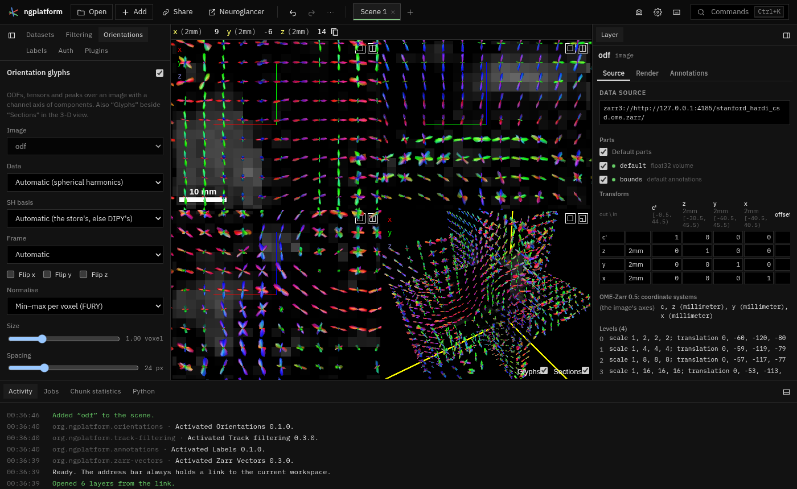

# Orientations



A tool plugin (off by default) that draws orientation glyphs over an image:
fibre ODFs from spherical harmonics, diffusion tensors as ellipsoids, and
peaks or vectors as lines, one per voxel, over Neuroglancer's 2-D views and
on their sections in the 3-D view. Neuroglancer still shows the image itself
(its first component, or a direction-colour map, below); the plugin reads
the same store and draws the glyphs. In a multiscale store each level holds
coarser glyphs: zoomed out, a view shows the coarse level's; zoom in and the
finer level's load in and replace them.

User guide: [docs/plugins/orientations.md](../../docs/plugins/orientations.md)
(and the manifest's `guide`, shown in the Plugins tab).

## Files

| File | What it does |
|---|---|
| `manifest.ts` | Id, panel, command, the user guide. |
| `plugin.ts` | The panel and settings; which level and voxels each view wants; the 3-D drawing. |
| `view.ts` | A 2-D view's section in RAS mm (from `panel.project`), the level for its zoom, the voxel box and slab to read. |
| `overlay.ts` | The WebGL2 canvas over the 2-D views (one context, a viewport per view). |
| `render.ts` | Drawing glyph sets, in that canvas and in Neuroglancer's 3-D view (`draw3d`). |
| `glyphs.ts` | Voxels to glyphs: SH on a sphere, tensor ellipsoids, lines. |
| `sh.ts` | Real symmetric spherical harmonics in four bases; least-squares fit; the order-2 quadratic forms. |
| `tensor.ts` | Tensor component orders, Jacobi eigen-decomposition, FA, MD. |
| `sphere.ts` | Icospheres with each vertex's ring of neighbours (for normals). |
| `reader.ts`, `ome4.ts` | The 4-D pyramid: levels, and the voxels of a box within slabs, as float32. |
| `worker.ts`, `client.ts` | The reader and glyph computation in a worker. |
| `shader.ts` | The direction-colour shader for the image layer. |
| `readout.ts` | What the voxel under the cursor holds, in words. |
| `zarr2.ts` | Zarr v2 arrays (OME-Zarr 0.4) read as v3. |
| `tools/make_dipy_example.py` | A real example from DIPY's sample data (below). |
| `tests/` | The maths against DIPY, synthetic multiscale stores read end to end. |

## Design notes

### How other software draws these

- **FURY** (`fury.actor`), which DIPY uses for its pictures:
  - `odf_slicer(odfs, sphere, scale=0.5, norm=True, radial_scale=True, colormap=None, B_matrix=…)`:
    a sphere mesh (default `repulsion724`) per voxel of a slice, each vertex
    pushed out to the ODF's value there. Given SH coefficients and a
    `B_matrix`, the values are the matrix times the coefficients, computed
    on the CPU for the slice shown. `norm` normalises each voxel's values
    (min-max), so every glyph is the same size and only its shape varies.
    With no colour map each vertex is coloured by its direction
    (|x|, |y|, |z|). `display_extent` / `display(x, y, z)` choose the slice.
  - `peak_slicer(peaks_dirs, peaks_values)`: a line through the voxel's
    centre for each peak, both ways (`symmetric=True`), coloured by direction.
  - `tensor_slicer(evals, evecs, scalar_colors=…)`: the sphere transformed
    by `evecs · diag(evals)`, an ellipsoid per voxel, coloured by default
    with `color_fa` (FA × |principal eigenvector|).
  - The newer SH glyphs (FURY's GSoC 2023 work, `fury.actors.odf`, after
    Peters et al., *Ray tracing spherical harmonics glyphs*, VMV 2023):
    a billboard per voxel and a fragment shader that ray-marches the SH
    function itself; no mesh, so far more glyphs per frame.
- **MRtrix `mrview`**: the ODF tool overlays SH glyphs (tournier07 basis,
  directions in scanner space) on the current slice, one per voxel, with
  options for lmax, level of detail, scale, "colour by direction",
  "hide negative lobes"; the fixel tool draws each fixel as a line, coloured
  by direction or a value; peaks images (3 × N) draw as lines too.
- **DSI Studio**: per-voxel ODF glyphs on the slice from its fib file
  (sampled ODFs on its own sphere), coloured by direction, and fibre
  directions as lines; a "flip x/y/z" for bad b-vectors.
- **Freeview**: `-v dti_V1.nii:colormap=... ` with `-dti V1 FA`: a colour
  map of the principal direction weighted by FA; lines for vectors.

The plugin follows FURY's slicer: one glyph per voxel of the section,
mesh-based (instanced: one sphere mesh, a texture of each glyph's radii),
min-max normalised by default, coloured by direction; peaks and vectors as
lines through the centre; tensors as ellipsoids coloured by the principal
direction, dimmed by FA. Ray-casting the SH in the fragment shader (as
FURY's new glyphs do) would let far more glyphs draw at once; with a cap
of a few thousand per view, instanced meshes are enough for now.

### Spherical harmonic bases

Symmetric (even orders only) real SH, coefficients ordered l = 0, 2, 4, …
and m = -l … l within each order: 6, 15, 28, 45, 66, 91 coefficients for
lmax 2, 4, 6, 8, 10, 12. On the complex Y_l^m of scipy (Condon-Shortley
phase included):

| Basis | m < 0 | m = 0 | m > 0 | Who writes it |
|---|---|---|---|---|
| `descoteaux07` legacy | √2 Re Y_l^\|m\| | Y_l^0 | √2 Im Y_l^m | DIPY by default (`legacy=True`) |
| `descoteaux07` | √2 Re Y_l^m (= (-1)^m × legacy) | Y_l^0 | √2 Im Y_l^m | DIPY with `legacy=False` |
| `tournier07` | √2 Im Y_l^\|m\| | Y_l^0 | √2 Re Y_l^m | MRtrix3; DIPY with `legacy=False` |
| `tournier07` legacy | Im Y_l^\|m\| | Y_l^0 | Re Y_l^m | MRtrix 0.2 (not orthonormal) |

`sh.ts` gives DIPY's values in all four to 1e-6 (`tests/sh.test.ts`,
against `dipy.reconst.shm` 1.12). The two families differ in which of
sin and cos goes with negative m, so reading a file in the wrong one gives
glyphs mirrored or scrambled, not merely flipped.

How a file says its basis: mostly it does not. NIfTI has no field; MRtrix's
`.mif` is always tournier07 (and scanner space); DIPY's PAM5 (HDF5) stores
coefficients, sphere and peaks but not the basis name (readers assume
descoteaux07); BIDS' derivatives proposal for diffusion models (BEP016)
gives a sidecar `"OrientationEncoding": {"Type": "sh", "SphericalHarmonicBasis":
"MRtrix3" | "Descoteaux", "SphericalHarmonicDegree": 8, "Reference": "xyz" | "ijk"}`.
This plugin reads the same facts from the store's group attributes:

```json
"orientations": {"type": "sh", "basis": "descoteaux07", "legacy": true, "lmax": 8, "frame": "voxel"}
"orientations": {"type": "tensor", "order": "dipy", "frame": "voxel"}
"orientations": {"type": "vector" | "peaks", "frame": "world"}
```

and otherwise guesses: the kind from the number of components (3 a vector,
6 a tensor, 15/28/45/… SH, other multiples of 3 peaks), the basis as DIPY's
default, the frame as the voxel axes (world for tournier07). Every guess can
be overridden in the panel.

### Directions and frames

DIPY and FSL give directions along the image's voxel axes (b-vectors in
voxel space, with FSL's x flip for neurological images); MRtrix in world
(scanner) coordinates. The plugin places glyphs in RAS millimetres and turns
each sphere direction into the data's frame before evaluating (the voxel
frame is the level's voxel-to-RAS matrix with its columns normalised), so
glyphs stay aligned on oblique or flipped images. "Flip x/y/z" negates a
data axis, as mrview and DSI Studio offer, for b-vectors with the wrong
sign.

A layer moved from where its store puts it (Registration, or its transform
edited) moves its glyphs too: the change from the layer's default transform
to its current one (`ViewerApi.layerTransform`) is applied after placing
each glyph from the store, in the 2-D views and the 3-D view.

### ODF shapes and peaks

An ODF is drawn as its shape (the default) or as lines along its peaks:
the sphere's vertices (642, about 8° apart) at least as high as all their
neighbours, positive, at least half the highest, one of each opposite pair,
up to three, each as long as its value over the voxel's highest (as MRtrix's
`sh2peaks` with its defaults, roughly). "Hide below anisotropy" leaves out
voxels whose GFA (SH) or FA (tensors) is lower, for a quieter picture
outside the white matter.

### Tensors

Six components in one of three orders: FSL `dtifit` (Dxx Dxy Dxz Dyy Dyz
Dzz, the default), DIPY `lower_triangular` (Dxx Dxy Dyy Dxz Dyz Dzz),
MRtrix `dwi2tensor` (Dxx Dyy Dzz Dxy Dxz Dyz). Eigen-decomposition by
Jacobi rotations; the ellipsoid's semi-axes are the eigenvalues over the
largest (never under 0.08, so a disc still shows).

### Levels and what is read

For each 2-D view: the view's projection (four points through
`panel.project`) gives an affine map from RAS mm to the screen; the level is
the finest whose voxels are at least **Spacing** pixels apart (the coarsest
when none is); the voxels read are those of a box around what the view
shows (with a quarter's margin, so panning does not read again at once)
that lie in the section's slab (the plane's voxels: one per line across
it). Where that level would give more than **Most glyphs per view**, the
next coarser that does not is used, and none when even the coarsest would
("zoom in"); nor are glyphs drawn under 4 pixels apart. A read starts once the view has settled for 100 ms; the
glyphs shown stay until the new ones arrive, so zooming in shows the coarse
glyphs until the finer load in below. Chunks are cached in the worker.

Each 2-D view's glyphs are redrawn, on the plugin's canvas, only when the
view moves or new glyphs arrive (Neuroglancer draws many frames while
chunks load), and into Neuroglancer's screenshots (`ui.screenshotOverlay`).

The plugin never coarsens: a store's levels are taken as they are. For SH
the mean of a box's coefficients is the mean ODF of the box (SH are linear),
so a pyramid of means (as `tools/make_dipy_example.py` writes, and as the
app's NIfTI reader makes for a 4-D NIfTI read in place) gives sensible
coarse glyphs. For tensors a mean is the Euclidean mean (a log-Euclidean
pyramid would keep determinants better).

### The 3-D view

The glyph sets of the 2-D views are drawn in the 3-D view too (draw3d,
depth-tested with Neuroglancer's own drawing): the same voxels on the same
sections Neuroglancer shows there. Each glyph's depth is lifted towards the
eye by its radius, so the half behind its section is not hidden by the
section. With no 2-D views (the 3-D layout), three planes along the level's
axes through the position, within a box that keeps under the cap.

### Direction colour

"Direction colour on the image" writes the image layer's shader, after
renaming its component axis to a channel dimension (`c^`) so the shader
sees all components: |x|, |y|, |z| of the principal direction (vectors: the
vector; tensors: the principal eigenvector by power iteration, weighted by
FA; SH: the principal eigenvector of the order-2 terms' quadratic form,
weighted by GFA).

Neuroglancer shows a channel dimension only when each chunk holds all of
it, so direction colour needs stores chunked whole along `c` (as
`make_dipy_example.py` and the synthetic stores are). A 4-D NIfTI read in
place keeps its fourth axis whole in each chunk when it is short (≤ 128)
and the header does not mark it as time, so it gets direction colour too;
a time series stores one volume per chunk and gets glyphs only. Its fourth axis, `t`, is made a local dimension of the layer (`t'`)
when the plugin opens it, so the views do not step through components.

### Under the cursor

The panel names what the finest level's voxel under the cursor holds: a
tensor's FA, MD, eigenvalues and principal direction (as Freeview and
mrview report them), an ODF's GFA and peaks, a vector's direction and
length, all in RAS after the frame and flips.

### Stores

OME-Zarr 0.5 (Zarr v3) and 0.4 (Zarr v2, `.zarray`, C or Fortran order:
`zarr2.ts` presents each array's metadata as v3's), 0.6 coordinate systems
(through the volume view's `ome.ts`), and 4-D NIfTI read in place by the
app. Axes: one component axis (`type: "channel"`, or named `c`, or a
NIfTI's `t`) beside x, y and z.

## A real example

`tools/make_dipy_example.py` fits DIPY's Stanford HARDI sample (2 mm, 150
directions; downloaded by DIPY) with CSD (lmax 8) and a tensor model, and
writes each as a four-level OME-Zarr with `orientations` attributes:

```sh
python3 -m venv dipy-env && dipy-env/bin/pip install dipy zarr
dipy-env/bin/python plugins/orientations/tools/make_dipy_example.py OUT [--slab]
```

(about 40 MB for the whole brain, in a minute or so; `--slab` fits 24
axial slices). Serve
`OUT` over http with CORS and add `zarr3://http://…/stanford_hardi_csd.ome.zarr/`.

## Tests

`npx vitest run plugins/orientations`: SH against DIPY in all four bases,
fits, quadratic forms and GFA; tensor orders, eigenvectors, FA; synthetic
multiscale stores (crossing fibres as SH, a tensor field, a vector field;
`tests/synthetic.ts`) read through the reader by slab, and their glyphs; the
level chosen by zoom and the cap, a section's geometry, a moved layer, ODF
peaks. With
`ORIENTATIONS_WRITE=<folder>` the synthetic stores are also written to disk,
to serve and look at.

The plugin also offers a service, `orientations.status`, with the lines its
panel shows and counts of reads and draws, which is how the headless browser
checks read what each view shows.

## Owner

The ngplatform maintainers.
