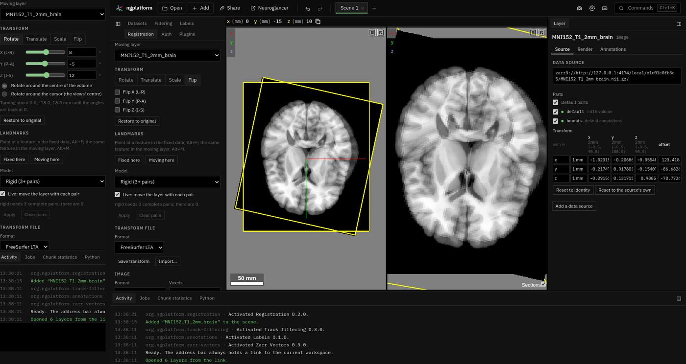

# Registration

Places a moving layer onto the global (fixed) space by hand (as Freeview's
Transform Volume tool), from landmark pairs, or from a transform file; and
saves the transform, or the moved image as NIfTI or OME-Zarr. After
Freeview (FreeSurfer), the landmark registration of Neuroglancer by Forrest
Collman and Sean Martin (google/neuroglancer pull request 883: pairs
refitted from their raw coordinates after every change) and ngtools by Yaël
Balbastre (transform files, moving-to-fixed RAS mm).

| File | What |
|---|---|
| `manifest.ts` | The Registration tab, Alt+F / Alt+M, the state slice |
| `plugin.ts` | The panel: moving by hand, pairs, fitting and applying, landmark layers, import, saving |
| `manual.ts` | Freeview's translate, rotate, scale and flip, composed as `LayerMRI::DoTransform` does; its slider ranges |
| `fit.ts` | Translation, rigid and similarity (Horn's quaternion method), affine (least squares); residuals |
| `formats.ts` | Plain 4 × 4, ITK / ANTs `.txt`, FreeSurfer `.lta` (RAS to RAS with both volumes' geometry; VOX to VOX read); read only: MNI `.xfm`, ANTs binary `.mat`, `register.dat` and FSL `.mat` (with both volumes' geometry) |
| `volume_io.ts` | Resampling (nearest, trilinear, cubic B-spline with its prefilter) and the enlarged grid; the writers (NIfTI, MGH, OME-Zarr, zip) are the platform's (`src/virtual/out/volume.ts`) |
| `blocks.ts` | Saving at full resolution however large: OME-Zarr in 256³ blocks (levels 0–2 per block, the coarser ones from level 3 in memory), NIfTI and MGH in slabs of z planes made of 256-wide tiles; each part resampled from only the source box it needs |
| `save_worker.ts` | Reads a layer's store (with the volume view's reader) and writes it moved, off the main thread |
| `tests/` | `npm test` runs them |

**Warp through the pairs** adds a layer computed by chunkmirage's engine
(the platform's `workspace.computed`, with a `warp` in place of ops): a
thin-plate spline from the fixed points to the moving ones
(`src/virtual/warp.ts`), each output voxel (on the moving image's grid and
levels, in the fixed space) sampled trilinearly where the spline takes it;
a chunk reads only the box of the moving level it maps into. The pairs are
taken in x, y, z order (fixed by the layer's output dimensions' names,
moving by its own).

Neuroglancer keeps a layer transform's linear part as a ratio of physical
lengths and its translation in multiples of the output scales; `physical()`
and `neuroglancer()` in `plugin.ts` convert to and from millimetres.

Checked against FreeSurfer 7: `register.dat` and FSL `.mat` read to the
matrices `lta_convert --inreg` / `--infsl` give (in `tests/fixtures`);
`lta_convert` reads the LTAs written here
(its VOX to VOX and ITK conversions read back to the same matrix), and
`mri_vol2vol --lta` resamples to the same image as Save image (trilinear to
about 1e-6, nearest neighbour identical, cubic B-spline to the rounding of
an integer image: at most 0.5 on FreeSurfer's uchar norm.mgz).
