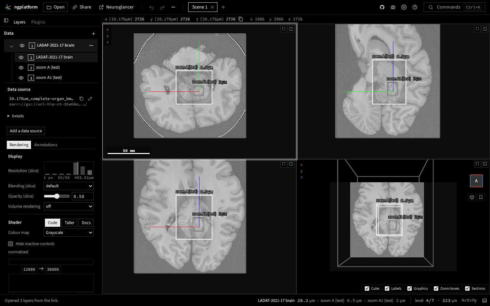

# Scale navigator

A tool plugin, on by default, for image layers that nest in space, as
HiP-CT scans do: a whole organ at about 20 µm and local zooms at 6.5, 2 or
1 µm inside it, each a dataset of its own, each a pyramid. It adds a
breadcrumb of the layers holding the position and the pyramid level drawn
to the status line, a box in the views where each finer layer lies, and
commands to step coarser and finer.

It is generic: it reads only each image layer's box and voxel size in the
scene (`viewer.layerBounds`) and what Neuroglancer drew
(`viewer.renderedLevel`), never a dataset's metadata about other datasets.
Two layers nest when the finer one's box lies inside the coarser one's.

User guide: [docs/plugins/scale-navigator.md](../../docs/plugins/scale-navigator.md)
(and the manifest's `guide`, behind **About** in the Plugins panel).

## Files

| File | What it does |
|---|---|
| `manifest.ts` | Id, commands, keys (Alt+↑, Alt+↓), state key, the user guide. |
| `plugin.ts` | Reads the image layers' boxes; the status items, the zoom boxes (`ctx.views`), framing, the commands, the **Zoom boxes** switch. |
| `hierarchy.ts` | Pure: containment, each layer's smallest container, the chain at a position, stepping coarser and finer, the view that frames a box, the level Neuroglancer would draw at a zoom, lengths in SI units. |
| `status.ts` | The breadcrumb (cut short at its left) and the level chip. |
| `style.ts` | Styles. |

## How the level is read

Neuroglancer's cross-sections fill each image layer's resolution histogram
as they draw: a row per level, with the chunks on screen and those still
wanted (the **Resolution (slice)** widget in the Rendering tab draws it).
The engine reads it after each frame: the finest level with chunks on
screen is the level drawn, the finest asked for is the one wanted (still
loading when finer). When no section draws the layer (the 3-D layout
without sections), the plugin works the level out from the zoom with the
rule Neuroglancer's slice views use (`filterVisibleSources` in
`sliceview/base.ts`) and marks it `≈`.

## Notes

- HiP-CT's zooms (VOIs) in the Human Organ Atlas bucket carry no
  registration to their overview: each starts at its own origin. They nest
  in a scene only once placed with a layer transform; the plugin does not
  guess one.
- In Neuroglancer's 3-D-only layout the 3-D panel has no switch group, so
  **Zoom boxes** is then only in the command palette.

Tests: `plugins/scale-navigator/tests` (containment, chains, stepping,
framing, level choice, lengths).
