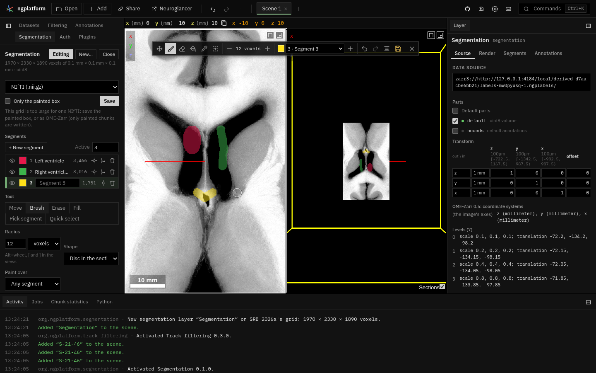

# Segmentation



Label volumes drawn by hand, as WebKnossos's volume annotation: a tab of
their own (**Segmentation**) and a tool bar over the views. It was the last
section of the Annotations tab; the code moved here whole (the files keep
their history) and that section was taken out of Annotations.

- **A new segmentation layer**: an empty label volume on the grid of an
  image or a segmentation, at one of its levels (the same voxels and
  placement); or a copy of a segmentation's labels at a level, to edit (the
  original is hidden, not changed); or a NIfTI label image opened from this
  computer.
- **The tool bar** over the 2-D views while a volume is edited (centred
  over the top row of 2-D views, so it never covers the 3-D view): Move (the
  views as Neuroglancer moves them; the default), Brush, Erase, Fill (2-D or
  3-D), Pick segment and Quick select; the brush's size; the active
  segment and New segment; Undo, Redo, Interpolate, Save; and a button that
  hides it.
- **The segment list**: each segment's colour, name, voxels (and volume, on
  hover) and visibility; the active one marked; Go to, Merge into the
  active segment, Delete.
- **Save** as NIfTI or OME-Zarr (only painted chunks written), the whole
  grid or the painted box; at the top of the tab and on the tool bar.
- Each scene shows its own label volumes: the tab and the tool bar follow
  the scene shown.

See the [user page](../../docs/plugins/segmentation.md) and
[the survey](../../docs/plugins/segmentation-survey.md) for how it compares
with WebKnossos.

| File | What |
|---|---|
| `manifest.ts` | The tab, commands, keys (while a volume is edited), context keys |
| `plugin.ts` | Activation: the editor, the tab, the tool bar |
| `editor.ts` | The volumes open and the current one; tools, drawing, segments, new layers (empty, copied, opened), save |
| `panel.ts` | The tab |
| `toolbar.ts`, `icons.ts` | The tool bar over the views, its icons |
| `tools.ts` | The tools, cycling through them, the brush's size steps (pure) |
| `segments.ts` | The segment list's rows, new ids, which segments a layer shows (pure) |
| `painter.ts` | The mouse in the 2-D views: drawing, the brush ring, Alt+wheel, the quick-select box |
| `label_volume.ts` | The label volume held in the page: chunks, counts by chunk, a segment's centre, its pyramid, the OME-Zarr store it answers |
| `store_format.ts` | Serving those stores to Neuroglancer through local data (loaded with the catalogue) |
| `session.ts` | A volume being drawn: its layer, history, colours, the image that limits the tools |
| `kernels.ts`, `history.ts` | Brush, fills and their limits, interpolation between sections (signed distances); strokes, undo and redo (pure) |
| `quick_select.ts` | The quick select interface, the threshold method, the registry other plugins add to |
| `save.ts` | NIfTI and OME-Zarr out, the painted box |
| `keep.ts` | Volumes kept in the browser (OPFS) while drawn, brought back after a reload |
| `style.ts` | The tab's and the tool bar's styles |
| `tests/` | `npm test` runs them |

It reads images through Annotations' worker (`../annotations/voxels.ts`, a
`Voxels` of its own) and uses Annotations' geometry and form helpers
(`geometry.ts`, `scene.ts`, `ui.ts`, `style.ts`); Annotations' Statistics
reads the volumes drawn here through the `segmentation.labelVolumes`
service.

## The tools and Neuroglancer

The editor keeps the tool and whether a volume is edited; `Painter`
(`painter.ts`) takes the mouse in the 2-D views while a tool that draws is
on, and gives everything else to Neuroglancer:

| Neuroglancer's | While a drawing tool is on |
|---|---|
| Left drag in a 2-D view (move the view) | Draws. Hold **Space** to move the view; Move (`M`, `Escape`) gives it back |
| Space (change the layout) | Held back (Space moves the view instead) |
| Shift+left drag in a 2-D view (rotate) | Draws |
| Double-click (select a segment), the click after a stroke | Held back in the 2-D views |
| Alt+wheel (depth of annotations shown) | Brush size, over a 2-D view with Brush or Erase |
| Wheel, Shift+wheel (sections), Ctrl+wheel (zoom), Ctrl+click (annotate), right button (move to the point) | Unchanged |
| The 3-D view | Unchanged: tools draw in the 2-D views only |

While a volume is edited (the tool bar shows), these keys are the tools'
rather than Neuroglancer's or the workspace's: `B` (Neuroglancer: scale
bar), `E` (rotate), `V` (default annotations), `F`, `I`, `M`, `Q`, `W`,
`C`, `Ctrl+Z` and `Ctrl+Y` (the workspace's undo and redo; here the
last stroke or the last workspace change, whichever came last, see
below); `[` and `]`
(time steps) with Brush or Erase; `Escape` (Neuroglancer's tool) with a
drawing tool. Hiding the tool bar (its ×, or **Editing** in the tab) gives
them back.

Strokes have an undo of their own (`history.ts`, chunk copies within a
memory budget), beside the workspace's (state snapshots). While the tool
bar shows, `Ctrl+Z` undoes whichever came last: each stroke is timed when
kept, and `workspace.undoSteps()` says when the workspace's change undo
would take back was made (`chooseUndo`). `Ctrl+Y` redoes whichever of the
two undone came first, so they redo in the order they were undone. The
quiet changes a stroke makes to the layer (its segment's colour, its
visibility) amend the workspace's current step, not a new one; a change of
the user's still settling when a stroke ends is recorded before the stroke
is timed.

A segment's visibility is Neuroglancer's own list of visible segments
(`segments`, with `!id` for one listed but hidden): with nothing hidden the
list is empty and every segment shows; hiding one lists the others and sets
`ignoreNullVisibleSet` to false, so a segment painted later is added as it
is painted.

## How a label volume reaches Neuroglancer

The volume is held in the page in 64³ chunks, made only where something is
painted (a mask on a whole-brain grid costs what is drawn on it). It answers
as an OME-Zarr store: Zarr v3, raw little-endian chunks, a pyramid whose
coarser levels are made from the level below when asked for (a coarse voxel
takes the first label of the eight under it, so thin strokes still show;
it is placed at their centre, so a stroke one section thick shows in that
section when zoomed out) and kept until a stroke changes them.

Neuroglancer reads it as it reads a file on this computer:

1. The catalogue entry (`plugins/index.ts`) declares a virtual format,
   `*.ngplabels`, whose "worker" is an object in the page
   (`store_format.ts`). Local data hands it every key under such a file.
2. A new volume registers itself under a unique file name and opens an
   empty file of that name with `workspace.local.open`; the dataset's
   source is `zarr3://<app>/local/<id>/<name>.ngplabels/`.
3. After each stroke (a few times a second while it lasts, once when it
   ends) the plugin calls `viewer.reloadData(url)`: Neuroglancer drops
   every chunk it holds from the store and asks for those on screen again,
   which the page answers from memory at once. Metadata is kept.

Painting runs in the page; a dab limited to an image's range first reads
the image's values on the label grid (chunk-sized blocks, cached) from the
worker, so a stroke's dabs are queued in order and keep the settings they
started with. Segment counts are kept per chunk and counted again only for
the chunks a stroke changed.

In a 2-D view the point under the pointer is found from the view's own
projection (`ViewPanelInfo.project`, inverted near the position, so it is
exact and immediate at any zoom); its depth gradient gives the section's
normal in the volume's voxels, so a disc brush and a 2-D fill take the
section shown.

### A copy of a segmentation

**Copy and edit** reads a level of a segmentation layer (anything the volume
view's reader reads: OME-Zarr, NIfTI, MGH, precomputed) into a new label
volume, in blocks of 256 × 256 × 64 voxels as a job that can be cancelled,
up to 512 M voxels; chunks with no label are not made. The type follows the
source's (8 and 16 bits as they are, anything else 32). The reader gives
values as 32-bit floats, so labels above 2²⁴ are refused rather than
rounded. Names and colours come from the source's lookup table when it has
one, otherwise from its layer's segment colours. The source is hidden and
not changed. Editing a large segmentation in place (copy-on-write over the
source) is not done: see *Large data*.

### Kept in the browser

While a volume is drawn, its painted chunks and description are written to
the browser's origin private file system (`keep.ts`), a moment after
strokes stop. The store's file is opened as a *derived* local file, so its
layer is a dataset known by its name rather than by the visit's URL: after
a reload, a layer whose volume is not in the page is pointed at the kept
copy (served under a new URL) in place, and the workspace keeps one
dataset. Volumes kept but not in the scene are offered under **New**.
**Close** forgets the copy.

### Large data

Today's limits: a label volume costs 256 KB (8-bit) to 1 MB (32-bit) per
painted chunk; undo keeps up to 512 MB of chunk copies; a fill stops at
64 M voxels; a copy or an opened NIfTI is at most 512 M voxels; NIfTI saves
are capped at 2 GB, so for a large grid save the painted box or as OME-Zarr
(painted chunks only).

The plan for data too large for the page is a **sparse edit layer over the
source**: strokes kept as chunks of a Zarr array on the source's grid
(absent chunks meaning "no edit"), written to a folder on this computer as
they are made (with `workspace.local.write`), shown over the source as they
are now, and merged with it (an existing segmentation, or nothing) only on
export, at the resolution asked for. The store and its pyramid already work
chunk by chunk, so the change is where the chunks live, not how they are
drawn.

## What it uses from the platform

`ui.overlay()` (the tool bar, the brush ring), `viewer.panels()`,
`viewer.onRendered()`, `viewer.cursor()`, `viewer.layerTransform()`,
`viewer.patchState()`, `viewer.setPosition()`, `viewer.lookupTables`,
`viewer.reloadData(url)`, `workspace.local.open/close`,
`workspace.undoSteps()`, `commands.invoke` (`edit.undo`, `edit.redo`), `services`
(`segmentation.quickSelect` and `segmentation.labelVolumes`, which it
provides), `context` (`segmentation.editing`, `segmentation.drawing`,
`segmentation.brushing`), `jobs`.

`viewer.reloadData(url)` (`src/sdk/types.ts`, `src/ui/apis.ts`) has
Neuroglancer invalidate every chunk source in its chunk manager whose key
names the URL (each held for two seconds, so the worker's answer never
finds it let go). A finer reload would re-read only the chunks a stroke
changed (today every chunk of the store on screen is read again; from
memory, so it is quick, but a large view flickers for a frame); that needs
a per-chunk invalidation in Neuroglancer's chunk worker, which the fork
does not have yet.

It also uses the volume view's reader (`../volume-view/volume_reader.ts`)
and Registration's writers (`../registration/volume_io.ts`).

## Adding a quick select method

```ts
import type { QuickSelectService } from "../segmentation/quick_select.js";

const qs = await ctx.services.get<QuickSelectService>("segmentation.quickSelect");
ctx.subscriptions.push(
  qs.register({
    id: "sam",
    title: "Segment Anything",
    prompts: ["box", "point"],
    // request.image: the image's values round the prompt on the label grid;
    // return a mask on that grid (1 = selected).
    async run(request, signal) { /* … */ return { lo: request.image.lo, size: request.image.size, data }; },
  }),
);
```
