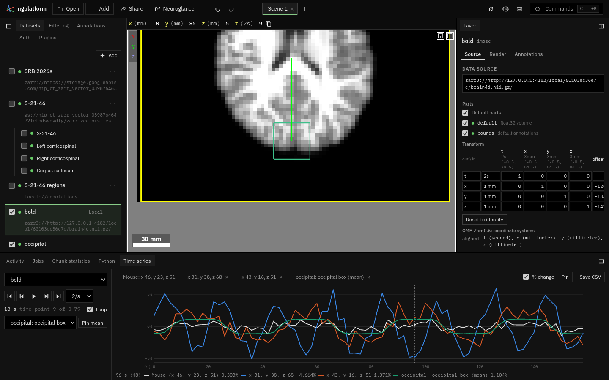

# Time series

A tool plugin (off by default) for images with a time axis: the **Time
series** tab in the bottom dock plots the values of the voxel under the
mouse at every time point, keeps pinned voxels and the mean over a region
(a box or ellipsoid in an annotation layer) beside it, marks the time the
views show, plays and steps through time, and saves the plotted series as
CSV. After FSLeyes' time series panel, Freeview's time course and napari's
time slider.

User guide: [docs/plugins/time-series.md](../../docs/plugins/time-series.md)
(and the manifest's `guide`, shown in the Plugins tab).

## Files

| File | What it does |
|---|---|
| `manifest.ts` | Id, the bottom-dock panel, commands (pin, play, save CSV) and keys, the user guide. |
| `plugin.ts` | The panel: the image, transport, pins and regions, the legend; the voxel under the mouse; playing; CSV. |
| `space.ts` | Global positions to a layer's source coordinates and back, in any number of dimensions (`LayerMap`). |
| `series.ts` | The time axis as the views show it (its global dimension, start, step and unit), the voxel at a position, stepping, colours, percent change, CSV. |
| `region.ts` | Boxes and ellipsoids from annotation layers; the image voxels whose centres are inside one. |
| `reader.ts` | `SeriesReader`: an OME-Zarr image's finest level read along time at some voxels, averaged; a byte-bounded chunk cache. |
| `worker.ts`, `client.ts` | The reader in a worker. |
| `plot.ts` | The SVG plot: ticks, lines broken at missing values, the current time, a crosshair readout, click to pick a time. |
| `tests/` | `time_series.test.ts`; `fixtures/tiny.nii.gz` (6 × 5 × 4 voxels × 12 time points, from `fixtures/generate.py` with nibabel). |

## How it works

- **Which images.** Image layers whose source has a dimension in seconds
  (or named `t`) and is OME-Zarr: a 4-D NIfTI opened from this computer
  (served in place as OME-Zarr 0.6 with `t` first, in the header's time
  unit, one step every `pixdim[4]`, see `src/virtual/images/nifti.ts`), or
  an OME-Zarr image (0.4, 0.5 or 0.6, Zarr v2 or v3) with an axis of type
  `time` or named `t`.
- **Where the mouse is in the image.** The pointer's global position goes
  through the inverse of the layer's transform (`ViewerApi.layerTransform`:
  the linear part is a ratio of physical lengths, the translation in
  multiples of the output scales) to the source's coordinates, which for
  OME-Zarr are voxel indices with centres at whole numbers. So a layer
  moved by Registration reads where it shows.
- **Which time point the views show.** The same map along the time
  dimension: the time point whose voxel holds the position's `t` (bounds
  from −0.5, so a position halfway between two time points, as Neuroglancer
  starts, shows the later one, as Neuroglancer draws it). Moving to a time
  point sets `t` to its centre. Times shown are the global coordinate times
  its scale, in the store's unit (seconds for NIfTI).
- **Reading.** The worker reads the finest level, chunk by chunk along
  time at the chunk holding the voxel (a NIfTI read in place has one time
  point per chunk; stored transposed, read in stored order as the volume
  view does), decoded to float32 and kept in a 256 MB cache shared by every
  image, so neighbouring voxels and pins in the same chunks read nothing
  again. A region's voxels are grouped by chunk and averaged per time point
  (missing values left out). The pointer is read 80 ms after it stops; a
  newer voxel cancels the older read.
- **State.** Pins (voxel indices, or an annotation layer and annotation id
  for a region) and the chosen image are in the plugin's state, in the
  link; their values are read again when it is opened. A region pin is
  read again when its annotation or its layer's transform changes. The
  rate, loop and percent-change switches are per-user settings.
- **Colours.** The series under the mouse is drawn in the docks' text
  colour; pins take eight categorical colours (stepped for a dark ground)
  in a fixed order, the first free one, and keep it; there are no more pins
  than colours.

## Checked

- `tests/time_series.test.ts`: the nibabel fixture read through the
  virtual NIfTI store (values exact at every time point, means, voxels
  outside, cancelling); an OME-Zarr 0.4 Zarr v2 store with four time points
  a chunk and partial edge chunks; positions to voxels and time points,
  with a time offset and a turned layer; regions (box, ellipsoid, the
  limit); CSV, stepping, colours, ticks.
- In the browser (headless Chrome, a 64 × 64 × 30 × 100 synthetic NIfTI,
  TR 2 s): the values plotted and saved equal nibabel's at the voxel
  under the mouse, and Neuroglancer's own value at the mouse at that time
  (also at a position halfway between time points); a box's mean equals
  nibabel's mean over the voxels inside; playing and stepping move `t`.
  An OME-Zarr 0.4 image served over http (t, z, y, x in µm; Zarr v2,
  blosc zstd, five time points a chunk) plots the values written and
  Neuroglancer's own at the mouse.

## Not done

- **Time as a local dimension.** When the layer's `t` is local (`t'`, as
  Orientations makes a component axis), the panel says time is not shown;
  reading the layer's local position would cover it.
- **Coarser levels.** Only the finest level is read: a long series with
  large chunks (1200 time points of 64³ float32 chunks) reads about a
  gigabyte the first time the mouse enters a chunk. Reading a coarser level
  while the mouse moves, then the finest when it rests, would help.
- **Undo while playing.** Each time point shown is a change of position;
  at 2 time points a second or slower each becomes an undo step (faster
  ones settle into one).
- **CIFTI time series on surfaces.** A `.dtseries.nii` beside a GIFTI
  surface is served as each vertex's mean and SD over time
  (`src/virtual/vectors/surfaces.ts`, `ciftiSeriesStats` in `cifti.ts`).
  Stepping through its time points would need, in that store: one more map,
  `<stem>_t`, whose values are one row of the matrix, the row chosen by a
  message from the page to the worker serving the store, and
  `viewer.reloadData(url)` after each step so Neuroglancer reads the
  attribute again; a vertex's time
  course is a column of the matrix (each structure's columns are
  contiguous, so the read is one strided pass over the rows). The plot,
  pins and CSV here would take a vertex index in place of a voxel. Not
  attempted: the surface store is the platform's, shared with the other
  surface maps, and the change needs its own tests.
