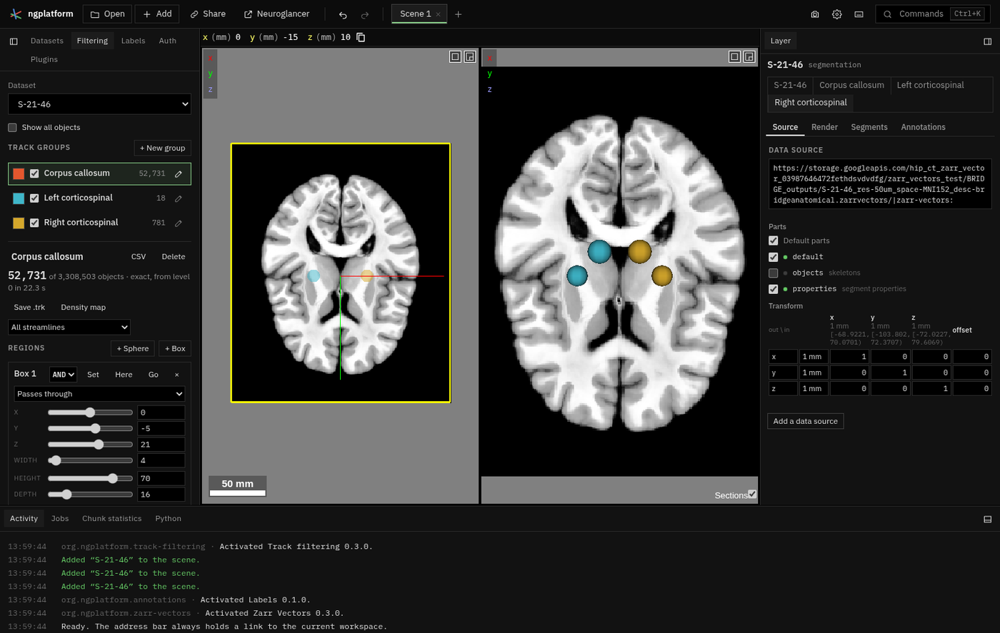

# Track filtering

TrackVis-style track groups over a Zarr Vectors dataset. Each group keeps
the streamlines that pass through its regions (spheres and boxes, with AND,
OR and NOT) and whose attributes are in range, and shows them as a layer of
its own colour. Groups save to TrackVis `.trk`. Requires the Zarr Vectors
plugin.

| File | What |
|---|---|
| `manifest.ts` | The Filtering tab, its commands and its state slice |
| `plugin.ts` | The tab, the groups, `.trk` saving; provides the `trackFiltering.groups` service (the volume view draws groups through it) |
| `filter.ts`, `roi.ts` | Attribute filters and region tests (pure, unit-tested) |
| `roi_client.ts`, `roi_worker.ts` | Region tests and streamline reads in a worker, against the store |
| `runner_job.ts` | A group as a filter job for the runner on this computer ("Run on this computer"): its regions and ranges as a zvf-predicate tree, masks as voxels |
| `trk.ts` | TrackVis v2 writing |
| `tests/` | `npm test` runs them |
