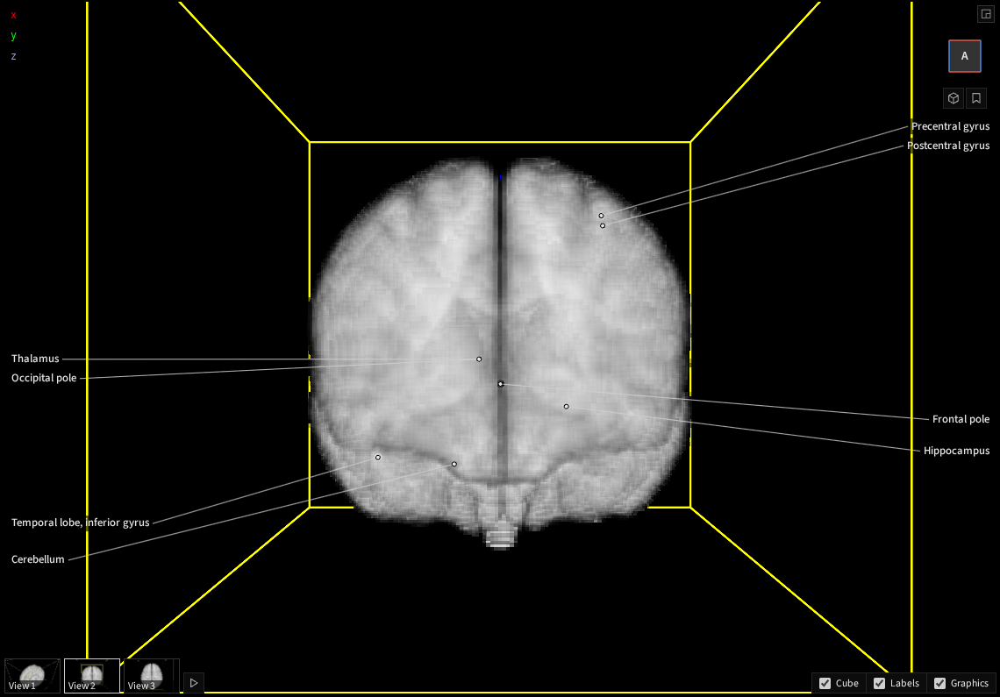

# View aids

A tool plugin, on by default, that adds aids to Neuroglancer's 3-D view in
every scene, after Siemens' Cinematic Anatomy (see
`docs/dev/cinematic-roadmap.md`, Phase 2): an orientation cube with Realign,
labels with leader lines for described point annotations, Hide graphics, and
camera bookmarks with a strip of thumbnails and Play.

It is a plugin rather than part of the shell because everything it needs is
in the plugin API (the 3-D panel's projection, `onRendered`, state patches,
`viewToggle`, `overlay`, `screenshotOverlay`, its own state slice for the
link and undo), so it can be switched off like any other, and other
plugins' views (Anatomical rendering's) get the same aids. The one addition
to the API it brought is `viewer.thumbnail`, a small picture of the 3-D
view for bookmarks.

User guide: [docs/plugins/view-aids.md](../../docs/plugins/view-aids.md)
(and the manifest's `guide`, behind **About** in the Plugins panel).

## Files

| File | What it does |
|---|---|
| `manifest.ts` | Id, commands, state key, the user guide. |
| `plugin.ts` | Places the aids over the 3-D panel each frame; the three switches (and their own group in the 3-D-only layout); Hide graphics; bookmarks, Play; commands. |
| `geometry.ts` | Pure: quaternions (slerp, easing), the data's axes and their letters, looking from a face, edge or corner upright, the standard views and the nearest, picking on the cube, the cube's faces and zones. |
| `placement.ts` | Pure: labels to the sides, ordered by angle, spaced by a least-squares fit in order (pool adjacent violators), leaders uncrossed. |
| `cube.ts` | The cube drawn on a 2-D canvas, hover and click, Realign and Bookmark buttons. |
| `labels.ts` | Described point annotations in global coordinates (through each layer's transform), laid out and drawn on a canvas, and painted into screenshots. |
| `camera.ts` | A bookmark's camera, read from the state and written to it; eased moves (instant with reduced motion), stopped by the user's input. |
| `state.ts` | The saved state: switches, what Hide graphics turned off, bookmarks. |
| `strip.ts` | The bookmark strip and its context menu. |
| `style.ts` | Styles. |

## Notes

- Points behind tissue are not greyed: that needs the 3-D view's depth read
  back from the GPU, not available cheaply to a plugin.
- Only annotations kept in the state are labelled (local annotation layers).
- The strip finds the right end of Neuroglancer's switch group
  (`div.perspective-panel-show-slice-views`) in the panel to stop short of it.

Tests: `plugins/view-aids/tests` (geometry, placement, state and cameras).
