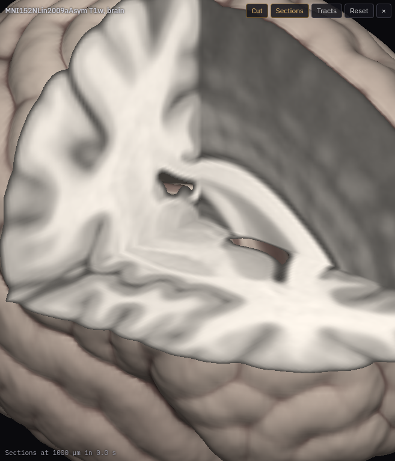

# Volume view

In place of Neuroglancer's 3-D panel: a solid brain ray-marched in WebGL2
from an OME-Zarr pyramid, with the octant facing the camera cut away at the
current position, sections from finer levels on the cut faces, and the
visible track groups drawn through the cut.

The cut's faces show three sections of the plugin's own: Neuroglancer
`crossSections` in the layout (xy, xz and yz through the position), whose
zoom follows the 3-D view's down to the image's finest voxel, within 2048
pixels a side (`sections.ts`). Neuroglancer loads their data at the level
that zoom needs, as for any section, so zooming into the cut shows fine
structure while the solid stays coarse. Without them (the Volume tab's
**Fine sections on the cut** off, or Sections switched on in the 3-D view),
the faces show the 2-D views' own sections, which Neuroglancer draws at the
2-D views' zoom and only as far as those views reach (in the xy-3d layout,
only the xy one). Volumes: BigBrain (in MNI) or
the MNI ICBM152 2009a template, or any uint8 OME-Zarr 0.4 to 0.6 (zarr v3).

| File | What |
|---|---|
| `manifest.ts` | The Volume tab, commands and state slice |
| `plugin.ts` | The tab, the view (mounted with `ctx.ui.view`), camera, presets; which levels it loads (a level whole, or the whole image coarse with a finer box around the position) |
| `sections.ts` | The fine sections on the cut: their zoom and size |
| `renderer.ts` | WebGL2: the solid, the cut, the sections, the tracts |
| `ome.ts` | OME-Zarr multiscales to voxel-to-RAS transforms |
| `volume_reader.ts`, `volume_client.ts`, `volume_worker.ts` | Reading levels and sections in a worker |
| `tools/mni_template_to_omezarr.py` | How the hosted MNI template was made |
| `tests/` | `npm test` runs them |
